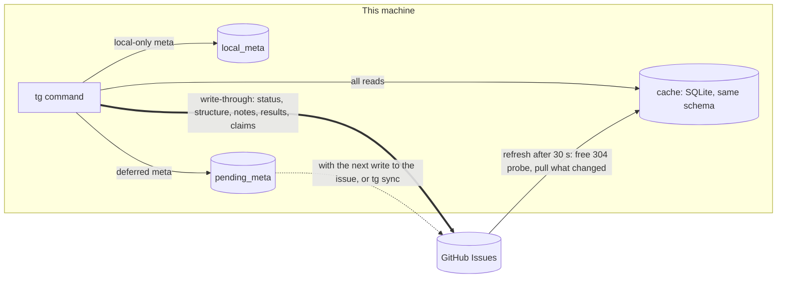

# ADR: Taskgraph storage behind a store interface, with a cached GitHub backend

Status: proposed, 2026-11-08. Issue: ronicayu/ronica-skills#15. Spec: `2026-11-08-taskgraph-github-backend-spec.md`.

## Decision

Taskgraph keeps its model and schedule logic in `tg.py`, and moves storage behind a small `Store` interface.

- `SqliteStore` is the current local database. With no `.taskgraph.toml`, or for a project that the file does not name, nothing changes.
- `CachedRemoteStore` keeps a local SQLite cache with the same schema, refreshes it from the remote, and sends writes to the remote. The first remote is GitHub (`GitHubRemote`, through `gh api`). GitLab and Jira can come later as other `Remote` classes.
- Reads (`show`, `ready`, `ls`, and the 5 tg calls of each agentic-team `record` and `wait` poll) come from the cache. The cache refreshes when it is older than 30 s. The refresh starts with conditional REST requests, and a 304 costs nothing (confirmed live). `tg sync` and `--fresh` force a refresh.
- Writes are **write-through** (status, structure, notes, results, claims, and every meta key that another Manager or a person needs), **local-only** (meta that names things on this machine: `sessions`, `session`, `cleanup_kept`, `host_rebase`), or **deferred** (report data: `tokens`, `model`, `started_at`, sent with the next write to the same issue or by `tg sync`). A meta key not named in the config is write-through.
- GitHub wins for remote fields. A pull never overwrites local-only fields.
- Task = issue with the label `taskgraph`; id = issue number; dependency = native "blocked by"; parent = native sub-issue; status = open/closed plus label `tg:in-progress`; type = label; meta = hidden JSON block at the end of the body; result = comment with a hidden marker.
- `tg start` claims with comments: the lowest unvoided claim comment id wins, and the loser exits 1. A claim always reads GitHub, never the cache.

## Context

- Taskgraph stores everything in `~/.taskgraph/tasks.db`. Other machines and people cannot share a plan (#15).
- Almost every command calls `load(conn)` and works in memory. The writes use SQL in each command, inside one transaction, and validation errors roll back.
- agentic-team calls tg often: each `wait` poll (every 30 s) runs 5 tg processes that each read the whole project, plus `record` after each wake. Its interface must not change.
- GitHub facts that drive the design (spec section 2, most confirmed live on `ronicayu/taskgraph-backend-test`): native dependencies and sub-issues exist with REST and GraphQL APIs; dependency and sub-issue changes do not move `updatedAt`, but they change the REST list page; issue types and issue fields exist only for organizations, and the repositories here belong to a user; issue bodies over 262,144 bytes are silently truncated; there is no compare-and-set on issues; the 5,000 per hour budgets are per user and shared with every other `gh` session of the account.

## Options considered

| Option | For | Against |
|---|---|---|
| A. No cache: every command reads GitHub (one paged GraphQL snapshot per process) | No sync code. Always fresh. No stale data. | One waiting Manager: about 1,550 GraphQL points per hour on 50 tasks and 5,060 on 300 tasks (over the limit). A poll takes 20–24 s on 300 tasks. No history for `changes` and `report`. Every command needs the network. |
| **B. Read cache + write-through (chosen)** | Reads are local and fast (0.1–0.2 s). About 30–60 GraphQL points and 135–175 counted REST requests per hour, about the same for 50 and 300 tasks (90–96 % fewer counted points than option A). Reuses the SQLite schema, `load()` and all read code. Writes are as fresh as option A. History comes from pulls. | Remote changes show after up to 30 s (or `--fresh`). Sync code: probe, pull, merge, class split. Dependency changes that keep all counts equal show only at the next full pull (10 min). |
| C. Full offline cache with later sync | Works offline. Fewest API calls. | Needs conflict resolution for every field. A claim cannot be safe offline. Two Managers see each other late, so double starts and lost updates become normal, not rare. |

Also rejected:

- **Projects v2 custom fields** for dates and estimates: needs the `project` scope, a project id and field ids per project, one more item per issue, and costs more per query. Meta such as `sessions` is not a field type, so a body block is needed anyway.
- **Issue types and issue fields**: organizations only (confirmed live). Use them later for organization repositories.
- **GitHub search for `ready`**: the search API matched a label named `blocked`, not real dependencies (live). `ready` also needs inherited dependencies and summaries. It stays a local computation.
- **Label or assignee claim**: adding a label twice makes no second event, and two Managers can use the same login. Comments have increasing ids, so they give an order.
- **A lock outside the issue API** (a GitHub Actions workflow with a `concurrency` group, a self-hosted runner, a lock container or any other lock service): it needs a runner or a container that must be up, it adds moving parts and credentials, and it is one more failure point that can stop every claim. The claim uses only the issue API (comments and labels) and the client's own re-reads.

## What the issue-API-only claim guarantees

- At most one claimant holds the task, and it is the one GitHub shows as the holder, if comment ids increase in commit order, a list read that holds my comment also holds every lower id, and no `tg start` pauses 60 s or more between its steps. A TLA+ model check proves this for two claimants and three `tg start` runs each, also with reads that miss newer comments (spec section 8.5, `plugins/taskgraph/model/claim/`).
- The model check found three ways to two holders in the first draft of the protocol: a close made claims posted after it stale; a loser's delete undid the void its comment carried; an owner reused its own old claim through a lagging read. Spec section 8.1 fixes all three.
- A loser learns it lost from its own reads and exits 1. It removes its claim, and keeps a void marker that its comment carried.
- Not guaranteed, and not always visible as a conflict: a `tg start` that pauses 60 s or more between its claim and its label `PATCH` (a 30 s check makes the window small; without compare-and-set it cannot close it); a person who removes the label or closes the issue in the GitHub UI; list reads that miss older comments.
- Not guaranteed: a claim made while GitHub is unreachable (tg fails instead); protection of the worker session that `run.py launch` starts before `tg start`.
- The only other locks are local to one machine: `BEGIN IMMEDIATE` and an `flock` on the cache file, so that 5 tg processes of one poll do not refresh at the same time. They are not part of the claim.

## Consequences

- PR 2 (refactor, no behaviour change): `tgstore/` with `Store` and `SqliteStore`; every write goes through `store.write()`; a pure `changeset()` replaces the journal diff. All current tests (125 in test_tg.py, plus test_page.py) pass unchanged.
- PR 3 (GitHub): `CachedRemoteStore`, `GitHubRemote`, a fake `gh` that copies the live behaviour, and a live check script for the test repository. The current test suite also runs against the fake GitHub.
- The claim protects against a double start. It cannot stop the worker session that `run.py launch` starts before `tg start`. A lost claim leaves that session for the operator to stop.
- Two agentic-team Managers on different machines must not run one project yet. agentic-team, not tg, would treat the other machine's tasks as dead or legacy. A later agentic-team change can fix this.
- Deferred and local-only data are lost with the machine. No decision of another Manager depends on them.
- History (`changes`) and baselines stay per machine.
- Taskgraph needs Python 3.11 when a `.taskgraph.toml` exists (`tomllib`).
- People can edit notes in the GitHub UI. A body save during the about 0.5 s of a tg body write can be lost. tg refuses to overwrite a broken meta block.
