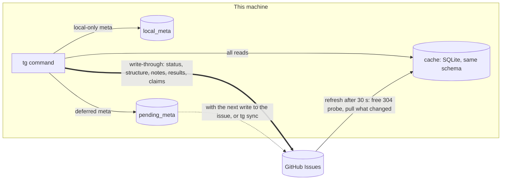
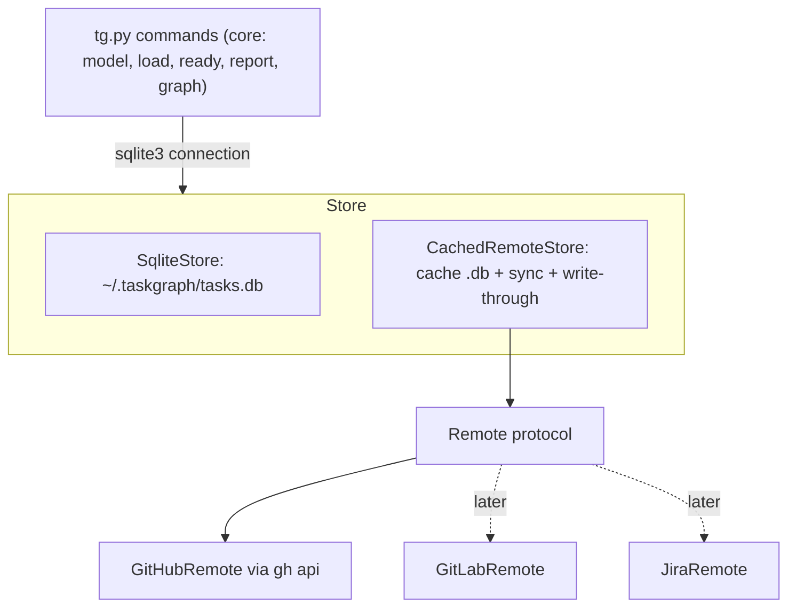
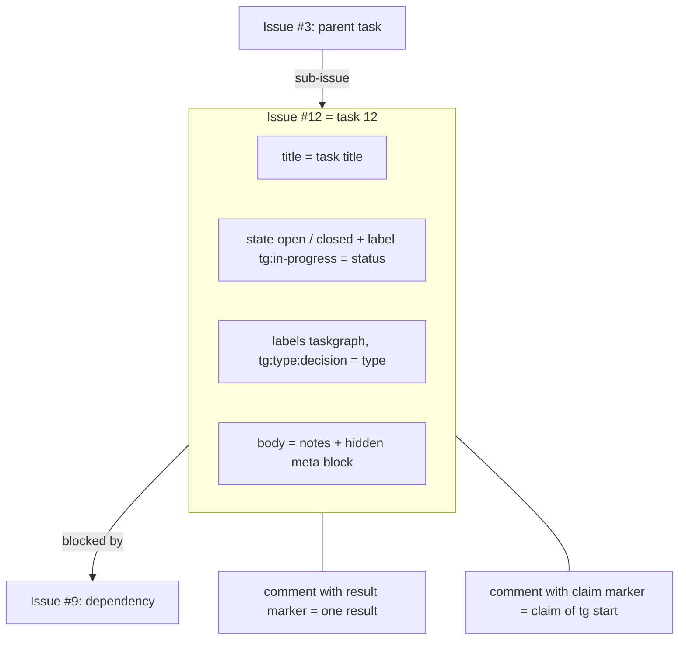
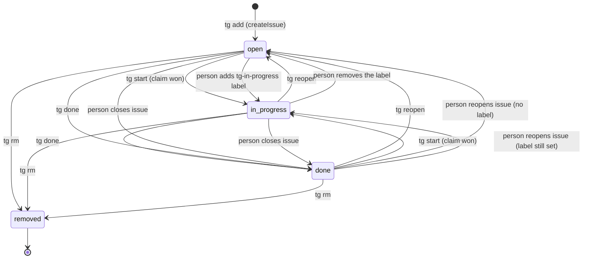
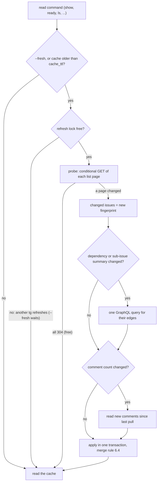
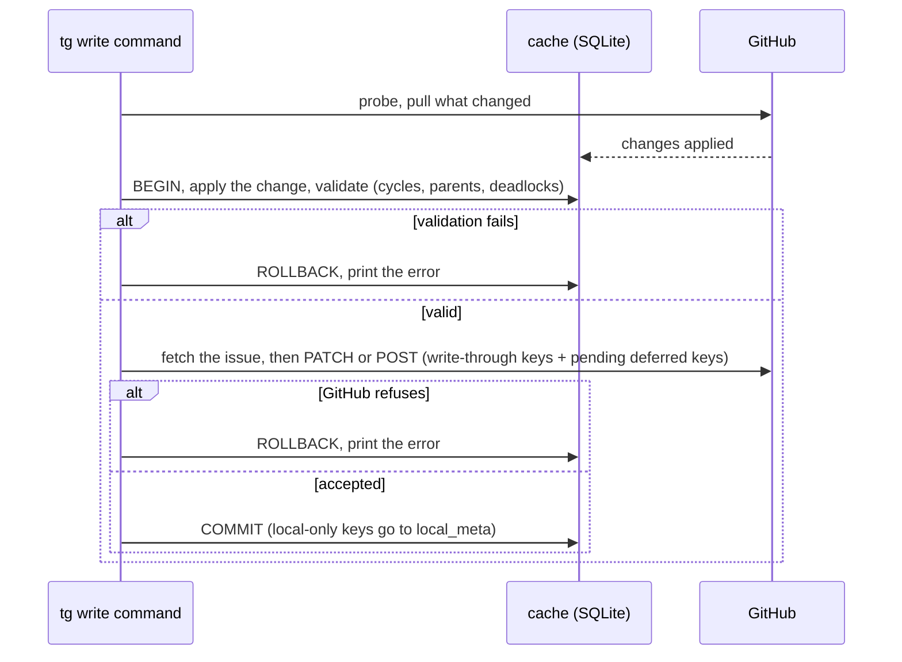
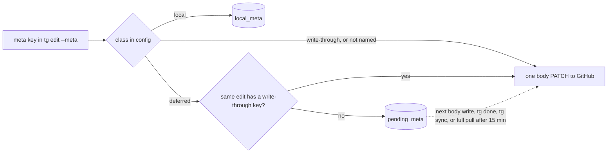
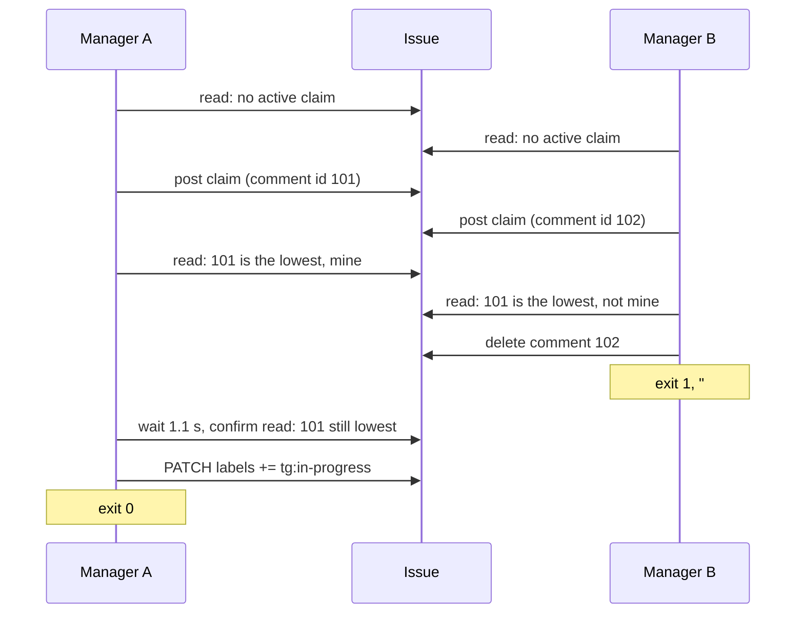
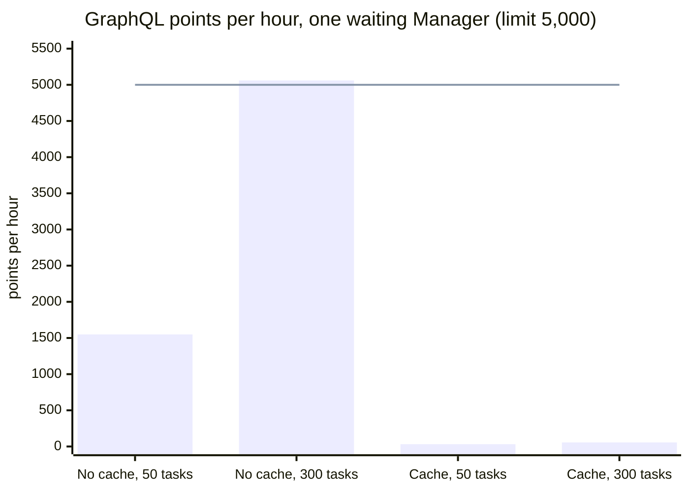

# Taskgraph storage backends: specification for PR 2 and PR 3

Status: draft for review, 2026-11-08. Related: ronicayu/ronica-skills#15, `2026-11-08-taskgraph-github-backend-adr.md`.
Base: `main` at 0422db3. Test repository: `ronicayu/taskgraph-backend-test` (private, owned by a user account).

## 0. Conclusion

1. Taskgraph gets a storage layer with two store types:
   - `SqliteStore`: the current local database. Behaviour does not change.
   - `CachedRemoteStore`: a local SQLite cache with the **same schema**, plus a sync layer and write-through to a remote. The first remote is GitHub (`GitHubRemote`). GitLab and Jira can be added later as other `Remote` classes.
2. All reads come from SQLite. For a GitHub project, the reads come from the cache. The existing `load(conn)` and all read commands do not change.
3. The cache refreshes when it is older than a TTL (default **30 s**). The refresh starts with conditional REST requests. A `304 Not Modified` response does not count against the primary rate limit (confirmed live). `tg sync` and `--fresh` force a refresh.
4. Every write is in one of three classes: **write-through** (to GitHub at once, then to the cache), **local-only** (cache only, never pulled over), **deferred** (cache now, sent to GitHub with the next write-through on the same issue or by `tg sync`). Section 7 gives the class of each write that agentic-team and the skill make.
5. A write command always refreshes first, validates against the refreshed cache inside a SQLite transaction (the current validation code), sends the change to GitHub, and only then commits. If GitHub refuses, the cache transaction rolls back.
6. Mapping: task = issue with the label `taskgraph`. Task id = issue number. Dependency = native "blocked by". Parent = native sub-issue. Status = open/closed plus the label `tg:in-progress`. Type = label `tg:type:<type>`. Notes = issue body text. Meta = a hidden JSON block at the end of the body. Result = a comment with a hidden marker. Events and baselines stay in the cache only.
7. Claim: `tg start` on GitHub runs a claim protocol with claim comments. The lowest unvoided claim comment id wins. In a live test, 10 of 10 rounds of two parallel claimers agreed on one winner. The loser deletes its comment and `tg start` fails with exit 1.
8. Numbers: one running agentic-team Manager uses about **1,550 GraphQL points per hour on 50 tasks and about 5,060 on 300 tasks without a cache** (over the 5,000 limit). **With the cache it uses about 30–60 GraphQL points and 135–175 counted REST requests per hour** (plus 120–360 free 304 probes), about the same for both sizes. Counted points go down by about 90 % (50 tasks) and 96 % (300 tasks); GraphQL points by about 98–99 %.
9. agentic-team does not change. One limit stays: two Managers on different machines must not run the same project at the same time. Section 7.4 explains why (agentic-team, not tg, would file `DIED` for the other Manager's tasks).



## 1. Terms

| Term | Meaning |
|---|---|
| store | The object that tg commands use for all storage. `SqliteStore` or `CachedRemoteStore`. |
| remote | The shared system of record behind a `CachedRemoteStore`. Now only GitHub. |
| cache | The SQLite file of a `CachedRemoteStore`. Default `~/.taskgraph/cache/github/<owner>/<repo>.db`. |
| refresh | Bring the cache up to date from the remote (probe, then pull if something changed). |
| probe | The cheap change check: conditional GETs of the issue list pages. |
| pull | Read the changed issues, edges and comments, and apply them to the cache. |
| full pull | Read all task issues and edges (not by change detection). |
| write-through | Send to the remote now, then commit to the cache. |
| claimant | The identity of one Manager: `<gh login>@<host>:<checkout id>`. |
| epoch | The life of one claim, from the claim comment until it is voided. |

## 2. Verified GitHub capabilities

"Live" means a call on `ronicayu/taskgraph-backend-test` or a public repository on 2026-11-08. Section 13 holds the commands and outputs. "Docs" means the page in the Source column. "Unconfirmed" means no proof yet.

| # | Capability | Finding | Status | Source |
|---|---|---|---|---|
| G1 | Issue dependencies, API | REST `GET/POST .../issues/{n}/dependencies/blocked_by`, `DELETE .../blocked_by/{issue_id}`, `GET .../blocking`. `issue_id` is the database id. GraphQL `addBlockedBy(issueId, blockingIssueId)`, `removeBlockedBy`; `Issue.blockedBy`, `Issue.blocking` connections. | Confirmed live (C4) | docs.github.com/en/rest/issues/issue-dependencies; introspection of `Issue`, `AddBlockedByInput` |
| G2 | Dependency limit | Changelog: "50 issues for each relationship type". Live: GitHub accepted and stored 51 blockers on one issue (`blockedBy.totalCount = 51`). Thus every query uses `blockedBy(first:100)` and checks `totalCount`; `first:50` would drop edges. tg refuses more than 50 blockers per task in its own validation (Q9), so a future enforcement of the documented limit cannot break a half-done write. | Docs say 50; live shows ≥ 51 (C6) | github.blog/changelog/2025-08-21-dependencies-on-issues |
| G3 | Dependency rules | GitHub rejects a cycle (B blocked by C when C is blocked by B) and a self dependency with a `VALIDATION` error. GitHub **accepts** a parent that is blocked by its own sub-issue. tg rejects that. | Confirmed live (C4, C5) | live |
| G4 | Dependency changes and `updatedAt` | `addBlockedBy` and `addSubIssue` do **not** change `updatedAt` of either issue. A `since` filter misses them. The REST issue JSON has `issue_dependencies_summary`, `sub_issues_summary` and `parent_issue_url`, so the list page ETag changes. A probe of all list pages sees dependency changes on old issues and a blocker swap. | Confirmed live (C4, C10) | live |
| G5 | Sub-issues, API | REST `POST .../sub_issues` (`sub_issue_id` = database id, `replace_parent`), `DELETE .../sub_issue`, `GET .../parent`. GraphQL `addSubIssue`, `removeSubIssue`, `Issue.parent`, `Issue.subIssues`, and `createIssue(parentIssueId)` in one call. | Confirmed live (C5) | docs.github.com/en/rest/issues/sub-issues; introspection |
| G6 | Sub-issue limits | "up to 100 sub-issues per parent issue", "up to eight levels of nested sub-issues". Live: a chain of 8 issues (root + 7 layers) was accepted; the 9th got HTTP 422 "You can't add more than 7 layers of sub-issues". Same owner only for REST add. tg refuses a parent chain longer than 8 before it writes. | Depth confirmed live (C6); count of 100 from docs | docs.github.com/en/issues/tracking-your-work-with-issues/using-issues/adding-sub-issues |
| G7 | Issue types | Only for organizations. `repository.issueTypes` is `null` on a user-owned repository (live, `ronicayu/ronica-skills`) and a list on `cli/cli`. | Confirmed live | introspection query in section 13 |
| G8 | Issue fields (org custom fields, GA 2026-07-02) | Organizations only. `repository.issueFields` is `null` on a user repository. | Confirmed live | github.blog/changelog/2026-07-02-issue-fields-are-now-generally-available |
| G9 | Labels | Labels with `:` create and read back. `PATCH` can set state, state reason, labels and body in one request. | Confirmed live (C1, C8) | live |
| G10 | Issue body size | Limit 262,144 UTF-8 bytes. A longer body is **silently truncated** to 262,144 bytes with HTTP 200. Body text round-trips byte-exact (no CRLF change). | Confirmed live (C2, C3) | live; third-party list github.com/dead-claudia/github-limits |
| G11 | Comment size | Limit 262,144 UTF-8 bytes. A longer comment gets HTTP 422 with the wrong text "maximum is 65536 characters". | Confirmed live (C3) | live |
| G12 | Comment order | Per-issue list: "ordered by ascending ID". Repo list supports `since`, `sort=created|updated`. The repo list includes pull request comments. | Docs; live ids ascending (C7) | docs.github.com/en/rest/issues/comments |
| G13 | Close reasons | `stateReason`: `COMPLETED`, `NOT_PLANNED`, `DUPLICATE`, `REOPENED`. `closeIssue(stateReason: NOT_PLANNED)` works. | Confirmed live (C8) | introspection `IssueStateReason` |
| G14 | No compare-and-set | `UpdateIssueInput` has no version or expected-value field. | Confirmed (introspection) | introspection `UpdateIssueInput` |
| G15 | Conditional requests | REST returns weak ETags. `If-None-Match` gives 304. Five 304 responses left `x-ratelimit-used` unchanged. `gh api` exits 1 on 304 and prints `gh: HTTP 304`; with `-i` the status line is on stdout. GraphQL has no ETag. | Confirmed live (C4, followup) | docs.github.com/en/rest/using-the-rest-api/best-practices-for-using-the-rest-api |
| G16 | Probe lag | With `sort=created` pages, the probe saw a comment, a body edit and a label in 0.5–0.7 s. One probe with `sort=updated&per_page=1` missed a comment (304). Use `sort=created`. | Confirmed live | live |
| G17 | Search for ready tasks | The search API `is:issue is:open is:blocked` returned issues with a label named `blocked` and `totalBlockedBy = 0`. `has:parent-issue` matched 188 million issues. Search also has a separate 30 per minute limit. tg does not use search. `ready` stays a local computation. | Confirmed live | changelog lists the qualifiers; live results in section 13 |
| G18 | GraphQL cost | Formula: one request per connection page, nested connections multiply, divide by 100, round, minimum 1. Observed: 100 issues with `labels(first:20)` and `blockedBy(first:50)` cost 2; 50 issues with `comments(first:100)` cost 1. | Confirmed live (C9) | docs.github.com/en/graphql/overview/rate-limits-and-query-limits-for-the-graphql-api |
| G19 | Rate limits | REST 5,000 per hour per user; GraphQL 5,000 points per hour per user, separate. Secondary: 100 concurrent; 900 REST points per minute (GET 1, write 5); 2,000 GraphQL points per minute (query 1, mutation 5); 80 content-creating requests per minute and 500 per hour; wait 1 s between mutations; 10 s request timeout. | Docs | rate-limit pages above |
| G20 | Shared budget | The limit is per user token. Every `gh` and Claude Code session of the account uses the same budget. On 2026-11-08 08:40Z, `rateLimit` alternated between two values for the same token: `used 847` and `used 4019` (different reset times). Cause unknown. tg must read the headers and stop before 0. | Observation | live |
| G21 | Projects v2 fields | Text, number, date, single select, iteration. Needs the `project` token scope, a project id, field ids and an item per issue. | Docs | docs.github.com/en/issues/planning-and-tracking-with-projects/understanding-fields |
| G22 | Cross-repository dependencies | Docs do not say. Not tested: the test must write to a second repository. tg v1 does not need it. | Unconfirmed | — |
| G23 | Read-after-write of comments | Claim test: each claimer saw its own new comment in its next list call, 20 of 20 times. | Confirmed live, small sample (C7) | live |

## 3. Architecture



- Core: everything in `tg.py` that works on the `load(conn)` model. It reads SQLite only.
- Store: opens the connection, owns the write transaction, the id allocation, `result add`, the claim and `sync`.
- Remote: the backend-specific part. It has no SQL. It turns a change set into API calls, and API data into cache rows.

The cache uses the existing schema. Thus the remote backend needs no second implementation of `ready`, `path`, `report` or the graph.

## 4. Interfaces

### 4.1 Store (PR 2)

File: `plugins/taskgraph/skills/taskgraph/scripts/tgstore/base.py`.

```python
class StoreError(Exception):          # tg.py catches it with Fail: "error: <message>", exit 1
    pass

class RemoteError(StoreError):        # the remote refused or failed
    def __init__(self, message, applied=(), not_applied=()): ...

class RateLimited(RemoteError):       # carries reset_at (UTC ISO); tg prints when to try again
    ...

class ClaimLost(StoreError):          # carries winner (claimant) and winner_comment_id
    ...

@dataclass(frozen=True)
class Capabilities:
    cross_project_deps: bool          # SQLite True, GitHub False
    claim: bool                       # SQLite False (start never refuses), GitHub True
    history: str                      # "full" (SQLite) or "cache" (from the first pull on this machine)
    baselines: str                    # "local" for both in v1
    soft_delete: bool                 # GitHub True: rm closes the issue, it does not delete it
    max_blockers: int | None          # GitHub 50, SQLite None
    max_depth: int | None             # GitHub 8 issues in a parent chain, SQLite None
    max_children: int | None          # GitHub 100, SQLite None

class Store(Protocol):
    name: str                          # "sqlite" or "github"
    caps: Capabilities
    def connect(self, *, fresh: bool = False) -> sqlite3.Connection: ...
    @contextmanager
    def write(self, conn: sqlite3.Connection, *, journal: bool = True) -> Iterator[None]: ...
    def new_id(self, conn) -> int: ...
    def resolve_id(self, provisional: int) -> int: ...
    def add_result(self, conn, task_id: int, row: ResultInput) -> dict: ...
    def claim(self, conn, task_id: int) -> None: ...
    def sync(self, *, full: bool = False) -> dict: ...
    def version(self, conn) -> str: ...
    def path(self) -> str: ...         # for serve: identity of the data
```

Behaviour of `SqliteStore` (no change from today):

| Method | SqliteStore |
|---|---|
| `connect` | Current `connect(path)`. `fresh` has no effect. |
| `write` | `with conn, journal(conn):` (journal off: `with conn:`). |
| `new_id` | Current `next_id(conn)`. `resolve_id` returns its input. |
| `add_result` | Current single `INSERT ... SELECT` of `cmd_result_add`. |
| `claim` | No operation. |
| `sync` | Raises `StoreError("tg sync: project <p> uses the local store; nothing to sync")`. |
| `version` | `PRAGMA data_version`. |

### 4.2 Remote (PR 3)

File: `tgstore/remote.py`. `CachedRemoteStore` calls only these methods.

```python
class Remote(Protocol):
    def probe(self, state: SyncState) -> Probe: ...                  # which list pages changed; free when nothing changed
    def pull(self, state: SyncState, probe: Probe | None) -> Delta: ...   # probe None = full pull
    def fetch(self, task_id: int) -> RemoteTask: ...                 # fresh read of one task for a write
    def push(self, changes: ChangeSet, fresh: dict[int, RemoteTask]) -> IdMap: ...
    def post_result(self, task_id: int, row: ResultInput) -> ResultRow: ...
    def claim(self, task_id: int, claimant: str) -> ClaimOutcome: ...
    def ensure_setup(self) -> None: ...                              # labels exist; repo reachable; auth works
```

`ChangeSet` is a pure value built from the journal's before/after snapshots (section 11, step 4). It lists: created tasks (provisional id, fields), removed ids, field changes per id (`title`, `notes`, `status`, `type`, `parent`, `meta` set/unset by key), and dependency edges added and removed.

`Delta` is a list of task rows (the `tasks` columns plus `remote_meta`), the full edge set for each changed task, result rows, and the ids that disappeared (full pull only).

### 4.3 Error model

- Every error prints one line `error: <message>` on stderr and exits 1. This is the current contract of `tg.py`.
- `RemoteError` names what GitHub applied before the failure, for example `error: GitHub refused addBlockedBy #12 -> #9 (VALIDATION ...); applied: created #12; not applied: dependency #12 -> #9. Run tg sync, then fix the dependency`. The cache rolls back. The next refresh pulls what GitHub applied (GitHub wins).
- `RateLimited` prints the reset time. tg never sleeps until the reset.
- Auth failure (HTTP 401, or `gh` not logged in): `error: gh is not logged in for github.com; run gh auth login`.
- A missing label or repository: `ensure_setup` creates missing labels on the first write. It does not create a repository.

## 5. Mapping

One task as GitHub stores it:



### 5.1 Every tg field

| tg field (SQLite) | GitHub home | Notes |
|---|---|---|
| `tasks.id` | issue `number` | Section 5.5. |
| `tasks.project` | the config entry that maps the project to the repository | One project per repository in v1. |
| `tasks.title` | issue `title` | GitHub length limit not tested; tg keeps no limit. Flag: test 256+ characters in the live check (C11). |
| `tasks.status` | `state` + label `tg:in-progress` | Section 5.4. |
| `tasks.notes` | issue `body`, the text before the meta block | Section 5.2. |
| `tasks.meta` (all keys except `type`) | hidden meta block at the end of the body, **for write-through and deferred keys only** | Local-only keys stay in the cache (section 7). |
| `meta.type` | label `tg:type:<type>`; no label = `task` | Issue types are not available on user repositories (G7). |
| `meta.start`, `due`, `date`, `decide_by`, `needed_by`, `promised`, `chase`, `review`, `raised` | meta block | No native date field for user repositories (G8, G21). |
| `meta.estimate`, `owner`, `decider`, `party`, `lane`, `team`, `tags`, `link`, other keys | meta block | `owner` is not mapped to assignees in v1 (people names in tg are free text). |
| `tasks.created_at` | `createdAt` | Server time. |
| `tasks.updated_at` | `updatedAt` | Dependency changes do not move it (G4). tg reads it only for display. |
| `tasks.done_at` | `closedAt` | Server time. |
| `tasks.parent_id` | sub-issue parent (`Issue.parent`) | At most 8 issues in a parent chain, 100 children (G6). tg refuses a deeper chain and a 101st child before it writes. |
| `deps(task_id, depends_on)` | `task_id` is blocked by `depends_on` | Includes risk edges. Flag: a risk edge shows as "blocked by" in the GitHub UI. |
| `results` rows | comments with a result marker | Section 5.3. `results.id` = comment id of part 1. |
| `events` rows | cache only | Written by tg writes and by pulls (section 6.5). |
| `baselines` rows | cache only | Per machine in v1. Open question Q4. |
| derived `ready`, `blocked`, rollups, slack, conflicts | computed by core | Not stored. |
| claim | claim comments | Section 8. |
| cross-project dependency on a milestone | not supported | `add_dep` fails: `dependencies cannot cross projects on backend github`. |

Fields that do not fit well: risk edges (shown as "blocked by"), cross-project milestones (refused), baselines and history (not shared), very long notes plus meta (refused above 260,000 bytes).

### 5.2 Body and meta block

Format, exactly:

```text
<notes text>

<!-- taskgraph:meta v1
{"estimate":2,"lane":"core","verify":"make check"}
taskgraph:end -->
```

Write rules:

1. The block is the last part of the body. tg writes `notes + "\n\n" + block + "\n"`. With empty notes, tg writes `block + "\n"`.
2. The JSON is `json.dumps(meta, ensure_ascii=False, sort_keys=True, separators=(",", ":"))` on one line, then `-->` becomes `-->` and `<!--` becomes `<!--`. These escapes are valid JSON and keep the HTML comment closed.
3. tg writes no block when the shared meta is empty and the issue had no block.
4. Before each body write, tg reads the issue again (`fetch`), splits it, replaces only the part it changes (notes, block, or both), and sends the result. Human text before the block stays as GitHub has it now.
5. If the new body is more than 260,000 UTF-8 bytes, tg refuses: `error: #N body would be 270,104 bytes; GitHub truncates above 262,144`. After the write, tg compares the length of the body that GitHub returns with the length it sent. A difference is a `RemoteError`.

Parse rules:

1. Find the last line `<!-- taskgraph:meta v1`. Find the first line `taskgraph:end -->` after it. Only whitespace can follow it.
2. Notes = the text before the block, with exactly one trailing `"\n\n"` removed when present. When there is no block, notes = the whole body, meta = `{}`. This is how a human-created issue with the `taskgraph` label enters tg.
3. If the JSON does not parse, or the block has no end line, the task gets a conflict `meta block on #N is broken; fix or delete it on GitHub`. Meta reads as `{}`. tg refuses every body write to that issue until a person fixes it. tg never overwrites a block that it cannot read.
4. A second, earlier block is kept as notes text, and the task gets a conflict `#N has 2 meta blocks; the last one counts`.

Human edit safety: the HTML comment hides the block in the rendered issue. A person can edit the notes freely. The rest of the risk is a lost update: if a person saves the body during the about 0.5 s between tg's fresh read and its write, the person's change is lost. GitHub has no compare-and-set (G14). This risk is accepted.

### 5.3 Results as comments

Comment body, exactly:

```text
<!-- taskgraph:result v1 {"at":"2026-11-08T09:00:00Z","attempt":2,"by":"task-12-2","key":"9f2c1d0e7a4b","kind":"task","part":1,"parts":1,"status":"PASS"} -->
<result body, unchanged>
```

- The marker is the first line. The body follows after one `"\n"`, byte for byte.
- `results.id` = the comment id of part 1 (a large integer that increases over time, G12). `results.at` = the comment `created_at`. `results.author` = `by`.
- A body that makes the comment larger than 260,000 bytes is split at line ends into parts. Each part has the same `key`, its `part` number and the total `parts`. tg posts the parts in order, 1.1 s apart. A reader joins them. A result with a missing part reads with the note `[incomplete: 2 of 3 parts]` at the end of its body. (A truncation would lose report lines; a split keeps the SQLite behaviour of no size limit.)
- Comments without a result marker are not results. People can discuss on the issue.
- `result add` does: refresh is **not** needed; `fetch(N)` to check that the issue exists and has the `taskgraph` label (else `no such task: N`); post the comment(s); insert the row into the cache `results` table in one SQLite transaction.

### 5.4 Status lifecycle



| From | Event | GitHub write | To |
|---|---|---|---|
| — | `tg add` | `createIssue(title, body, labelIds=[taskgraph, tg:type:*], parentIssueId)` | open |
| open | `tg start` | claim protocol (section 8), then `PATCH labels += tg:in-progress` | in_progress |
| in_progress | `tg start` by the holder | label added only if missing (idempotent) | in_progress |
| in_progress | `tg start` by another claimant | none; exit 1 `#N is claimed by <claimant>` | in_progress |
| open, in_progress | `tg done` | `PATCH state=closed, state_reason=completed, labels -= tg:in-progress, body` (deferred meta rides along) | done |
| in_progress | `tg reopen` | `PATCH labels -= tg:in-progress` | open |
| done | `tg reopen` | `PATCH state=open` | open |
| done | `tg start` | `PATCH state=open, labels += tg:in-progress` after the claim | in_progress |
| any | `tg rm` | `PATCH state=closed, state_reason=not_planned, labels += tg:removed` | removed (left out of the cache) |
| open, in_progress | person closes (any reason, no `tg:removed`) | — (pull) | done |
| done | person reopens | — (pull) | open, or in_progress when the label is still set |
| open / in_progress | person adds / removes `tg:in-progress` | — (pull) | in_progress / open |

Summaries and milestones keep their derived status (core rule). tg never closes a summary issue. A person can. tg ignores the GitHub state of a summary or milestone, as it ignores `tasks.status` for them today.

### 5.5 Task ids

Decision: **id = issue number**. No mapping table.

- Reasons: people see `#12` in GitHub and in tg; agentic-team branch names stay `worktree-task-12` and `task-12`; PR bodies that say `Taskgraph #12` link to the issue when the code is in the same repository.
- Effects: ids have gaps (pull requests use the same number space). Ids are per repository. Thus one cache file per repository, and the GitHub cache never shares a file with `tasks.db` (ids would collide).
- `tg add` uses a provisional negative id inside the transaction. After `createIssue` returns the number, the store renames the rows (`tasks`, `deps`, `events`) under `PRAGMA defer_foreign_keys=ON`, then commits. `cmd_add` prints the final id through `store.resolve_id`.
- agentic-team meta that holds ids (`sessions[].worktree = "task-12"`) stays valid.

## 6. Cache and sync

### 6.1 Cache file

`~/.taskgraph/cache/github/<owner>/<repo>.db`, or `cache = "<path>"` in the config. Schema: the current `SCHEMA`, plus:

```sql
ALTER TABLE tasks ADD COLUMN remote_node_id TEXT;      -- GraphQL id, for mutations
ALTER TABLE tasks ADD COLUMN remote_db_id INTEGER;     -- REST id, for dependency and sub-issue calls
ALTER TABLE tasks ADD COLUMN remote_meta TEXT NOT NULL DEFAULT '{}';  -- block as last pulled
ALTER TABLE tasks ADD COLUMN fingerprint TEXT;         -- from the REST list item, section 6.3
CREATE TABLE local_meta (task_id INTEGER, key TEXT, value TEXT NOT NULL, PRIMARY KEY (task_id, key));
CREATE TABLE pending_meta (task_id INTEGER, key TEXT, op TEXT CHECK (op IN ('set','unset')), value TEXT,
                           base TEXT, at TEXT NOT NULL, PRIMARY KEY (task_id, key));
CREATE TABLE claims (comment_id INTEGER PRIMARY KEY, task_id INTEGER, token TEXT, claimant TEXT,
                     voids INTEGER, at TEXT);
CREATE TABLE sync_state (key TEXT PRIMARY KEY, value TEXT);  -- page etags, last_pull_at, last_full_at, comments_since
```

`tasks.meta` holds the merged view `remote_meta ⊕ pending ⊕ local_meta` (later wins). Thus `load(conn)` reads the cache with no change. The `results.id` column takes comment ids (SQLite `INTEGER` holds them).

### 6.2 When the cache refreshes



| Trigger | What runs |
|---|---|
| A read command and the last refresh is older than `cache_ttl` (default 30 s) | probe; pull if a page changed |
| `--fresh` on any read command | probe and pull now |
| Every write command (`add`, `edit`, `date`, `dep`, `start`, `done`, `reopen`, `rm`) | probe and pull before validation |
| The last full pull is older than `full_every` (default 600 s) | full pull |
| `tg sync` | flush deferred meta, probe, pull. `tg sync --full`: full pull, and all comments again |
| `result add` | none (write only; the cache gets the new row) |

Why 30 s: `run.py wait` polls every 30 s with 5 tg calls inside about 1 s. A 30 s TTL gives one probe per poll. A probe that finds nothing costs 0 primary points (G15), so a shorter TTL buys little.

Every write command runs this sequence:



Concurrency: the refresh holds `BEGIN IMMEDIATE` on the cache plus a non-blocking `fcntl.flock` on `<cache>.lock`. A second tg process that cannot get the lock reads the cache as it is and does not wait. `--fresh`, writes and the claim wait for the lock (30 s timeout, the current `DB_TIMEOUT`).

### 6.3 Probe and incremental pull

1. Probe: for each page `GET /repos/{o}/{r}/issues?labels=taskgraph&state=all&sort=created&direction=asc&per_page=100&page=K`, send `If-None-Match` with the stored ETag. Stop after the first page that has fewer than 100 items. Pages: `ceil(N/100)`. Skip every item that has a `pull_request` key: the issues list also returns pull requests, and a labelled pull request is not a task.
2. All 304: the refresh ends. Set `last_pull_at`.
3. For each changed page: the response holds the full issue JSON. For each item, compute `fingerprint = sha1(updated_at, state, state_reason, labels, comments, issue_dependencies_summary, sub_issues_summary, parent_issue_url, title, body)`. Items with a new fingerprint are the changed set.
4. Update the changed tasks from the REST items (title, body → notes and `remote_meta`, state, labels → status and type, `parent_issue_url` → parent, timestamps).
5. If a changed item has a new `issue_dependencies_summary`, `sub_issues_summary` or `parent_issue_url`, read its edges in one GraphQL query with one alias per issue: `i12: issue(number:12) { blockedBy(first:100) { totalCount nodes { number } } parent { number } }`. Cost: 1 point for up to 99 issues (G18).
6. If any changed item has a new `comments` count, read `GET /repos/{o}/{r}/issues/comments?since=<comments_since - 60 s>&sort=updated&direction=asc&per_page=100` until done. Keep only the comments of task issues (the list also holds pull request comments). Parse result and claim markers. Upsert by comment id.
7. Apply in one SQLite transaction with the merge rule (6.4). Write events (6.5). Store the new ETags and `comments_since`.

Full pull: GraphQL `repository.issues(labels:["taskgraph"], states:[OPEN,CLOSED], first:100)` with `labels(first:20)`, `parent`, `blockedBy(first:100) { totalCount }`, body and timestamps. Cost 2 points per 100 issues (C9). If a `totalCount` is above 100, tg reads the rest of that connection with `after`. Tasks absent from the full result (deleted, transferred, label removed) leave the cache with a `removed` event. `tg sync --full` also reads all comments (1 point per 50 issues).

Known gap: a dependency change that keeps every summary count the same is seen only by the next full pull (at most 10 minutes). The live swap test still changed the counts (C10).

### 6.4 Merge rule (GitHub wins, local-only stays)

For each pulled task:

1. Remote fields (title, notes, status, type, parent, edges, timestamps, `remote_meta`) overwrite the cache.
2. `local_meta` rows are never read from or written by a pull.
3. Each `pending_meta` row stays and is laid over the remote value, unless the remote value of that key is no longer equal to the row's `base` (the remote value when the row was queued). Then a person or another Manager changed the key: GitHub wins, tg drops the row and prints `warning: deferred <key> on #N dropped; GitHub has a newer value`.
4. `tasks.meta = remote_meta ⊕ pending ⊕ local_meta`.
5. A key that is local in this config but present in `remote_meta` (another config sent it) stays in `remote_meta` on GitHub and is hidden by the local value here.

### 6.5 History in the cache

- tg writes journal as today (`events` rows).
- A pull compares the cached task before and after it applies the delta, with the existing `tracked()` function, and writes `events` rows with `at` = the issue `updatedAt` (or pull time for edge changes, G4).
- Thus `changes` and `report --since` work. They show changes since this cache's first pull. A new machine starts with no history; `created` and `completed` still come from `created_at` and `done_at`.

### 6.6 Pulled data that breaks tg rules

People can make, in the GitHub UI, a graph that tg would refuse: a parent blocked by its own sub-issue (G3, accepted live), a dependency on an issue without the `taskgraph` label, a parent chain whose top issue has no label, an objective under a task.

1. The pull stores the data as GitHub has it. GitHub wins.
2. An edge to an issue that is not a task is left out of the cache. The task gets the conflict `#N is blocked by #M, which has no taskgraph label`.
3. A rule break becomes a conflict on each task involved (the existing `conflicts` list), so `show`, `ls` and `agenda` show it.
4. `check_deadlock` and the parent checks fail a write only for a break that the write **adds**. PR 3 changes `check_deadlock(conn)` to `check_deadlock(conn, before)`: it ignores chains that exist in `before`. For SQLite, `before` never has a chain (every write is checked), so the behaviour is the same.

## 7. Write classes

### 7.1 Rules

- **write-through**: GitHub first, then the cache, in the command. Other Managers and people must see it, or another Manager's decision depends on it.
- **local-only**: cache table `local_meta` only. It names things on this machine (claude session ids, local folders) or a short-lived step of this Manager.
- **deferred**: cache table `pending_meta` now. tg sends it with the next body write of the same issue (zero extra calls), on `tg done` of that issue, on `tg sync`, or on the full pull when the row is older than 15 minutes.
- Status changes, structure changes, notes, results and claims are always write-through. Only meta keys can be local-only or deferred.
- A meta key not named in the config is write-through. This is the safe default.



One `tg edit --meta` can hold keys of all three classes (`run.py launch` does). The store splits it: write-through keys and pending deferred keys of that issue go in one body `PATCH`; local keys go to `local_meta`; if the edit has no write-through key, the deferred keys go to `pending_meta` and no GitHub call happens.

### 7.2 Class of every write that agentic-team and the skill make

From `run.py` (`run.tg(`, `edit_meta`, `set_meta`, `unset_meta`, `add_result`), the playbooks and the agents.

| Write | Who, where | Class | Reason |
|---|---|---|---|
| `tg add` (tasks, decisions with `--blocks`) | Manager plan step; `agents/manager.md` escalation | write-through | Shared plan. |
| `tg edit --notes`, `--title`, `--parent`, `--type` | plan; decision answers | write-through | Shared spec. |
| `tg dep add/rm`, `--depends`, `--blocks` | plan | write-through | `ready` of everybody depends on it. |
| `tg date` | plan | write-through | Shared dates. |
| `tg start` | `launch`, `adopt`, launch repair | write-through + claim, fresh read | Section 8. |
| `tg done` | `close`; decisions | write-through, fresh read | Unblocks others. |
| `tg result add` (worker PASS/ISSUES/BLOCKED; verifier verdicts; Manager DIED, STOPPED, BLOCKED, ABANDONED, salvaged, CI rows) | `RESULT_COMMAND` in briefs; `add_result` | write-through | Results are the audit trail and the input of `record`. |
| meta `scope`, `verify`, `estimate`, `tier`, `risk`, `verify_mode`, `verify_kind`, `decider`, `owner` | plan step | write-through | Task spec. |
| meta `attempt` | `launch`, `adopt` | write-through | The retry cap (`wanted_attempt`) and `is_legacy` read it. It is in the same `PATCH` as the launch's unset of `verdict`. |
| meta `verdict`, `verdict_ref` | `close`, rebase, catch-up | write-through | `unmerged()` decides `ready` for dependents. |
| meta `abandoned` | `abandon`; unset at `launch` | write-through | Stops a relaunch elsewhere. |
| meta `merged_at`, `merged_by` | `close` (local merge), `merged`, `record` | write-through | `unmerged()` again. |
| meta `pushed`, `pr`, `pr_branch`, `caught_up_from` | `publish`, `pr_status`, catch-up | write-through | One request per task; another Manager must not open a second one. |
| meta `target`, `base` | `launch` (first), `adopt` | write-through | A retry must build on the same base. They are in the launch `PATCH` anyway. |
| meta `tokens` | `close` | deferred | Report data. The `tg done` that follows in `close` sends it. |
| meta `model` | `launch` | deferred | Report data. Sent with the launch `PATCH`. |
| meta `started_at` | `launch`, `adopt` | deferred | Report data. Sent with the launch `PATCH`. |
| meta `sessions` | `launch`, `verify`, `record_row` | local-only | Claude session ids exist only on this machine. Section 7.4. |
| meta `session` | `launch`, `adopt` | local-only | Session name on this machine. |
| meta `cleanup_kept` | `cleanup` | local-only | Folder paths on this machine. |
| meta `host_rebase` | catch-up, set then unset within one command | local-only | A short-lived step of this Manager. |

No `tg` call in `run.py` writes poll timestamps or pids. `wait` writes nothing.

Config lines for an agentic-team project:

```toml
[projects.<name>.meta]
local = ["sessions", "session", "cleanup_kept", "host_rebase"]
deferred = ["tokens", "model", "started_at"]
```

### 7.3 Machine loss

- Write-through data: safe on GitHub.
- Deferred data not yet sent: lost. Today that is at most `tokens` of a task between `close` steps, or `model`/`started_at` of an edit that had no write-through key. Status reports lose a token count. No decision depends on it.
- Local-only data: lost. A new machine has no `sessions` for the tasks in progress. agentic-team then treats such a task as legacy (`is_legacy`: in progress, attempt ≥ 1, no `sessions` key) and prints the `legacy` line with its fix. It files no result and stops no session. The operator follows the line.
- The cache: rebuilt by the first full pull. History before that pull is lost (6.5). Baselines are lost (open question Q4).

### 7.4 A second Manager on another machine

- tg is correct: both caches converge on GitHub within the TTL; the claim stops a double start.
- agentic-team is not ready for it, independent of the cache. `record_in_progress` files `DIED` for an in-progress task with an attempt, no result and no live session that this machine can see. A second Manager cannot see the first Manager's sessions (`claude agents` is per machine). With `sessions` as local-only, the second Manager sees no `sessions` key and prints `legacy` instead of filing `DIED`. That is the safer result, and it is one more reason for the local-only class.
- Rule for now: one Manager per project. Two Managers need disjoint projects (one repository each, or open question Q2). A future agentic-team change can skip tasks whose claim holder is another claimant. That change is out of scope here.

## 8. Claim

### 8.1 Protocol (`tg start N` on GitHub)

1. Refresh and validate as for every write (section 6.2).
2. `fetch(N)`: state, labels.
3. `GET .../issues/N/comments` (all pages). Build the claim list: comments whose first line is `<!-- taskgraph:claim v1 {...} -->`, and void markers `<!-- taskgraph:void v1 {"of":<claim comment id>} -->`.
4. Find the active claim: the claim with the lowest comment id that no void marker names. It is **stale** when the issue has no `tg:in-progress` label and the claim comment is older than 60 s, or when the issue is closed.
5. If the active claim is mine and not stale: make sure the issue is open and has the `tg:in-progress` label (`PATCH` only when it is missing, for example after a failed step 10), then exit 0 (idempotent restart, launch repair).
6. If the active claim is another claimant's and not stale: exit 1, `error: #N is claimed by <claimant> since <at>`.
7. Post one comment. If a stale claim exists, the comment voids it and claims in one body (two marker lines: void first, then claim). The claim marker holds `{"token": <12 hex>, "claimant": "...", "at": "..."}`.
8. Read the comments again. The winner is the lowest unvoided claim id. My comment must be in the list; if not, read again (3 times, 1 s apart), then fail with `RemoteError`.
9. If I lost: delete my comment, exit 1 `#N is claimed by <winner>`.
10. If I won: wait 1.1 s (mutation pacing), read again (the confirm read). If I still win: `PATCH` state open (when closed), labels += `tg:in-progress`, body with pending deferred meta. Commit the cache. If the confirm read shows a lower unvoided claim: delete my comment, exit 1.

Two Managers claim the same task at the same time:



`tg done` and `tg reopen` post nothing. Removing the label makes the claim stale after 60 s. The next claimer voids it in its claim comment.

A void marker names one claim id. Two claimers that both void the same stale claim do not void each other. Thus the void step cannot create two winners.

### 8.2 Statechart

```mermaid
stateDiagram-v2
  [*] --> Checking: tg start N
  Checking --> Held: active claim is mine
  Checking --> Refused: active claim is another's, not stale
  Checking --> Posting: no claim, or stale claim
  Posting --> Deciding: claim comment posted (voids the stale claim)
  Deciding --> Lost: lower unvoided claim exists
  Deciding --> Confirming: my claim is lowest
  Confirming --> Lost: confirm read shows a lower claim
  Confirming --> Held: still lowest; label added
  Lost --> Refused: my comment deleted
  Held --> Stale: label removed (done, reopen) and 60 s passed, or issue closed
  Stale --> Posting: next tg start voids it
  Refused --> [*]
  Held --> [*]
```



| State | Event | Action | Next |
|---|---|---|---|
| Checking | active claim is mine, not stale | add the label if it is missing | Held (exit 0) |
| Checking | active claim is another's, not stale | print holder | Refused (exit 1) |
| Checking | no claim or stale claim | post claim (+ void) comment | Posting → Deciding |
| Deciding | my comment not in list after 3 reads | none | error (exit 1); comment stays; next start sees it as mine |
| Deciding | a lower unvoided claim exists | delete my comment | Lost → Refused |
| Deciding | mine is lowest | wait 1.1 s, read again | Confirming |
| Confirming | a lower unvoided claim appeared | delete my comment | Lost → Refused |
| Confirming | mine is still lowest | PATCH label (+ state, + deferred meta); commit cache | Held |
| Held | `tg done` / `tg reopen` / person closes / label removed, then 60 s | none | Stale |
| Stale | another `tg start` | its comment voids my claim | (their) Posting |

### 8.3 What is guaranteed

The claim uses only the issue API (comments, labels) and the client's re-reads. It uses no GitHub Actions runner, no workflow `concurrency` group, no lock container and no other service that must run somewhere (user decision; the ADR lists this as a rejected option). The `flock` and `BEGIN IMMEDIATE` of section 6.2 are local to one machine and guard only the cache refresh.


- G-a: **At most one claimant gets exit 0 for one epoch**, if two GitHub properties hold: comment ids increase in commit order (docs: lists are in ascending id order), and a list read that contains my comment also contains every comment with a lower id. The live test (C7) found both in 10 of 10 rounds; the second property is not documented.
- G-b: A loser always learns it lost from its own reads, and its exit code is 1.
- G-c: If the second property fails, two claimants can both get exit 0. Then two unvoided claims stay on the issue (neither deletes its comment). Each later refresh computes the same winner from the cached claims and adds the conflict `claim conflict on #N: <a> and <b>` to `show`, `ls` and `agenda`. The unsafe case is thus detectable, not silent.
- Not guaranteed: anything about agentic-team's session start. `run.py launch` starts the worker session **before** it runs `tg start`. A lost claim makes `tg start` fail (run.py exit 1, `tg start failed: ... claimed by ...`), and that session is left running. The operator stops it. A future agentic-team change can claim before it starts the session.

### 8.4 Paths that must read GitHub, not the cache

| Path | Rule |
|---|---|
| `tg start` (claim) | Fresh comments read, twice (section 8.1). Never from the cache. |
| `ready` → `start` in `run.py launch` | `ready`/`show` may use the cache (TTL). The decision is safe because `start` reads GitHub and refuses a task held by another claimant. |
| Every write (`add`, `edit`, `date`, `dep`, `done`, `reopen`, `rm`) | Refresh before validation (cycles, deadlocks, parent rules use fresh data); `fetch` of each written issue right before its `PATCH`. |
| `result add` | `fetch` of the issue (exists, has the label). |
| Deferred flush | `fetch` first; GitHub wins on a changed key (6.4). |
| `ready --fresh`, any read with `--fresh` | Refresh now. For a person who wants to be sure. |

## 9. Configuration

File `.taskgraph.toml`. Commit it: it holds no secrets.

```toml
version = 1

[projects."ronica-skills"]           # the tg project name (--project, TASKGRAPH_PROJECT, or agentic-team taskgraph.project)
backend = "github"
repo = "ronicayu/taskgraph-backend-test"
label = "taskgraph"                  # optional; default "taskgraph"
cache_ttl = 30                       # optional, seconds
full_every = 600                     # optional, seconds
cache = "~/.taskgraph/cache/github/ronicayu/taskgraph-backend-test.db"   # optional
claimant = ""                        # optional; default "<gh login>@<short hostname>:<checkout id>"

[projects."ronica-skills".meta]
local = ["sessions", "session", "cleanup_kept", "host_rebase"]
deferred = ["tokens", "model", "started_at"]
```

- Discovery order: `$TASKGRAPH_CONFIG` (a path); else the first `.taskgraph.toml` in the current folder or a parent folder up to `/`; else the main worktree root from `git rev-parse --git-common-dir`. Workers run in `.claude/worktrees/task-<id>`; the walk up finds the file in the main checkout even when it is not committed.
- Project selection is unchanged (`--project`, `TASKGRAPH_PROJECT`, git name, folder name). A project that the config does not name uses `SqliteStore` as today. No config file: SQLite, unchanged.
- `--db` keeps its meaning: the path of the local SQLite store. For a GitHub project tg does not use it, because the cache cannot share a file with local ids. `run.py` always passes `--db`; that is harmless.
- `--all-projects` on a GitHub project lists that project only (one repository = one project in v1). On SQLite it is unchanged.
- Auth: tg calls `gh api`. tg stores no token. `GH_HOST` and `GH_TOKEN` pass through to `gh`. The token needs `repo` (private repository) or `public_repo`. No `project` scope.
- Checkout id: the first 8 hex digits of sha1 of the real path of `git rev-parse --git-common-dir`. All worktrees of one checkout share it.
- `tomllib` needs Python 3.11. With a config file and Python 3.10, tg exits 1: `error: .taskgraph.toml needs Python 3.11 or later`. Without a config file, 3.10 still works (open question Q6).

Validation errors (exit 1, before any command runs): unknown `backend`; `repo` not `owner/name`; a key in both `local` and `deferred`; `cache_ttl` < 0; `full_every` < 60.

## 10. Numbers

### 10.1 Load model of a running Manager (from `run.py`)

- `wait`: polls every 30 s (`WAIT_INTERVAL`). Each poll runs `wait_state`: `Snapshot` = `tg ls --status open in_progress done`, `tg result ls`, `tg ls --type decision --status open in_progress`, `tg ready`; then `sessions()` = one more `tg ls --status open in_progress done`. **5 tg processes per poll, 600 per hour** while the Manager waits.
- `record`: the same 5 reads, plus writes only for events. Assumed 12 per hour.
- Per task in flight (launch + verify + close): about 17 reads (`show`, `show` per dependency, `result ls ID`, `ls` for sessions) and about 8 writes (`start`, 3–4 `edit --meta`, `done`, 2 `result add`, pr mode 1–2 more). Assumed 3 tasks per hour.
- pr mode adds `gh` calls of `host.py` every 300 s on the same token. They are not counted here.

### 10.2 Cost per tg command

GraphQL points per call / requests. N = tasks in the repository. Measured costs: snapshot page of 100 issues = 2 points, about 0.6–1.2 s including the `gh` start (C9, cli/cli); comments page of 50 issues = 1 point, 1.1–1.7 s.

| Command | No cache, N = 50 | No cache, N = 300 | With cache (fresh) | With cache (TTL expired, nothing changed) |
|---|---|---|---|---|
| `ls`, `ready`, `path`, `agenda`, `projects`, `report` | 2 pts / 1 req | 6 pts / 3 req | 0 | 1 / 3 conditional GETs, 0 pts |
| `show ID`, `result ls ID` | 2 pts + 1 REST | 6 pts + 1 REST | 0 | as above |
| `result ls` (all) | 3 pts / 2 req | 12 pts / 9 req | 0 | as above |
| `result add` | 1 REST GET + 1 POST per part | same | same | same |
| `start` (claim) | refresh + GET + POST + 2–3 GET + PATCH | same | probe + 4–5 REST | same |
| `done`, `reopen`, `edit`, `date` | refresh + GET + PATCH | same | probe + 2 REST | same |
| `dep add/rm` | refresh + 1 REST | same | probe + 1 REST | same |
| `add` | refresh + `createIssue` (+1 GraphQL with aliased `addBlockedBy`) | same | probe + 1–2 GraphQL mutations | same |

### 10.3 Per hour, one Manager

| | No cache, N = 50 | No cache, N = 300 | Cache, N = 50 | Cache, N = 300 |
|---|---|---|---|---|
| `wait` polls (120) | 120 × (5 snapshots + 1 comments read) = 120 × 11 = 1,320 pts | 120 × 36 = 4,320 pts | 120 probes × 1 page = 120 GETs, ~0 pts (304) | 360 GETs, ~0 pts |
| `record` (12) | 132 pts | 432 pts | in the probes | in the probes |
| other reads (51) | ~102 pts + 51 REST | ~306 pts + 51 REST | 0 | 0 |
| pulls after changes (assumed 40) | — | — | 40 × (1 page + 1 comments) = 80 REST + ~20 GraphQL pts | ~120 REST + ~20 pts |
| full pulls (6) | — | — | 12 pts | 36 pts |
| writes (3 tasks) | ~55 REST (~25 writes, ~12 comments) | same | same | same |
| **Total GraphQL** | **~1,550 pts (31 % of 5,000)** | **~5,060 pts (101 %)** | **~32 pts** | **~56 pts** |
| **Total REST** | ~106 | ~106 | ~255 incl. ~120 free 304s → ~135 counted | ~535 incl. ~360 free → ~175 counted |
| Content-creating requests | ~12 per hour (limit 500) | same | same | same |



Result: without a cache, a 50-task project uses about a third of the GraphQL budget for one waiting Manager. The account already used between 847 and 4,019 points in the same hour (G20). A 300-task project goes over the limit. With the cache, the cost no longer grows with N for reads, and it is about 1–3 % of each budget.

### 10.4 Latency

| | No cache | Cache |
|---|---|---|
| Read command | N = 50: 0.6–1.2 s; N = 300: about 3 s (3 pages in sequence) | 0.1–0.2 s (Python start + SQLite); +0.4 s per page when the TTL expired |
| One `wait` poll (5 calls) | N = 50: about 5–6 s; N = 300: about 20–24 s, near the 30 s interval | about 0.6–1.2 s |
| `record` with no events | as one poll | under 1.5 s |
| Write command | 1–3 s | 1–3 s (same GitHub calls) |
| `start` (claim) | 3–5 s (includes the 1.1 s confirm wait) | same |

The no-cache design is viable only for small projects with a person at the keyboard. It fails for a waiting Manager on 300 tasks (rate and latency). The smallest fix would be a read memo with a TTL; a memo with change detection is the cache in this spec.

## 11. PR 2: put SQLite behind the Store interface

Goal: no behaviour change. All current tests (125 in `tests/test_tg.py`, plus `tests/test_page.py`) pass with no edit.

New files:

- `plugins/taskgraph/skills/taskgraph/scripts/tgstore/__init__.py` — `open_store(args) -> Store`.
- `tgstore/base.py` — section 4.1.
- `tgstore/sqlite.py` — `SqliteStore`; `connect`, `SCHEMA`, `next_id` move here.
- `tgstore/changes.py` — `changeset(before, after) -> ChangeSet` and `tracked()`.
- `plugins/taskgraph/skills/taskgraph/tests/test_store.py`.

`tg.py` runs as a script, so its folder is on `sys.path` and `import tgstore` works. The plugin installs the whole `scripts/` folder; `tg-path.sh` of agentic-team resolves `tg.py` in place.

Steps (one commit each, each green):

1. **Move SQL setup.** Move `SCHEMA`, `connect`, `next_id`, `data_version`, `db_path` to `tgstore/sqlite.py`. `tg.py` imports them. No logic change.
2. **Add `Store` and `SqliteStore`.** `main()` calls `store = open_store(args)` and passes `store` to each `cmd_*` (signature `cmd_x(store, conn, args)`). `open_store` returns `SqliteStore(args.db)` always in this PR.
3. **Route writes.** Replace each `with conn, journal(conn):` in `cmd_add`, `cmd_dep_add`, `cmd_dep_rm`, `set_status`, `cmd_edit`, `cmd_rm`, `cmd_date` with `with store.write(conn):`. Replace `next_id(conn)` with `store.new_id(conn)` and print `store.resolve_id(task_id)`. Move the insert of `cmd_result_add` into `store.add_result`. Call `store.claim(conn, id)` in `set_status` when the new status is `in_progress` (no operation for SQLite). Baseline writes stay plain SQL (cache-local in both stores).
4. **Extract the change set.** `journal()` keeps its output, but builds rows from `changeset(before, after)`. The `ChangeSet` holds created, removed, field changes (with meta set/unset by key) and edge changes.
5. **`serve` and `version`.** `make_handler` uses `store.version(conn)` and `store.path()`.
6. **Docs.** `references/cli.md`: one sentence that storage is pluggable and the default is unchanged. No new command in PR 2.

Tests in `tests/test_store.py`:

- `test_changeset_detects_each_field` — one case per tracked field: title, status, type, parent, notes, start, due, promised, depends_on (add and remove), meta set, meta unset.
- `test_changeset_created_and_removed` — add and rm produce created and removed entries with provisional ids.
- `test_failed_command_writes_nothing` — import `tg` in-process; replace `open_store` with a `RecordingStore(SqliteStore)` that records each `write()` exit with its change set; run `add --depends` that makes a cycle, `dep add` with a deadlock, `edit --parent` to a risk; assert the store recorded no committed change set and the database is unchanged.
- `test_successful_commands_produce_expected_changesets` — `add`, `dep add`, `start`, `done`, `edit --meta`, `rm --recursive` each produce exactly the expected change set.
- `test_result_add_goes_through_store` — the recording store sees one `add_result` with the given fields.
- `test_start_calls_claim_once` — `start` calls `claim`; `done` and `reopen` do not.
- The existing suite unchanged (the proof of no behaviour change).

## 12. PR 3: GitHub backend

### 12.1 Module layout

| File | Contents |
|---|---|
| `tgstore/config.py` | `find_config(cwd) -> Path | None`, `load_config(path) -> Config`, `project_entry(config, project)`; validation of section 9. |
| `tgstore/cached.py` | `CachedRemoteStore(Store)`: cache file and schema extension, `refresh()`, lock, merge (6.4), class split (7.1), `pending_meta` flush, provisional id rename, pull journaling (6.5), `claim()` that calls `remote.claim`. |
| `tgstore/remote.py` | `Remote` protocol, `ChangeSet`, `Delta`, `Probe`, `RemoteTask`, `ClaimOutcome`, `IdMap`. |
| `tgstore/github/gh.py` | `Gh`: runs `gh api -i` (`$TASKGRAPH_GH` overrides the program, for tests); parses status, headers, body; treats 304 as a result, not an error; waits 1.1 s between mutations; raises `RateLimited` on 403/429 with `retry-after` or `x-ratelimit-remaining: 0`; raises `RemoteError` on other failures; logs to stderr with `TASKGRAPH_DEBUG=1`. |
| `tgstore/github/body.py` | `render(notes, meta) -> str`, `parse(body) -> (notes, meta, problems)`, size check. |
| `tgstore/github/comments.py` | result, claim and void markers: `render_result(row) -> list[str]` (parts), `parse_comment(c)`, `join_parts(rows)`. |
| `tgstore/github/queries.py` | GraphQL text: full pull, edges by alias, `createIssue`, aliased `addBlockedBy` / `removeBlockedBy`, `addSubIssue` (with `replaceParent`) / `removeSubIssue`. |
| `tgstore/github/remote.py` | `GitHubRemote(Remote)`: probe (6.3), pull, fetch, push (order: create, body/title/labels/state `PATCH`, parent, edges), `post_result`, `claim` (8.1), `ensure_setup` (labels `taskgraph`, `tg:in-progress`, `tg:removed`, `tg:type:*`). |
| `tg.py` | new command `sync [--full]`; new flag `--fresh` on read commands; `start` prints the claim result; `show` text prints the claimant of an in-progress GitHub task. |

`open_store(args)`: config entry with `backend = "github"` → `CachedRemoteStore(GitHubRemote(...), cache_path, entry)`; otherwise `SqliteStore(args.db)`.

### 12.2 Fake `gh` for unit tests

File `tests/fake_gh.py`, run as a program through `TASKGRAPH_GH="python3 -I tests/fake_gh.py"`. State in the JSON file named by `$FAKE_GH_STATE`.

It implements only what `GitHubRemote` sends:

- REST: `GET/POST/PATCH /repos/{o}/{r}/issues[/{n}]` (with `labels`, `state`, `sort=created`, `page`, `per_page`), the item fields used in 6.3 (including the summaries and `parent_issue_url`), `GET/POST/DELETE .../comments`, `GET /repos/{o}/{r}/issues/comments?since=`, `POST/DELETE .../dependencies/blocked_by`, `POST .../sub_issues`, `DELETE .../sub_issue`, labels.
- GraphQL: the queries in `queries.py`, matched by operation name, not by text.
- Behaviour that matches the live results: issue numbers from 1 (shared with a fake PR counter); comment ids that increase; weak ETags as sha256 of the page JSON; pull requests in the issues list (with a `pull_request` key); 304 on a match; `updatedAt` unchanged by dependency and sub-issue calls (G4); body truncation at 262,144 bytes with 200 (G10); comment 422 above 262,144 bytes (G11); cycle and self-dependency rejection (G3); acceptance of a parent blocked by its child (G3); 422 for a 9th issue in a parent chain (G6); more than 50 blockers accepted (G2).
- Fault switches in the state file: `fail_after` (fail the Nth write with 502), `rate_limited` (403 with `x-ratelimit-remaining: 0`), `hide_comment_ids` (list reads leave out these ids, to model replica lag), `delay_ms`.
- Every call appends one line to `$FAKE_GH_STATE.log`, so tests assert exact call counts.

### 12.3 Tests

- `tests/test_github_body.py` — round trip; escapes of `-->` and `<!--`; empty notes; body without a block; broken JSON (refuse writes, conflict text); two blocks; size limit refusal at 260,001 bytes; human text before the block kept.
- `tests/test_github_comments.py` — result marker round trip; a 600,000-byte body splits into 3 parts and joins back byte-exact; a missing part gives the `[incomplete ...]` note; human comments ignored; claim and void parse.
- `tests/test_cached_store.py` (fake gh):
  - a fresh read makes zero calls; an expired TTL makes exactly `ceil(N/100)` conditional GETs; an unchanged repository costs zero counted calls (all 304);
  - a person's edit in the fake state shows after the TTL, and at once with `--fresh`;
  - a dependency added in the fake state (no `updatedAt` change) shows after the next probe;
  - the class split: one `edit --meta` with local, deferred and write-through keys makes one `PATCH` whose block has only the shared keys, puts the local key in `local_meta`, and nothing is pulled over the local key;
  - a deferred-only edit makes zero calls; the next `done` sends it; `tg sync` sends it;
  - a pending row whose key changed on GitHub is dropped with the warning;
  - `fail_after=2` during `add --depends A B`: exit 1, message names what was applied, the cache has no new row, the next refresh shows the created issue;
  - `rate_limited`: exit 1 with the reset time, no retry loop;
  - provisional id rename: `add --parent P --depends X` prints the issue number; `deps` rows use it;
  - `rm` closes as not planned with `tg:removed` and the task leaves the cache;
  - a parent chain of 9 and a 51st blocker are refused before any call (capability limits);
  - a pulled parent that is blocked by its own child (GitHub allows it, G3) gives a conflict on both tasks and does not crash `load`;
  - pull writes `events`, so `changes --since` lists a person's date change.
- `tests/test_claim.py` (fake gh): no claim → win; held by me → no write; `fail_after` on the label `PATCH`, then a second `start` → the label is added and exit 0; held by another → exit 1; stale (label removed, 61 s old) → void + claim in one comment; two claimers interleaved by a scheduler in the fake (both post, then both read) → exactly one exit 0, the loser's comment deleted; `hide_comment_ids` on the loser's first read → the confirm read makes it lose; `hide_comment_ids` on both confirm reads → both win and the next `show` has the `claim conflict` text.
- `tests/test_config.py` — discovery from a worktree subfolder; `$TASKGRAPH_CONFIG`; unmapped project uses SQLite; `--db` ignored for a GitHub project; validation errors; Python 3.10 message (simulate by patching `tomllib` import).
- The existing suite on the GitHub backend: a `conftest.py` option `--backend=github-fake` writes a config and an empty fake state, and runs `tests/test_tg.py` through the same `tg` fixtures. Tests that depend on capabilities are marked `@pytest.mark.sqlite_only` with the reason (cross-project dependencies, multi-project `--all-projects`, hard delete of ids). Target: all other tests pass unchanged. This is the main proof that the GitHub backend keeps tg behaviour.

### 12.4 Live check (`tests/live/github_live_check.py`)

Not collected by pytest (no `test_` prefix). It refuses any repository except `ronicayu/taskgraph-backend-test` unless `--yes` is given. It writes a JSON-lines log. It closes every issue it creates (`not_planned`). The capability part is the script in section 13 (already run once). PR 3 adds the end-to-end part E1–E12, which uses `tg` itself with a temporary config that maps project `tgcheck` to the test repository and a temporary cache file.

Steps, in order:

| Step | Command | Pass condition |
|---|---|---|
| C1–C10 | `python3 -I tests/live/github_live_check.py` | as in section 13; C6 is slow (about 4 minutes, 52 issues); `--skip-bulk` leaves it out |
| C11 | create an issue with a 300-character title | HTTP 201 or a clear 422; record the limit |
| E1 | `tg --project tgcheck add "tgcheck: goal" --type milestone` | prints a number G; issue has labels `taskgraph`, `tg:type:milestone` |
| E2 | `tg add "tgcheck: A" --blocks G --meta estimate=2 lane=core` | issue A blocked-by none, G blocked by A (GraphQL `blockedBy`); body block `{"estimate":2,"lane":"core"}` |
| E3 | `tg add "tgcheck: B" --parent A --depends A` | refused with the current error text (dependency on an ancestor); no issue created (issue count unchanged) |
| E4 | `tg add "tgcheck: C" --parent A` | C is a sub-issue of A |
| E5 | edit A's body on GitHub by hand (via `gh api PATCH`, change the notes only), then `tg --fresh show A` | notes show the change; meta unchanged |
| E6 | `tg edit A --meta sessions='[{"id":"x"}]' tokens='"1/2"' verify='"make"'` with the agentic-team class config | one PATCH; block has `verify` only; `tg show A` shows all three keys |
| E7 | in two shells at the same time: `tg start C` with `TASKGRAPH_CLAIMANT=m1` and `=m2`, 10 rounds with `tg reopen C` between | per round exactly one exit 0; loser stderr names the winner; no claim comment of a loser remains |
| E8 | `tg result add C --status PASS --body-file <600 kB file>` | 3 comments; `tg result ls C` body equals the file |
| E9 | `tg done C`, then `tg ready` | C closed `completed`; label removed; deferred `tokens` now in C's block |
| E10 | close A on GitHub by hand; `tg --fresh ls --status done` | A is done |
| E11 | `tg rm G` | G closed `not_planned` with `tg:removed`; `tg ls` does not list it |
| E12 | `tg sync --full` twice | second run: all pages 304; `x-ratelimit-used` unchanged by the probes |

The script prints one `PASS`/`FAIL` line per step and a summary. Every write sleeps 1.1 s after it.

## 13. Live results (2026-11-08)

Script: `/private/tmp/claude-501/-Users-ronica-projects/5e0c1f80-e89e-517b-8af4-7440e1660cbe/scratchpad/live/tg_live_check.py` (to move to `tests/live/github_live_check.py` in PR 3). Log: `/private/tmp/claude-501/-Users-ronica-projects/5e0c1f80-e89e-517b-8af4-7440e1660cbe/scratchpad/live/tg_live_check.log.jsonl`. Follow-up scripts: `/private/tmp/claude-501/-Users-ronica-projects/5e0c1f80-e89e-517b-8af4-7440e1660cbe/scratchpad/live/followup.py`, `/private/tmp/claude-501/-Users-ronica-projects/5e0c1f80-e89e-517b-8af4-7440e1660cbe/scratchpad/live/size2.py`, `/private/tmp/claude-501/-Users-ronica-projects/5e0c1f80-e89e-517b-8af4-7440e1660cbe/scratchpad/live/depprobe.py`. All created issues were closed `not_planned`.

Run 1 (`python3 -I tg_live_check.py --skip-bulk`):

```text
C1-labels CONFIRMED labels with ':' create and read back: ['taskgraph', 'tg:in-progress', 'tg:removed', 'tg:type:decision', 'tg:type:milestone']
C2-body-roundtrip CONFIRMED body read back byte-equal=True, contains CRLF=False, len=174
C3-issue-body-65537 "REFUTED" PATCH body of 65537 ASCII chars -> HTTP 200          (65,536 is not the limit; see followup)
C3-comment-body-65537 "REFUTED" comment of 65537 chars -> HTTP 201
C4-rest-add-blocked-by CONFIRMED POST .../issues/3/dependencies/blocked_by issue_id=<database id of #2> -> HTTP 201
C4-dep-bumps-updatedAt REFUTED after addBlockedBy: blocked issue updatedAt 08:51:19Z -> 08:51:19Z; blocking issue 08:51:17Z -> 08:51:17Z
C4-graphql-blockedBy CONFIRMED GraphQL blockedBy of #3 = {'blockedBy': {'nodes': [{'number': 2}]}, 'issueDependenciesSummary': {'totalBlockedBy': 1}}
C4-graphql-add-remove CONFIRMED removeBlockedBy and addBlockedBy mutations accepted with node ids
C4-cycle CONFIRMED GitHub rejects a dependency cycle: {"data": {"addBlockedBy": null}, "errors": [{"type": "VALIDATION", ...
C4-self CONFIRMED self dependency rejected: {"type": "VALIDATION", ...
C4-comment-bumps "REFUTED" comment: updatedAt 08:51:17Z -> 08:51:44Z; issue probe (sort=updated, per_page=1) HTTP 304; comments probe HTTP 200
C5-rest-add-sub-issue CONFIRMED POST .../issues/4/sub_issues sub_issue_id=<database id> -> HTTP 201
C5-sub-bumps-updatedAt REFUTED addSubIssue: child and parent updatedAt unchanged; probe HTTP 200
C5-parent-field CONFIRMED Issue.parent of #5 = {'number': 4}
C5-create-with-parent CONFIRMED createIssue(parentIssueId) -> #6 parent {'number': 4}
C5-dep-on-own-child REFUTED GitHub accepted parent blocked by its own sub-issue
C7-claim-race CONFIRMED 10 rounds: both saw own comment 10, agreed on winner 10, both thought they won 0
C8-close-not-planned CONFIRMED closeIssue -> {'state': 'CLOSED', 'stateReason': 'NOT_PLANNED'}
C8-one-patch CONFIRMED PATCH state+labels+body in one request -> HTTP 200, state=closed
C9-costs CONFIRMED full snapshot page: cost 2, 9 issues, 0.57s; incremental (filterBy since): cost 2; comments page (50 issues x 100): cost 1
```

"REFUTED" here means the check's first assumption was wrong. The design uses the corrected facts. The script now holds the corrected checks (C3 at 262,144 bytes, C4-304-free, C10).

Follow-up runs:

```text
$ python3 -I followup.py free
304-free: [304, 304, 304, 304, 304] core used before 118 after 118
$ python3 -I followup.py size
issue body 262144: HTTP 200 readback_len=262144
issue body 262145: HTTP 200 readback_len=262144        <- silent truncation
issue body 1000000: HTTP 200 readback_len=262144
comment body 262144: HTTP 201
comment body 262145: HTTP 422 'Body is too long (maximum is 65536 characters)'
$ python3 -I size2.py
comment 131072 x é (262144 bytes): rc=0
comment 131073 x é (262146 bytes): rc=1 Validation Failed (HTTP 422)
issue body 131073 x é (262146 bytes): rc=0 readback chars=131072 bytes=262144
$ python3 -I followup.py lag            (probe: sort=created, per_page=100)
lag after comment: probe 200 after 0.5 s
lag after edit: probe 200 after 0.7 s
lag after label: probe 200 after 0.7 s
$ python3 -I depprobe.py
add X blocked-by Y (older issues): page probe HTTP 200
swap X blocker Y->W (counts unchanged): page probe HTTP 200
add sub-issue Z under Y: page probe HTTP 200
$ gh api repos/ronicayu/taskgraph-backend-test/issues/3 --jq '{issue_dependencies_summary, sub_issues_summary, parent_issue_url}'
{"issue_dependencies_summary":{"blocked_by":0,"blocking":0,"total_blocked_by":1,"total_blocking":0}, "sub_issues_summary":{...}, "parent_issue_url":null}
$ gh api -i 'repos/ronicayu/taskgraph-backend-test/issues?labels=taskgraph&state=all&per_page=1' | grep -i cache-control
Cache-Control: private, max-age=60, s-maxage=60
```

Bulk limits (`python3 -I tg_live_check.py --only C6`, 52 issues, about 4 minutes):

```text
C6-blocked-by-limit 51 blockers accepted; first failure None
$ gh api graphql ... issue(number:17) { issueDependenciesSummary { totalBlockedBy } blockedBy(first:100) { totalCount } }
{"repository":{"issue":{"blockedBy":{"totalCount":51},"issueDependenciesSummary":{"totalBlockedBy":51}}}}
C6-sub-issue-depth chain of 8 issues accepted; first failure (9, 422, 'You can’t add more than 7 layers of sub-issues. To add a sub-issue, remove a parent issue at any level.')
closed 52 issues
```

(The first script version expected a failure at the 51st blocker and at the 10th issue. The script now expects "at least 50" and a failure at the 9th issue.)

Read-only checks (public repositories and introspection):

```text
$ gh api graphql -f query='{ repository(owner:"ronicayu", name:"ronica-skills") { owner { __typename } issueTypes(first:5){ nodes { name } } issueFields(first:5){ totalCount } } }'
{"data":{"repository":{"owner":{"__typename":"User"},"issueTypes":null,"issueFields":null}}}
$ gh api graphql -f query='{ repository(owner:"cli", name:"cli") { owner { __typename } issueTypes(first:5){ nodes { name } } } }' --jq .data
{"repository":{"issueTypes":{"nodes":[{"name":"Task"},{"name":"Bug"},{"name":"Feature"}]},"owner":{"__typename":"Organization"}}}
$ gh api graphql (search "is:issue is:open is:blocked", first 20, with issueDependenciesSummary)
20 of 20 results: totalBlockedBy=0, each has a label named "blocked"
$ gh api -X GET search/issues -f q="is:issue has:parent-issue" -f per_page=1 --jq .total_count
188391620
$ gh api graphql (cli/cli, issues first:100 with labels(first:20), parent, blockedBy(first:50)) x3
real 1.22 / 0.79 / 1.17 s; rateLimit {'cost': 2, 'nodeCount': 7100}
$ gh api graphql (cli/cli, issues first:50 with comments(first:100){databaseId createdAt body}) x3
real 1.65 / 1.09 / 1.47 s; cost 1
$ for i in 1..6: gh api graphql -f query='{ rateLimit { remaining used resetAt } }'
4153 847 09:06:46Z | 4153 847 | 981 4019 08:53:34Z | 981 4019 | 981 4019 | 4153 847
Introspection: Issue has blockedBy, blocking, parent, subIssues, issueType, issueFieldValues, issueDependenciesSummary,
subIssuesSummary, timelineItems(since, itemTypes). Mutations include addBlockedBy, removeBlockedBy, addSubIssue,
removeSubIssue, reprioritizeSubIssue, createIssue(parentIssueId, issueTypeId, issueFields), updateIssue (no version field).
IssueTimelineItemsItemType includes BLOCKED_BY_ADDED_EVENT, BLOCKING_ADDED_EVENT, SUB_ISSUE_ADDED_EVENT, PARENT_ISSUE_ADDED_EVENT.
IssueFilters (Repository.issues filterBy) has since, labels, states, type, issueFieldValues; no blocked filter.
```

Still unconfirmed: cross-repository dependencies (G22, would write to a second repository); the title length limit (C11); the read-after-write property under heavy load (C7 is 20 reads only); the sub-issue count limit of 100 (needs 101 issues; not run).

## 14. Open questions (each with the recommended default)

| # | Question | Default |
|---|---|---|
| Q1 | Should the task repository be the code repository or a separate one? | The code repository. Tasks are found by the `taskgraph` label, and `Taskgraph #N` in PR bodies then links to the task. |
| Q2 | One repository = one project. Should one repository hold several projects (for example a `tg:project:<name>` label)? | No in v1. Add it when two Managers need disjoint projects in one repository. |
| Q3 | `rm`: close as `not_planned` with `tg:removed`, or delete the issue (`deleteIssue` needs admin)? | Close with the label. It keeps the history and works without admin rights. |
| Q4 | Baselines are per machine. Share them (for example one comment per baseline on a pinned "taskgraph baselines" issue)? | Per machine in v1; add sharing when a team does steering reviews. |
| Q5 | Should a risk edge use the native "blocked by" (shows "blocked" in the GitHub UI) or a meta key `threatens`? | Native, for one code path. Revisit if people find it confusing. |
| Q6 | Raise taskgraph's Python floor from 3.10 to 3.11 (for `tomllib`)? | Yes. agentic-team already needs 3.11. |
| Q7 | `cache_ttl` default 30 s and `full_every` 600 s? | Yes. A 304 probe is free; a full pull costs 2 points per 100 tasks. |
| Q8 | Should `owner` map to GitHub assignees? | No in v1. tg owners are free text, not logins. |
| Q9 | Should tg refuse more than 50 blockers per task although GitHub accepted and stored 51? | Yes. It follows the documented limit, so a write never fails half way. |
| Q10 | Change agentic-team later so that `launch` claims before it starts the session, and `record` skips tasks held by another claimant? | Yes, as a separate issue after PR 3. It is the only way to run two Managers on one project. |
