# agentic-team

A Manager agent that runs project work through [Taskgraph](../taskgraph). The
Manager runs one script, `run.py`, for every state change. The script launches
a background worker session for each ready task in its own git worktree, reads
the results the workers file in Taskgraph, verifies them, closes and merges
verified work, and reports from Taskgraph data. Taskgraph owns the plan, task
state, and worker results. The Manager owns the plan content, the judgement
calls, and the contact with the operator. Workers do the work and commit it on
their own branch.

The design adapts the playbook, and principle structure of
[pstack](https://github.com/cursor/plugins/tree/main/pstack) by Lauren Tan
(MIT).

## Install

```text
/plugin install agentic-team@ronica-skills
```

This also installs its dependency, `taskgraph`. After installing or updating
the plugin, restart Claude Code. `/reload-skills` does not load a freshly
installed plugin's skills or agents.

The scripts need Python 3.11 or later.
[scripts/python-path.sh](scripts/python-path.sh) finds one (`python3.13`,
`python3.12`, `python3.11`, then `python3`). Set `AGENTIC_TEAM_PYTHON` to an
interpreter path to choose one yourself. The wrappers `scripts/run`,
`scripts/config`, and `scripts/tg` call it for you, from any directory, so no
prompt builds a command from a variable.

## Start a Manager

- As the session's agent type: `claude --agent agentic-team:manager`. Or select
  `agentic-team:manager` in the agent picker, or mention
  `@agent-agentic-team:manager`.
- In a session that is already running: type `/agentic-team:manager`, or ask
  the session to switch to the Manager role. A session cannot change its agent
  type, so the skill makes it act as the Manager. It first hands over the work
  the session had started, as Taskgraph tasks or integration steps, and then
  runs the Manager's Start steps. The role ends when you say so.

After a context compaction, the Manager would have only a summary. The plugin
ships a `SessionStart` hook with the matcher `compact` (`hooks/hooks.json`,
`scripts/recompact`, `scripts/recompact.py`) that puts the role and the orders
back, in the Manager session only. `run.py` writes the Manager's session id
(`$CLAUDE_CODE_SESSION_ID`) to `.agentic-team/manager-session` in `notify-to` and in every `record`. The hook finds
the project from the session's working directory (the nearest directory upward
with `.agentic-team.toml`) and prints nothing unless the session id equals that
file's. In the Manager session it adds to the context, in this order: an
instruction to read `agents/manager.md` in full first (the hook does not inline
it), `standing-orders.md`, `manager-orders.md` (when it exists), a short
`run status --brief` (work not yet closed, and open decisions), and an
instruction to run `run record` and start `run wait` again. The context is at
most 9000 characters, because Claude Code replaces a longer one with a preview.
An orders file that does not fit is not inlined: the hook gives its absolute
path, and the Manager reads it in full. The status has a 5 second limit; when it
is slow, the hook gives the rest without it. Workers and other sessions get
nothing. On any error (no run directory, an unreadable file, bad input) the
hook exits 0 with no output; it never blocks a session
start. If you wrote a user-level hook for this, delete it after the upgrade.

The Manager keeps the plan, launches and verifies work, and reports. It does
not diagnose failures, edit the repository, review diffs, or run tests itself;
each of those becomes a Taskgraph task for a worker or a verifier.

## Set up a project

Run `/agentic-team:setup` in the repository. It creates `.agentic-team.toml`
from [the template](templates/agentic-team.toml), fills what it can find,
asks for the rest, and gitignores `.agentic-team.local.toml`, the run
directory `.agentic-team/`, and the worktree directory `.claude/worktrees/`. It finishes only when `config.py check` prints
`ok`. The Manager does not start work while the check fails.

The setup skill also checks for the project verify skill, `.claude/skills/verify/SKILL.md`, which tells the verifier how to prove this project's artifacts: how to launch and drive the application (a code project), or where the sources are and which script recomputes a count (a schema or design-document project). When the file is missing, setup offers to create it from the skeleton for the config's `verify.kind` ([templates/project-verify-skill-code.md](templates/project-verify-skill-code.md) or [templates/project-verify-skill-document.md](templates/project-verify-skill-document.md)) and fills what the repository shows. The file is repository content; commit it when you are satisfied. Without it the verifier still runs, reports the highest level it can prove, and names the method step it could not carry out.

`claude --bg` refuses to start in a workspace that is not trusted. A trusted
parent folder does not count. Run `claude` once in the repository and accept
the trust prompt before the Manager launches its first worker.

## Skills

| Skill | Use |
|-------|-----|
| `/agentic-team:manager` | Make a running session act as the Manager. Model-invocable, so "switch to the Manager role" also works. |
| `/agentic-team:setup` | Create or complete `.agentic-team.toml`. |
| `principle-<name>` | One rule each, such as `principle-decision-forks`. Hidden from automatic invocation; the Manager reads them by path. |

## How it works


| Part | Role |
|------|------|
| [Manager](agents/manager.md) | A short index: startup, playbook routing, principles, escalation, standing orders, and session rules. |
| [Playbooks](playbooks/) | One file per situation: `plan`, `run`, `report`, and `pause`. The Manager copies the matching playbook's steps into its todo list word for word, and marks any it skips with a reason. |
| [Worker](agents/worker.md) | Each task session runs as `--agent agentic-team:worker`, in its own worktree. The worker agent holds the fixed rules and the report format (`PASS`, `ISSUES`, or `BLOCKED`), so briefs carry only task content. |
| [Principles](skills/) | One skill per principle (`principle-<name>`), hidden from automatic invocation. The Manager keeps a one-line index and reads the full rule only when it applies. |
| [Config script](scripts/config.py) | The only reader of the project config. It merges, fills defaults, validates, and answers `get`, `show`, `check`, and `model`. |
| [Run script](scripts/run.py) | Launches, adopts, drains, verifies, closes, merges, stops, abandons, and reports. It refuses an unscoped task, a fourth attempt, a launch under `STOP`, and a merge without a `MERGE:` line or (in `local` mode) into a dirty checkout. It matches sessions to tasks by the session id it recorded, never by name. |
| [Host script](scripts/host.py) | The one module that speaks to a code host in `pr` mode: push, request, checks, merge. GitHub through `gh`, GitLab through `glab`. |

Three rules carry the rest:

- Completions and questions are queue events. A worker files one
  `tg result add`, or an `ask` row, then may send the Manager one line with
  SendMessage, which only wakes it. The Manager runs `run.py record` at drain
  points, reads one line per event, and returns to its current step.
  `run.py wait`, in the background, wakes it when no message comes.
- The brief is the product. A worker may ask the Manager a question; the
  question and the answer are Taskgraph rows, and the answer reaches the same
  session. Its task content comes only from Taskgraph. `run.py launch` refuses
  a task with no purpose, acceptance criteria, scope, or verify command, and
  the Manager fixes the task in Taskgraph rather than writing the brief by
  hand. Every attempt is still a fresh session; a resume happens only inside
  an attempt, through `run.py answer` or `run.py steer`.
- A worker's `PASS` is a claim. A task closes only on a verdict tied to the
  exact output: the commit SHA the worker reports, at the pass level of its
  verify kind.

### Task lifecycle

Nothing is patched in place. A refused launch is fixed in Taskgraph, a retry
or fix round renders a fresh brief, and a merged task unblocks the next. Only
calls that need the operator leave the loop, as Taskgraph `decision` nodes.

`run.py launch <id>` renders the brief and starts the worker in the task's one
worktree (`.claude/worktrees/task-<id>`), on the task's one branch
(`worktree-task-<id>`). A task keeps that worktree and branch for its whole
life. The first attempt creates the worktree itself, at the base commit, with
`git worktree add`, and `claude --bg --worktree` reuses it. This relies on
`claude --bg --worktree <name>` reusing an existing worktree, which was
verified with Claude Code 2.1.311; the `launched` and `verifying` events warn if
the session's worktree is no longer at the base. The worker resets and checks
out nothing: its brief names the commit the worktree is at, and it reports
`BLOCKED` if `HEAD` is not there. The first `launch` refuses when the branch or
folder already exists (the message gives the steps to reuse the name), and
removes the worktree and branch again if `claude` fails to start, unless a
session, a change or a new commit is there. The base of a first attempt is the
Manager's `HEAD`; in `pr` mode the fetched target branch replaces it.
`launch --base <sha|branch>` starts a first attempt from any commit and wins
over both.

A retry or fix round is a fresh session with a fresh brief, in the same
worktree, on top of the commits of the earlier attempts. The attempt is only a
number: it caps retries at 3 and labels result rows, session names, and brief
files. The retry starts at the worktree's `HEAD`, and its brief says so and pastes
the previous report. `launch --base` on a retry is refused while the worktree
exists, and the message gives the by-hand reset; `run.py` never resets,
rebases, or checks out another commit in place. Before a retry the worktree
must be clean. `launch` refuses a `STOPPED` attempt whose WIP commit is not made
yet (run `record` first). When a dead or stuck attempt left uncommitted files,
`launch` commits them as `WIP task <id> attempt <n>: <status>` and says so in
the `launched` line, with the file names. That commit holds every untracked file
that is not ignored, and in `pr` mode it is pushed with the branch. A worktree on another branch (a detached `HEAD` included), or a plain folder, is
refused with a fix that loses no commit. `record` never commits WIP in such a
folder: it files the `STOPPED` row with `Head: None` and says why. If the worktree is missing on a retry, `launch` reattaches
`worktree-task-<id>` when the branch exists; else it creates the worktree at the
`Head` of the latest worker or stopped result (an adopted task's first fix
round); else it asks for `--base`. A failed `claude --bg` on a retry removes
nothing. `base` in the task's metadata is the commit the branch forked from; it
is written once and a retry does not change it.

`run.py verify` creates a verifier's worktree of its own
(`verify-<id>-<attempt>`, then `-2`, `-3` for a second verifier), fresh at the
commit under review, and `cleanup` removes it after the merge. `claude --bg`
writes session data under `~/.claude`, so run
`launch` and `verify` outside the Bash sandbox or allow writes to `~/.claude`;
either needs the operator's agreement. Before it files its report, whatever the
status, the worker commits on its branch (a `WIP task <id> attempt <n>: <status>` commit for
`ISSUES` or `BLOCKED`), so `Head` is always set and the worktree is clean. It
writes its report to a file with the Write tool, checks it with
`run.py check-report`, and files it with
`mailbox.py report --body-file` (the same `tg result add`, behind a check that no steer of the
attempt is unacked, run under the task's lock), so no report text reaches a shell command, where a
project's guard could refuse it for a word. The report names the `Branch`, the
`Head` commit SHA, and the `Worktree` path. If the Manager set its address
with `run.py notify-to`, the session then sends it one line with SendMessage.
The Manager messages a worker only with `run.py answer` and `run.py steer`
(see [Messaging](#messaging)), never with SendMessage.

`run.py record` finds the result, one line per event. A session that ends with
no result is filed as `DIED` and retried; a complete report in its report
file, its transcript or `claude logs` is filed as the worker's own. A session stuck on a permission prompt is
stopped and filed as `BLOCKED`; the row holds what it waited for, its model,
and the last lines of `claude logs`, read before the stop. The `stuck` hint
names a pinned model id only when the session ran on one. A session that waits
on a prompt after its result is filed is not stuck: its work is done. `launch`
stops such a worker (`stopped-idle`), and `record` stops such a verifier and
keeps its verdict. A worker that stays idle with no result is `unknown`; the
hint names `claude logs`, then `run.py stop`, `run.py record` and `run.py launch`. Attempt 3 is the
last (`launch` refuses a fourth): when it fails, `run.py abandon` marks the task abandoned. At attempt 3,
every `next:` hint that would retry the task names `run.py abandon <id> <mode>` and the
`--attempt 4` override instead of a plain `launch`. Its
worktree stays, and the report lists it for the operator to remove.

A verifier with no result gets the same search, once its turn is over. That
means state `stopped`, `done` or `failed`, or state `blocked` with no
`waitingFor`, and a status other than `busy`. A row in another state with no
`busy` status, for example `idle/working` after the session said that it will
check back, counts only after 30 minutes with no write to its transcript. A
report needs a `Verdict:` line with a known level. `record` files it under the
verifier's name, so it counts as the verifier's verdict, stops the session if
it is still there, and prints `salvaged`, then `verified`. When nothing is
found, every drain prints `no-verdict`, until a verdict or a new verifier
comes. `run.py verify <id> --again` stops the old session and starts a new one.
`run.py status` shows such a task under "In flight" with the verifier's name.
`claude logs` works only while the session's process lives, and it shows the
terminal screen. The report file and the transcript are the sources to rely on.

The Manager then verifies the commit. For a `risk=low` task it reruns VERIFY
inside the worker's worktree. For a `risk=high` task, `run.py verify` starts a
verifier in a worktree of its own, created at the `Head` commit. A `schema` or
`design-doc` task always goes to `run.py verify`, whatever its `risk`. The brief
carries the method for the task's verify kind, names the base and head commits, and names the project verify skill (`.claude/skills/verify/SKILL.md` at the commit under review, else in the main checkout, else none). Only `artifact-verified` closes those two kinds. Then
`run.py close` records the verdict and the token counts, stops the task's
sessions, and then follows `merge.mode`. A task is done only when its change is
merged: until then it stays in progress in Taskgraph with the `phase`
`awaiting_merge`, so the tasks that depend on it are not ready, and its session
slot is free. In `local` mode `close` merges only when a standing-orders line
starts with `MERGE:`, and only into the checked-out branch of a clean main
checkout. Without that line, during a pause, on a dirty or detached main
checkout, or on a conflict, the task waits: `close` lists the branch as ready
to merge, and on a conflict it aborts the merge and prints the decision to add,
naming both branches. Every merge record goes through one step: it writes
`merged_at`, `merged_by` and `phase=merged`, then runs `tg done`. That happens
when `close` merges, when `record` finds the branch in `HEAD` or the request
merged, and when the operator says a branch is merged, by any method including
squash or rebase, with `run.py merged <id>`. If a command stops between the two
writes, the next `record` finishes it. While the task waits, it carries a
Taskgraph gate `merge` that says what it waits for: `merge of <branch>` in
`local` mode, the request (`PR #<n>` or `MR !<n>`, with its URL) in `pr` mode.
`tg ls` shows it as `(waiting: ...)` and `tg ls --gated` lists those tasks. The
merge record clears the gate before `tg done`, and `abandon` clears it too. Two closes are done at once, with no
merge: output that is not a git commit, and a branch with no commit beyond its
base (`merged_by=no-change`). In `pr` mode `close` pushes the branch and opens a
request instead (next section). A task that depends on one that waits for its
merge is not ready; `launch --base <its branch>` builds on it anyway (`adopt`
takes only a branch that holds its commit), and the Manager says so plainly in its replies and reports. A task that waits for its
merge refuses `launch`, `adopt`, `verify` and `stop`; `close` again resumes at
the merge or the push, and `abandon` drops it. After the merge, `run.py` removes
the worktrees of the task by default (`merge.remove_worktrees = true`). It
works in two steps.

1. It removes every session of the task with `claude rm`, newest first and the
   task's first session last. `claude` locks a worktree in the name of the first
   session that used it. `claude rm` of any later session removes only that
   row; `claude rm` of the first session removes the folder, when the tree is
   clean and pushed. `claude rm` refuses work that is on no remote, so the
   script passes `--discard-unpushed` only for a commit that
   `git merge-base --is-ancestor` finds in `HEAD` or, in `pr` mode, in the
   recorded merged head (`pushed`). A commit also counts as merged when the
   target holds the same patch, as after a rebase merge. `claude rm` deletes
   the folder with its ignored files, so `run.py` skips every session whose
   folder fails the container, `git status` or ignored-file check of step 2.
   Step 2 then names the reason.
2. It then removes every folder of the task that is still there: `task-<id>`,
   an old `task-<id>-<n>`, and `verify-<id>-<n>[-<k>]`. This covers a task that
   0.6.0 started, a folder whose lock owner has no row, and a row `claude rm`
   refused. It reads `claude agents` again first. A folder is removed only when
   all five checks hold, in this order:
   - No live session or process uses it: no live row has it as its working
     directory, and (when `lsof` is installed) no process has its working
     directory inside it. A lock must be Claude Code's own
     (`claude session <folder> (pid <N> ...)`) with a pid that has ended; any
     other lock reason, or a live pid, keeps the folder.
   - No Docker container uses it, running or stopped. A container's processes
     run in the Docker VM, so `lsof` does not see them. When `docker` is on
     `PATH`, `run.py` runs `docker ps -a -q --no-trunc` and one `docker inspect`
     of all the containers, once per command, with a 20-second limit for each.
     A container uses the folder when a mount source (`Mounts[].Source`) or its
     Compose working directory (the label
     `com.docker.compose.project.working_dir`) is the folder or a path in it. A
     mount of a folder above it, such as the main checkout, does not count. When
     `docker` is on `PATH` but fails or does not answer, every folder stays.
     Without `docker` on `PATH`, `run.py` skips this check.
   - `git status --porcelain` shows no change. Untracked or modified files keep
     the folder.
   - Every ignored path is disposable. `run.py` reads the ignored paths with
     `git status --porcelain --ignored=matching`, which names each path where
     its ignore rule matched (`src/__pycache__/`, `infra/.data/`). The folder
     goes only when each path, or a folder on its path, matches the disposable
     list: the defaults (see [Disposable patterns](#disposable-patterns)) plus
     `[merge] disposable`. Any other ignored path may be data, such as a
     database folder that a container uses, an `.env` file or logs, and keeps
     the folder. The `removed` line counts the ignored paths that went with the
     folder and names the first five.
   - Its `HEAD` commit is merged. `local` mode: it is in the local branch the
     task merges into (the `target` meta, else `merge.base`, else the branch the
     main checkout is on; a detached checkout counts as nothing merged). After a
     squash or rebase merge that was recorded, the task's verified commit
     (`verdict_ref`), or a commit with the same change, counts as well. `pr`
     mode: it is in `pushed`, the head the request merged, or in the fetched
     target branch, or it is the head that the host rebased (`caught_up_from`).
     The main checkout's `HEAD` is never the test in `pr` mode.

   Then `run.py` runs `git worktree unlock` when the folder is locked (it
   unlocks Claude Code's lock only for a clean, merged folder),
   `git worktree remove` without `--force`, and `git branch -D worktree-<folder>`
   when the branch tip is merged too. A branch checked out elsewhere, or with an
   unmerged tip, stays. It last runs `claude rm` for every session row that
   still names the folder, so `claude agents` does not list sessions of a
   folder that is gone. It prints `removed ... worktree <folder> (merged at <short>)`.

A folder that fails a check stays, with one `kept` line that names the check:
`still running`, `process <pid> (<command>) uses it`, `locked (<reason>)`,
`used by docker: container <name> (<state>) mounts <path>` (or `... was started
by docker compose from <path>`), `docker did not answer (<why>); start Docker
and run run.py record again`, `uncommitted changes (<files>)`, `ignored files
that may be data: <paths>`, `commit <short> is not merged`, or `pushed head
<short> is not in this clone; fetch <remote>/<branch>`. If git refuses the removal (for example for a worktree with a
submodule), the folder and its lock stay and the `kept` line quotes git's first
line; `run.py` does not retry with force. `run.py` never deletes a file and
never forces a worktree removal. A closed task that waits for its merge keeps
its worktree, and so does an abandoned task. `run.py record` repeats this for every done task with `merged_at` that
still has a folder, so it also removes the leftovers of tasks closed under 0.4.0
to 0.6.0. It prints a folder's `kept` line only when the reason differs from
the last one (stored in the task's `cleanup_kept` meta); the merge and
`run.py merged` always print it. Set `merge.remove_worktrees = false` to keep everything: `run.py`
then removes no session and no worktree, and prints `kept <folder>:
merge.remove_worktrees is false` once, at the merge.

What the operator does with a `kept` line about data:

- `ignored files that may be data: <paths>`: look at each path. If the project
  rebuilds it with a command (a cache or build output), add a pattern for it to
  `[merge] disposable`. If it is data, copy what you need out of the folder,
  then delete those paths. The next `run.py record` removes the folder.
- `used by docker: ...`: stop and remove those containers (for a Compose
  stack, `docker compose down` in the folder that the line names), or start the
  stack again from the main checkout, which recreates its containers there.
  Then run `run.py record`.
- `docker did not answer`: start Docker, then run `run.py record`.

A question only the operator can answer is a Taskgraph `decision` node that
`--blocks` the tasks it holds back. Blocked tasks leave `ready` by themselves,
and `run.py record` and `run.py status` list the open decisions.

A pause adds `STOP: ...` as the first standing-orders line. `run.py stop <id>`
stops a worker that cannot finish soon and files a `STOPPED` result. Once the
session has exited, `run.py record` commits the worktree's uncommitted work as
a WIP commit and files a second `STOPPED` row with its `Head`. The next
attempt is a fresh session in the same worktree, on top of that commit; there
is no resume. A stop under the `STOP` line is a pause (`Reason: pause`) and
does not use an attempt. A stop without it recovers a session that went quiet
or broke (`Reason: recover`), and the attempt counts toward the cap, as a
`DIED` attempt does.


The chart below is checked, not drawn by hand. [model/](model/) holds a TLA+ model of one task's attempts in `run.py`. The [statechart](../statechart/) skill, adapted from poteto's pstack, checks it with TLC and draws the chart. TLC checks every reachable state against the model's rules: following `record`'s hints never reaches a dead end, a verdict is never lost, nothing merges without a passing verdict, a task is done exactly when its change is merged, and the attempt cap holds. The chart leaves out the operator's pause, which `pause.cfg` checks, and it leaves out decisions, splits, CI verify and the request states that the diagram above shows. [model/NOTES.md](model/NOTES.md) says how to run the model and keep it current.



### Merging through pull or merge requests

Set `[merge] mode = "pr"` for a repository whose protected branch takes changes
only through pull requests (GitHub) or merge requests (GitLab). Setting it is
the operator's standing permission for `run.py` to push task branches to
`<remote>/task-<id>` and to open requests. Merging still needs a `MERGE:` line.
`local` mode never pushes and never runs `gh` or `glab`.

1. `run.py close` records the verdict, pushes the branch, and opens a request
   against the target branch (`merge.base`, else the host's
   default branch). The task keeps one request across attempts: a fix round
   pushes `worktree-task-<id>` to the same `task-<id>`. Every push after the
   first carries a lease on the last pushed head (`--force-with-lease`), recorded
   as `pushed`. A remote branch that is not ours stops the first push.
   With `[merge] draft = true` the request opens as a draft (GitHub
   `gh pr create --draft`, GitLab a `Draft: ` title), so it starts no full
   CI run until someone marks it ready. `record` then reports `pr-draft`
   until it is ready. The default is `false`. The task's `merge` gate says
   `merge of <branch>` until the request exists, then `PR #<n>` (GitHub) or
   `MR !<n>` (GitLab) with the request URL as its ref; a later publish or
   `record` updates the same gate when the request changes. On the Taskgraph
   GitHub backend the issue body then shows `Waiting for: [PR #<n>](<url>)`, and
   GitHub lists the issue on the pull request. A GitLab URL is a plain link.
2. `run.py record` reads the request at each drain. It prints `pr-pending`,
   `pr-blocked` (with the required checks), `pr-draft`, `conflict`,
   `pr-behind`, `pr-rebased`, `pr-changed`, `pr-unpinned`, or `ready-to-merge`. When the host reports the
   request clean, a `MERGE:` line exists, and `STOP` is absent, `record` merges
   it with `merge.method`. The merge is guarded by the pushed head
   (`--match-head-commit` on GitHub, `sha` on GitLab). A request whose head is
   not the pushed head is never merged by `run.py`, and an open request with no
   recorded `pushed` head is never merged either (`pr-unpinned`; `close <id>`
   pushes and records it). If the host fails for one task, `record` prints
   `host-error` for that task, goes on with the others, and exits 1 at the end.
3. A merge that anyone did on the host is recorded at the next drain from the
   request state (`merged_by=operator`), squash and rebase merges included.
   `run.py merged <id> --by operator` is for a merge the host cannot show. The
   task is done from that merge on; until then it stays in progress with
   `phase=awaiting_merge`. On the Taskgraph GitHub backend the host may close
   the task's issue at the merge first (a request or commit that says
   `Closes #<n>`; `run.py`'s own request text does not). Taskgraph then reads
   the task as done; `record` still records the merge, clears the gate and
   runs `tg done`, which keeps the task's `done_at` and removes the
   `tg:in-progress` label that the close left on the issue (Taskgraph 1.19.0).
   In the other order, `tg done` before the host closes the issue, the host's
   close is a no-op on GitHub. A request closed without a merge is reported at every
   drain (`pr-closed`), and the task stays in progress: reopen the request, or
   `run.py abandon <id> <mode>` (the request stays open on the host, and
   `record` no longer follows it). To redo the task, abandon it, then
   `run.py launch <id> --attempt <n+1>`.
4. When the host reports the request behind its target, `run.py close <id>`
   catches it up. With `[merge] catch_up = "host"` (the default) it asks the
   host to rebase the request: GitHub `gh pr update-branch <n> --rebase`,
   GitLab `PUT merge_requests/<iid>/rebase`. Then it reads the request until
   the head moves (at most 20 reads, 3 seconds apart), fetches the new head,
   and checks that the change is the same. The same change moves `verdict_ref`
   and `pushed` to the new head (`rebased ... on the host`). Nothing is pushed
   from this machine, so a local pre-push hook does not run, and the task
   worktree is not touched. A changed diff is a decision, and `pushed` stays at
   the old head, so `record` prints `pr-changed` and never merges the request.
   A conflict on the host is a decision. A host that cannot rebase (an old `gh`,
   no endpoint) or that refuses this user falls back to the local rebase
   (`catch-up-local`). A rebase that the host finishes late is found by the next
   `record` (`pr-rebased`) and checked by the next `close`. With
   `catch_up = "local"`, `close` rebases the branch in its idle worktree, checks
   that the change is the same, and pushes it again. A conflict is aborted and
   written as a decision. A worktree that is missing, dirty, or in use is not
   touched. `run.py` never approves, force-resolves, or unprotects. A push is
   made only when our head moved. A push that fails while the remote branch is
   still at `pushed` did not reach the remote, for example because of a pre-push
   hook, credentials, or a protected branch: `push-failed`, with git's line. If
   someone else moved the remote branch while our head stayed, `record` prints
   `pr-changed`; `push-refused` appears when our head moved too, with where the
   remote branch is and git's line.
5. `run.py close` posts the verdict on the request as one comment: the level, whether it closes the task, the verified head, the kind, the attempt, who filed it, and the evidence from that verify result (its `Ran:`, `Issues:` and `Follow-ups:` lines; for CI, `Run:` and `Conclusion:`; for an override, `Overrides:` and `Reason:`). A hidden marker is the comment's first line; a later verdict on the task edits that comment instead of adding one. A verdict that does not close the task is posted too, when a request exists; before any push there is none, and nothing is posted. A failed post is one `comment-failed` line with the next step, and `close` still exits 0. GitHub: `gh api` on the issue-comments resource. GitLab: `glab api` on the merge request notes.

**Rebase tolerance.** A rebase moves the commit that a verdict names. `close`
and the push accept a branch at a new head when the change is the same. The
change id is a hash of `git diff -U0 base tip` without line numbers or blob
ids. The base of the old head is its merge base with the target, which covers
every attempt on the branch and survives repeated rebases; the task's `base`
meta (the commit the branch forked from, which a retry does not move) is a
second span for a stacked task whose dependency was merged and dropped by the
rebase. A clean rebase, a squash, a split, and
a reorder give the same id. A whitespace edit, an added commit, a conflict
resolved by hand into a changed line, and a binary file changed on both sides do
not. Two trade-offs: with no context lines, the same `-` and `+` lines at
another place in the same file count as the same change; and a target that
renamed a file the task edited is refused (the `diff --git` line differs), which
is the safe side. The move is printed
(`rebased`) and written (`verdict_ref`); any other difference is refused.

**CI as the verifier.** With `--meta verify_mode=ci:<name>` on the task,
`run.py verify <id>` pushes the branch, opens the request, and finds the CI run
for the pushed head, or dispatches one when it has a manual trigger. `record`
files the finished run as a `verify` result by `ci` (`test-verified`, or
`verify-failed`; a cancelled run is `verify-blocked`), once per run id and
attempt. `artifact-verified` stays a Manager override. On GitHub `<name>` is a
workflow file or name; on GitLab it is `pipeline` or a job name. A CI
`test-verified` does not close a `schema` or `design-doc` task.

**Override.** `run.py close <id> --verdict <level> --override-verifier "<why>"`
changes a verifier's verdict and files the reason. An upgrade needs a run id or
a link in `--ran`. `verify-failed` is never upgraded; it needs a fix round.

**Adopt.** `run.py adopt <id> --branch <b> --head <sha> [--pr <n>]` brings work
that started outside `run.py` under the Manager. It files a `PASS` result by the
Manager (no worktree, no session) and records the request when `--pr` is given.
`record` lists tasks in progress with no `attempt` in one `unmanaged` line.

**The host seam.** [scripts/host.py](scripts/host.py) is the only module that
speaks to a code host: GitHub through `gh`, GitLab through `glab api`.
`merge.host = "auto"` reads the `remote` URL: `github.com` is GitHub, and a host
name that contains `gitlab` is GitLab. A self-managed GitLab on another host
name needs `host = "gitlab"`. The operator runs `gh auth login` or
`glab auth login --hostname <host>` once. The GitLab host is tested only against
a fake `glab`; its calls rest on the documented REST API and carry `UNVERIFIED`
notes in `host.py` until they are checked against a test project. The seam is
separate from Taskgraph's storage backend (issue #15); neither depends on the
other.

GitLab differs from GitHub in these ways:

- `run.py` keeps only pipelines whose `sha` is the pushed head. A pipeline run on
  a merged-results commit (Premium) never matches, so the task waits (`ci-waiting`),
  which is the safe side.
- Requests are numbered by `iid` per project. The `pr` meta holds the `iid`.
  Event lines say `MR !<iid>` for GitLab and `PR #<n>` for GitHub.
- GitLab has one pipeline per commit, not named workflows, so `verify_mode` is
  `ci:pipeline` or `ci:<job name>`.
- The merge method is a project setting (merge commit, rebase and merge,
  fast-forward). `merge.method` only controls `squash`. A fast-forward project
  reports `need_rebase` when the branch is behind; `run.py` rebases locally and
  pushes again, and never calls the server-side rebase endpoint.
- Required approvals and protected branches show as `pr-blocked` (`not_approved`)
  or as a failed merge with the API message. `run.py` never approves and never
  unprotects.
- The pushed branch `task-<id>` must not match a protected branch pattern that
  forbids force pushes; a refused push is reported, not forced.

### One task, end to end


The diagrams are rendered with [Pele](https://pele.run) from the Mermaid
sources in [assets/diagrams/](assets/diagrams/). After editing a `.mmd` file,
run `npm install -g pele` once, then
`node plugins/agentic-team/assets/diagrams/render.mjs`.

## `run.py`

[scripts/run.py](scripts/run.py) is the only writer of run state. The Manager
runs it from the repository root through the wrapper:
`"${CLAUDE_PLUGIN_ROOT}/scripts/run" [--root DIR] [--tg PATH] [--run-dir DIR] [--json] <command>`.
A `next:` hint that says `run.py <cmd>` means that wrapper with `<cmd>`.
Only `wait` and the host catch-up in `close` sleep or poll, and `wait` writes
nothing: `claude --bg` returns at once, and the Manager runs `record` when a
session's message or the end of `wait` wakes it.

| Command | What it does |
|---------|--------------|
| `launch <id>` | Renders the brief, creates the task worktree at the base (or continues in it on a retry), starts the worker, and records `session`, `model`, `attempt`, `sessions`, `started_at`, and, on the first launch, `base`. Options: `--keyword`, `--tier`, `--model`, `--effort`, `--profile`, `--attempt`, `--base <sha\|branch>`, `--dry-run`. If an open task already has a live session, it records the start instead (`repaired`). It stops a session of the task that is idle with its work filed, or a worker that waits on a prompt after its result (`stopped-idle`), instead of refusing. |
| `adopt <id>` | Brings a branch started outside `run.py` under the Manager. Options: `--branch`, `--head`, `--pr`, `--base`. It launches nothing. |
| `verify <id>` | Starts a verifier for a `PASS` result, pinned to its `Head`. Options: `--ref`, `--result`, `--model`, `--effort`, `--profile`, `--again`, `--dry-run`. In CI mode (`verify_mode = ci:<name>`) it pushes the branch and finds or starts the CI run instead of a session. |
| `record` | Reads the queue and prints one line per event: results that arrived, dead, stuck, and stopped sessions, verdicts, merges, open decisions, free slots, and ready tasks. In `pr` mode it also reads the request state, the CI runs, and merges. |
| `close <id>` | Records the verdict and tokens, stops the task's live worker and verifier sessions, and merges, pushes and opens a request, or lists the branch as ready to merge. A passing verdict sets `phase=awaiting_merge`, and the task stays in progress until its change is merged; a verdict that does not pass sets `phase=verdict_failed`. Accepts a rebased branch with the same change. Options: `--verdict`, `--ref`, `--ran`, `--override-verifier`. Rerun it on a task that waits for its merge: it resumes at the merge or the push. In `pr` mode it posts the verdict as a comment on the request (`commented`, or `comment-failed`), and it catches up a request that is behind its target (`[merge] catch_up`). A task whose branch holds no commit beyond its base is recorded as merged (`merged_by=no-change`) without a merge, a push or a request. |
| `merged <id>` | Records that the operator merged a task branch (`--by operator`, the default), marks the task done, then removes its sessions and worktrees. |
| `stop <id>` | Stops a worker and files a `STOPPED` result. The row says `Reason: pause` when the standing orders' first line is `STOP`: a pause, which does not use an attempt. Else it says `Reason: recover`: a stop that recovers a quiet or broken session, which counts as an attempt. |
| `abandon <id> <mode>` | Marks a task abandoned after attempt 3 failed, and stops the task's live worker and verifier sessions. `mode` is `died`, `tool-error`, `stuck`, or `unknown`. It also drops a task that waits for its merge: its branch stays unmerged, and in `pr` mode its request stays open on the host for the operator to close. |
| `status` | Prints the status report as Markdown tables. Options: `--since`, `--limit`, `--mark`. A task that waits for its merge is listed under "Closed, awaiting merge" (`awaiting_merge` in `--json`), not under "In flight"; it is listed as done once merged. It also counts the `Follow-ups:` lines of the worker reports filed in the period by label, with `unlabelled` for a line without a known label (verifier reports, the Manager's `DIED`, `STOPPED`, `ABANDONED` and `BLOCKED` rows, and `leftover ...` lines are not counted), and gives the mean attempts of the tasks done in the period. `--json` has them as `follow_ups` and `attempts` (`{"tasks", "mean"}`). When an in-flight session runs under another Claude profile, the In flight table gains a `Profile` column (`Profile` in `--json`). |
| `roles` | Lists every task role, one line each: the name, its source (`plugin`, `project`, or `project, overrides plugin`), what it fits, its tier, verify kind and skills. `--json` prints one object per role. Read only. A broken role file is listed with its error, and the command exits 1, so you see it before a `launch` fails. See [Roles](#roles). |
| `check-report <file>` | Checks a report file before a session files it: a `Status:` line with `PASS`, `ISSUES` or `BLOCKED`, a `Checkpoint:` line, and a label on each `Follow-ups:` line. A leading `- ` or `* ` is ignored; `None` and `leftover ...` lines pass. With `--acceptance <n>`, a `PASS` report also needs at least `<n>` non-empty lines under `Evidence:` (the first may sit on the `Evidence:` line; the lines run to the next field; a `None` line does not count), else the problem is ``PASS needs one `Evidence:` line per ACCEPTANCE line: found <k>, ACCEPTANCE has <n>``; `ISSUES` and `BLOCKED` reports are not counted, and without the option nothing changes. Prints `ok`, or one `run.py: <problem>` line per problem on stderr and exits 2. It reads only the file, so it needs no config, no Taskgraph and no repository; `--json` does not change its output. The brief's REPORT section names it with the session's report file. A worker's brief adds `--mailbox <context file>`: the command then also reads Taskgraph through that file and names a steer of the worker's attempt that has no ack (if Taskgraph cannot be read, it behaves as without the option) and `--acceptance <n>` with the number of ACCEPTANCE items of the task. A verifier's check command has neither: a verifier's report has no `Evidence:` line. `record` never checks the evidence of a report that it recovers from a transcript or a file. |
| `wait` | Polls until something in flight changes and prints one `changed` line per change. It prints `timeout` after `--timeout` seconds (default 1800, at most 6600), or `nothing-in-flight` at once when no session runs and, in `pr` mode, no request is open and no CI run is read. It compares each poll with its own first read: the results of each task in progress, the state of each of their sessions, the open decisions, and in `pr` mode each open request of a closed task and the newest CI run that `record` reads. Options: `--tg-interval` (default 5 seconds, from `[messaging] tg_poll_seconds`: how often Taskgraph is read, so a new ask row wakes the Manager within seconds), `--interval` (default 30 seconds: how often `claude agents` is read), `--host-interval` (default 300 seconds; the host limits its rate). It writes nothing. |
| `notify-to [<name>]` | Stores the Manager's session name in the run directory. Each brief rendered after that tells its session to send one line with SendMessage after its `result add`, to `uds:<the Manager's inbox socket>` when `manager.addr` holds it, else to the name. `--clear` removes the name; with no argument it prints the name. |
| `answer <id>` | Answers a worker's `ask` row with `--file F`, `--default` (the ask's own `Default:` line) or `--decision <id>` (a done decision with `--meta ask=<ask id>`; its notes are the answer). Options: `--ask <row id>` (default: the newest open ask of the current attempt), `--supersede` (answer an ask again), `--by operator`. It refuses an ask of an ended attempt and a second answer without `--supersede`. It files the `answer` row, then delivers the doorbell. |
| `steer <id>` | Sends a running worker a steer: `--file F`, `--kind info\|redirect\|wrap-up`, `--by operator`, `--interrupt` (stop and resume a busy worker). It refuses a verifier, and a task with no live worker in its current attempt (the message says to write the text in the task notes). |
| `inbox <id>` | Shows the task's messages: asks, answers, steers and acks, with the delivery state of each. Read only. |

Each event is one line: `<event> #<id> attempt <n>: <detail>`, followed by
` | next: <step>` when a step follows. `--json` prints one array of
`{"event", "task", "attempt", "session", "detail", "next"}` objects and nothing
else on stdout (`status --json` prints one object). Refusals go to stderr as
`run.py: <message>`.

| Exit code | Meaning |
|-----------|---------|
| 0 | The command ran. An event may still say `died` or `kept`. |
| 1 | A tool failed: `tg`, `git`, or `claude`. |
| 2 | The command refused. The message names the fix. |
| 3 | The standing orders say `STOP`. Only `launch` returns it. |

`local` mode never runs `gh` or `glab`.

`run.py` finds `tg.py` through `--tg`, then `$TASKGRAPH_TG`, then
`scripts/tg-path.sh`. It matches a session to its task by the session id it
recorded in the task's `sessions` meta when it started the session. A live or
finished row whose id is not recorded, and whose working directory is a
worktree folder of this repository (`.claude/worktrees/task-<id>` or
`verify-<id>-<attempt>`), belongs to the task of that folder, current attempt;
this covers a launch that died before it wrote its meta. A second
`claude --bg --worktree task-<id>` after the first session finished reuses the
same folder and branch, so the folder is shared by every attempt and the id
tells the sessions apart. It never uses names, because `claude agents --all`
lists every project on the machine. A session that `claude stop` ended shows
`state` `stopped`, no `status`, and the repository root as its directory. A
stopped row cannot be matched by its directory: `run.py` ties it to a task only
through its recorded id, counts it as exited, and derives the worktree path from
the task. A stopped row that is not recorded, such as a worker the operator
stopped by hand, belongs to nobody. The `Session: <id>` lines in result bodies
are a record, not the match. A row with no status and no pid has no process
now. It does not count toward the session cap, and cleanup removes it once its
task is merged. While its task is in progress, `record` reports it as `unknown`.
After 30 minutes with no transcript write it counts as ended, as a quiet
verifier does: `launch` no longer waits for it, and `record` salvages its report
or files `DIED`. A row that `run.py` stopped counts as ended at once.

## Configuration

The project config is `.agentic-team.toml` in the repository root, in TOML.
An optional, gitignored `.agentic-team.local.toml` holds private or
machine-specific values. It is merged into the tracked file table by table;
its keys win, and a list there replaces the tracked list. Omit a key to use
its default. `""` or `[]` means the item does not apply. The string `"TODO"`
marks a value someone still has to fill in. Never put credentials or secrets
in either file.

Model values are either a model id (`"opus"`) or a table
(`{ model = "sonnet", effort = "high" }`). A table may add `profile`, a Claude
profile for the sessions of that tier (see [Workers on more than one Claude
profile](#workers-on-more-than-one-claude-profile)). The config has 11 sections
and 32 keys, and one optional table, `[profiles]`, whose names are your own.

### `[taskgraph]`

| Key | Type | Default | Meaning |
|-----|------|---------|---------|
| `project` | string | none; required | Taskgraph project name (`tg projects` lists them). |

### `[constraints]`

| Key | Type | Default | Meaning |
|-----|------|---------|---------|
| `forbidden` | list | `[]` | One rule per item; they become FORBIDDEN in every brief. The template sets `["TODO"]` until someone confirms the list, even if it ends up empty. |

### `[autonomy]`

| Key | Type | Default | Meaning |
|-----|------|---------|---------|
| `grant` | string | `""` | Decisions and actions the Manager may take without asking. `""` means no standing grant. |
| `always_pause` | list | `[]` | Decisions that always need the operator, even under the grant. |

The grant never overrides safety rules, required approvals, or constraints.
See the [decision-forks principle](skills/principle-decision-forks/SKILL.md).

### `[sessions]`

| Key | Type | Default | Meaning |
|-----|------|---------|---------|
| `max_parallel` | positive integer | `2` | Cap on in-flight sessions, workers and verifiers. Start with 1 or 2. The Manager refills as sessions finish. |
| `permission_mode` | string | `"auto"` | `--permission-mode` for worker sessions. |
| `timezone` | string | System zone (`/etc/localtime`), else `"UTC"` | IANA zone name, for example `"Asia/Singapore"`. Used for all recorded times. |
| `timezone_label` | string | Derived from `timezone` | Label written after times, for example `"SGT"`. Set it when the derived label is an offset such as `+08`. |

### `[models]`

| Key | Type | Default | Meaning |
|-----|------|---------|---------|
| `mechanical` | model | `"haiku"` | Sweeps, counts, diffs, summaries. Use an alias: an older pinned id such as `claude-haiku-4-5-20251001` drops out of `auto` mode in a `--bg` worker and waits on a permission prompt. |
| `implementation` | model | `{ model = "sonnet", effort = "high" }` | Well-scoped build or edit work with a known answer shape. |
| `judgement` | model | `"opus"` | Judgement, review, prose readers rely on, long unattended runs. |
| `verifier` | model | unset | Verification sessions. Unset means a different model from the worker's: `opus`, or `sonnet` if the worker ran on `opus`. |
| `overrides` | table | `{}` | `[models.overrides]` maps a work type to a model, for example `"data migration" = { model = "opus", effort = "high" }`. Matched case-insensitively before the tiers. A task's `tier` meta may name an override key. |

Any tier or override table may also set `profile = "<name>"` or
`profile = ["<name>", ...]`. A string tier (`"opus"`) uses the Manager's own
profile.

### `[merge]`

| Key | Type | Default | Meaning |
|-----|------|---------|---------|
| `mode` | `"local"` or `"pr"` | `"local"` | `local`: `close` merges into the main checkout under a `MERGE:` line, as before. `pr`: `close` pushes the task branch and opens a pull or merge request; `record` merges it under a `MERGE:` line when the host reports it clean, and records merges done by anyone from the request state. Setting `pr` is the operator's standing permission to push task branches and open requests. Merging still needs the `MERGE:` line. |
| `host` | `"auto"`, `"github"`, `"gitlab"` | `"auto"` | Which CLI speaks to the host: `gh` or `glab`. `auto` reads the `remote` URL: a host name of `github.com` means GitHub, a host name that contains `gitlab` means GitLab. A self-managed GitLab on another host name needs `host = "gitlab"`. Only read in `pr` mode. |
| `remote` | string | `"origin"` | The git remote the host is reached through. |
| `base` | string | `""` | The branch requests target. `""` means the host's default branch, asked once per `run.py` command. A task launched with `--base <branch>` targets that branch instead (meta `target`). |
| `method` | `"merge"`, `"squash"`, `"rebase"` | `"merge"` | How `record` merges. GitHub: `gh pr merge --merge\|--squash\|--rebase`. GitLab: the project's merge method setting decides between merge commit, rebase and fast-forward; `squash` adds `squash=true`, the other two values add nothing. |
| `catch_up` | `"host"` or `"local"` | `"host"` | How `close` catches up a request that is behind its target, in `pr` mode. `host`: it asks the host to rebase the request (GitHub `gh pr update-branch --rebase`, GitLab `PUT merge_requests/<iid>/rebase`) and pushes nothing; a host that cannot rebase or refuses this user falls back to `local`. `local`: it rebases the branch in its idle worktree and pushes it under the lease. |
| `remove_worktrees` | boolean | `true` | `true`: after a merge, `run.py` removes the task's worktrees and sessions when they are safe to remove (no session, process or container uses them, a clean tree whose ignored files are all disposable, a merged `HEAD`); see the cleanup section. `false`: it removes nothing, and prints `kept <folder>: merge.remove_worktrees is false` once, at the merge. |
| `disposable` | list of patterns | `[]` | Ignored paths that `run.py` may delete with a merged worktree, added to the default list. An entry `"!<pattern>"` turns off one default pattern. See [Disposable patterns](#disposable-patterns). |

#### Disposable patterns

After a merge, `run.py` deletes a worktree's ignored files only when each one
is disposable: the project rebuilds it with a command. Any other ignored file
keeps the worktree (see the cleanup section under Task lifecycle). The default
list:

- Dependencies: `node_modules/`, `bower_components/`, `.pnpm-store/`.
- Python: `.venv/`, `venv/`, `.tox/`, `.nox/`, `__pycache__/`, `*.pyc`,
  `*.pyo`, `.pytest_cache/`, `.mypy_cache/`, `.ruff_cache/`, `.hypothesis/`,
  `.coverage`, `.coverage.*`, `htmlcov/`, `*.egg-info/`, `.eggs/`.
- JavaScript: `.next/`, `next-env.d.ts`, `.nuxt/`, `.svelte-kit/`, `.turbo/`,
  `.parcel-cache/`, `.eslintcache`, `*.tsbuildinfo`, `coverage/`.
- Other build output and caches: `.cache/`, `dist/`, `build/`, `target/`,
  `.gradle/`.
- Operating system files: `.DS_Store`, `Thumbs.db`.
- Session report and scratch files: `.agentic-team/`, `.agentic-team-scratch/`.

The list holds nothing that can be data: no `.env` file, log, database or
editor file. `[merge] disposable` adds this project's patterns, for example
`disposable = [".sdk-wheels/", "*.sqlite-journal"]`. An entry `"!<pattern>"`
turns off that default pattern, for example `"!build/"` when `build/` holds
files that no command rebuilds. A list in `.agentic-team.local.toml` replaces
the tracked list.

The pattern rules are close to `.gitignore`:

- A pattern that ends in `/` matches only a folder.
- A pattern with no other `/` matches a name at any depth: `node_modules/`
  matches `pkg/sub/node_modules/`.
- A pattern with a `/` inside matches the path from the worktree root:
  `apps/*/generated/`. A leading `/` changes nothing.
- `*` matches any characters, `/` included; `?` matches one character;
  `[abc]` matches one of a set. Case counts.
- A path is disposable when it, or a folder on its path, matches a pattern.

`config.py check` reports a pattern that is empty, has spaces at an end, or
holds only `*`, `?` and `/`, and an entry `"!<pattern>"` that names no default
pattern.

### `[verify]`

| Key | Type | Default | Meaning |
|-----|------|---------|---------|
| `kind` | `"code"`, `"schema"`, `"design-doc"` | `"code"` | The verify kind of a task without a `verify_kind` meta. See Task metadata. |

### `[scope]`

| Key | Type | Default | Meaning |
|-----|------|---------|---------|
| `adjacent` | list of strings | `[]` | Kinds of change outside a task's SCOPE that a worker may make without `BLOCKED`. `"lower-ratchet"`: only lower a baseline, ratchet or allow-list count (never raise it, never add an entry). `"stale-exemption"`: delete an exemption or baseline row that a scanner run in this attempt proves stale. `"own-lint"`: fix lint or format errors that this attempt's change caused in files outside SCOPE. When set, the worker brief's SCOPE gains one line that names the kinds, and the worker lists each such change under `Deviations:` as `adjacent: <kind>: <path>`. The verifier brief names the same kinds and checks each `adjacent:` line. |

### `[roles]`

| Key | Type | Default | Meaning |
|-----|------|---------|---------|
| `default` | string | `""` | The role of a task with no `role` meta: `"architect"`, `"software-engineer"`, or a project role. `""` means no role. A name that has no role file makes `launch`, `adopt` and `verify` refuse. See [Roles](#roles). |

### `[brief]`

| Key | Type | Default | Meaning |
|-----|------|---------|---------|
| `carried_report_bytes` | positive integer | `3000` | The most UTF-8 bytes of one carried report (the previous attempt, an upstream dependency, the worker report in a verify brief) in a brief. A report over it is cut at a line boundary and ends with a line that names its result id and the command that prints it. |
| `carried_total_bytes` | positive integer | `12000` | The most UTF-8 bytes of all carried reports of one brief together. It must be at least `carried_report_bytes`. |

### `[notifications]`

| Key | Type | Default | Meaning |
|-----|------|---------|---------|
| `skill` | string | `""` | Skill for messages when all work is complete or the Manager is blocked, for example `"telegram-send:telegram-send"`. With `""`, the Manager reports only in the conversation. |

### `[messaging]`

| Key | Type | Default | Meaning |
|-----|------|---------|---------|
| `asks_per_attempt` | integer, 0 or more | `3` | How many asks a worker may file in one attempt. `0` forbids asks. A task's `asks` meta overrides it; the `mechanical` tier defaults to `0`. |
| `ask_due_minutes` | positive integer | `60` | An ask with no answer after this long prints `ask-due` at each `record`, with the hint `run.py answer <id> --default`. |
| `pending_minutes` | positive integer | `10` | A message that was posted to a socket and has no ack after this long goes back to pending, and the next delivery resumes the session. A message that a busy worker has not seen after this long prints `steer-pending`. |
| `doorbell` | `"socket"`, `"resume"` | `"socket"` | `"socket"`: post the doorbell to the worker's inbox socket, and fall back to stop plus resume. `"resume"`: always stop plus resume. `config.py check` warns when it is `"socket"` and a settings file puts the Manager in `bypassPermissions`. |
| `tg_poll_seconds` | positive integer | `5` | The default of `run.py wait --tg-interval`. |

### Reading config

Agents read config only through [scripts/config.py](scripts/config.py), by
the `config` wrapper, run from the repository root (or pass `--root DIR`). Workers never read it; their
brief carries what they need.

```sh
"${CLAUDE_PLUGIN_ROOT}/scripts/config" check                      # every problem, one per line; else "ok"
"${CLAUDE_PLUGIN_ROOT}/scripts/config" get sessions.max_parallel  # one value; tables and lists print as JSON
"${CLAUDE_PLUGIN_ROOT}/scripts/config" get models --json          # always JSON
"${CLAUDE_PLUGIN_ROOT}/scripts/config" show                       # the merged config with defaults filled in
"${CLAUDE_PLUGIN_ROOT}/scripts/config" model implementation       # {"model": "sonnet", "effort": "high"}
"${CLAUDE_PLUGIN_ROOT}/scripts/config" model "data migration"     # a models.overrides key, else a tier
```

A tier that names profiles prints them: `{"model": "haiku", "effort": null, "profile": "api"}`. A tier without
`profile` prints no `profile` key.

`check` reports a missing file, TOML syntax errors with their line, `"TODO"`
values, an empty `taskgraph.project`, unknown sections or keys (with the
closest known key), wrong types (a value outside a fixed choice reads `must be
one of "local", "pr"`), and invalid time zones. With a `[profiles]` table it also
reports a profile name that a tier uses and `[profiles]` does not define, a profile
directory that does not exist, and `default` defined in `[profiles]`, and it runs
`claude plugin list --json` under each profile and fails when `agentic-team` is
not installed there (a different version only warns). It reads no git state and makes
no network call. `get` and `model`
refuse to answer while `check` fails. Exit codes: 0 OK, 2 config problem, 1
unexpected error. It needs Python 3.11 or later; the `config` wrapper finds
one through `scripts/python-path.sh`.

## Workers on more than one Claude profile

One Manager can start its worker and verifier sessions under more than one
Claude profile (a `CLAUDE_CONFIG_DIR`), for example a subscription profile and
an API-billed profile, to share the usage between accounts. A model tier names
the profile, or a list of profiles to balance across. Without a `[profiles]`
table nothing changes.

```toml
[profiles]
# name = the CLAUDE_CONFIG_DIR of that profile; "default" is always the Manager's own environment and needs no entry
api = "~/.claude-api"

[models]
mechanical = { model = "haiku", profile = "api" }
implementation = { model = "sonnet", effort = "high", profile = ["default", "api"] }   # balance: fewest live sessions first
judgement = "opus"                       # no profile: default
verifier = { model = "opus", profile = "default" }

[models.overrides]
"data migration" = { model = "opus", effort = "high", profile = "api" }
```

- `[profiles]` maps a name to the profile's directory (`~` is expanded). `default` is the Manager's own
  environment, is always there, and cannot be defined. Paths are machine-specific, so `[profiles]` may live in
  `.agentic-team.local.toml` while the tiers that use it stay in the tracked file.
- A tier value without `profile`, and a string tier, use `default`.
- With a list, `launch` and `verify` pick the listed profile with the fewest live sessions of this project (the
  count that `max_parallel` uses); a tie goes to the name listed first.
- `launch --profile NAME` and `verify --profile NAME` override the tier. `--model` replaces the model only; the
  tier still names the profile.
- `run.py` writes `"profile": "<name>"` into the `sessions` entry of each session that is not on `default`, and
  uses that profile for every later call on the session: `claude agents`, `logs`, `stop`, `rm`, and the
  transcript folder (`<dir>/projects/...`). `claude agents` lists one profile only, so `run.py` reads the list of
  `default` and of each profile that a `sessions` entry names, and keeps one row when two lists return the same
  id. `record` and `status` show the profile next to a session that is not on `default`.
- `claude --bg` under a profile that does not trust the repository refuses with `profile <name> does not trust
  <repo>: run CLAUDE_CONFIG_DIR=<dir> claude in <repo> once and accept the trust prompt`. `run.py` never changes
  trust, and writes no `sessions` entry.

Set up each extra profile once, in this order:

1. **Trust the repository.** Run `CLAUDE_CONFIG_DIR=<dir> claude` in the repository and accept the trust prompt.
   Trust is per profile, and a trusted parent folder does not count.
2. **Install the plugin.** Plugins are per profile. A worker starts with `--agent agentic-team:worker`, so the
   profile needs `agentic-team`:
   `CLAUDE_CONFIG_DIR=<dir> claude plugin marketplace add ronicayu/ronica-skills`, then
   `CLAUDE_CONFIG_DIR=<dir> claude plugin install agentic-team@ronica-skills`. It does not need `taskgraph`: the
   brief carries absolute paths to the Manager's `python`, `tg.py` and `run.py`. `config.py check` fails when
   `agentic-team` is missing in a profile and warns when its version differs from the Manager's.
3. **Mirror the permission rules.** `run.py` copies no permissions or settings between profiles. A worker
   profile needs the same permission rules as the Manager's profile for the commands workers run, or workers
   stop at permission prompts (`record` files them as BLOCKED).

Cost and failure notes:

- A profile on an API key bills per token. A subscription profile draws on its plan's limits. Put a tier on the
  API profile only when you accept that bill.
- A profile can fail at the account level, for example `Credit balance too low`. `launch` cannot see it (the
  session starts); `record` sees an idle session with no result. Check the profile's account, then rerun.
- Not in this version: moving a running session to another profile, retrying a failed launch on the next
  profile, and two Managers on one project.

## Messaging

A worker may ask the Manager a question, and the Manager may answer it or steer a running worker. This works
across Claude profiles: a worker on `~/.claude-2` cannot be reached with ListAgents or SendMessage by name, so
the messages are Taskgraph rows, and a one-line doorbell only wakes the receiver.

**Rows.** Every message is a Taskgraph result row (see Results). The row id is the message id. `run.py` lists the
id of each `answer` and `steer` row that it files in the task's `mailbox` meta, and a worker acts only on listed
ids that were filed by `manager` or `operator`. Rows are history: nothing deletes them.

```text
worker: mailbox.py ask      -> ask row (OPEN) -> worker ends its turn: "Waiting for answer to ask #41" (no tokens)
Manager: run.py record      -> asked #12 attempt 2: #41 <question>      (not stuck, not DIED)
Manager: run.py answer 12 --ask 41 --file a.md
                            -> answer row (ANSWERED) -> doorbell -> the same session wakes
worker: mailbox.py inbox    -> prints the answer row; mailbox.py ack 44 --action "use v2"
Manager: run.py record      -> answer-seen #12 attempt 2: #44 acked by task-12-2 (via socket): use v2
```

**The doorbell** is one fixed line, built by `run.py` and never by a message:
`agentic-team: task <id> attempt <n> has message #<row> (<kind>). Run: <inbox command>`. It carries no
instructions. The brief and the worker agent say that this line means one thing, to run the inbox command, and
that the worker acts only on the rows that command prints. In a live check a session refused to run a script
because a peer message asked it to, so the command comes from the brief, not from the message.

**Transports**, best first; the first that works is used:

1. **Socket post.** Every Claude Code session binds a Unix socket in `/tmp/cc-socks/`, shared by all profiles;
   only the same OS user can connect. `run.py` posts one JSON line (`{"type":"user","message":{...}}`). A busy
   worker reads it between tool calls; an idle one starts a new turn. `run.py` posts only when the worker's
   process runs and its session id is matched: the `SessionStart` check-in hook writes
   `.agentic-team/inbox/<task>-<attempt>.addr` (the socket from `$CLAUDE_CODE_MESSAGING_SOCKET` and the hook's
   `session_id`), and the post goes ahead only when that id equals the `sessionId` of the `claude agents` row and
   the file is not older than the row's start. When the file is missing or stale, `run.py` reads
   `<profile dir>/sessions/<pid>.json` (an internal format, observed on CLI 2.1.319) and accepts its
   `messagingSocketPath` only when that file's `sessionId` equals the row's. The row must have a pid, and the socket path
   must name it (`<pid>.sock`), so a reused pid is never posted to. A post that works proves nothing: only
   the worker's `ack` row does. With no ack after `pending_minutes`, the message goes back to pending.
2. **Stop plus resume.** For an idle, parked or stopped worker, for `steer --interrupt`, and as the fallback:
   `claude stop <id>` (when its process runs), then `claude --bg --resume <sessionId> "<doorbell>"` with no other flag,
   run under the worker's own profile, in its worktree. On CLI 2.1.319 a flag after `--resume` starts a copy under a new
   id, while the bare command wakes the same session (same id and session id, a new process and socket) with its saved
   options, hooks included; so `run.py` passes none, and removes the old socket address first (the wake's
   `SessionStart` hook writes a new one). If a copy starts anyway (the printed id differs), `run.py` records it as a
   new `sessions` entry with its session id, stops the original and prints `deliver-copy`. A resume that cannot start, or a conversation with no transcript, files `DIED`: only then is a
   waiting worker called dead.
3. **Pointer flag.** For a busy worker whose socket post failed: `run.py` writes the doorbell line to
   `.agentic-team/inbox/task-<id>-<attempt>.flag`, and the worker's `PostToolUse` hook shows it after the next tool call
(the flag is per attempt, and the hook prints it only when its text starts with its own task and attempt). After
   `pending_minutes` `record` prints `steer-pending` with the hint `run.py steer <id> --file <same text> --interrupt`.

A message delivered by a socket post or by a resume that the worker does not ack within `pending_minutes` goes
back to pending and is delivered again, at most 3 times (the count is socket posts and resumes; a pointer-flag touch is
not a try); then `record` prints `steer-pending` and stops. A `claude --resume` that exits non-zero files `DIED` only when the conversation cannot be resumed (no transcript, or
the CLI says the session is not found); any other failure leaves the message pending and counts one try. A session whose
row is `failed` (an account out of credit, say) is never resumed: `record` files the attempt end even while the
thread holds, carries the open asks and unacked messages, and the hint names `run.py launch <id> --profile <name>` or
`abandon`. A process that does not exit after `claude stop` is not a try; the line names its pid and `run.py stop <id>`.
A missing or stale socket address skips the socket for that try only; a post that fails turns it off for that message.
`run.py stop` also accepts a parked or failed session that holds an open thread (there is nothing to kill).
`claude rm` removes a job's row and keeps its transcript: a blocking ask with no session row still holds while the
transcript exists. A delivery then resumes the recorded session id in the worktree with the flags a launch passes
(`--agent`, `--model`, `--effort`, `--permission-mode`, `--name`, `--settings`; no `--worktree`), because the job's saved
options went with it, and counts a try; with no transcript `record` files `DIED` and carries the thread. `stop` and
`abandon` accept such an attempt: `abandon` files the end row (`ABANDONED`) and carries, so `launch --attempt` works.
A worker that waits on a permission prompt is never sent a doorbell by `steer` or `answer` either (the line names
`claude attach <id>`). If another run.py holds a task's lock past the wait (`AGENTIC_TEAM_LOCK_SECONDS`, default 120;
the worker's report command waits 90), `record` prints `locked #<id>: held by another run.py; record skips it this time`
and goes on with the other tasks. A worker that waits on a permission prompt gets no doorbell and
no resume: `record` stops it once and files `BLOCKED`. `record` reads each task's rows, meta and session rows again under
the task's lock, and files no `DIED` or salvaged report while a steer of the attempt has no ack. A blocking
ask stays open until the worker acks its answer, not merely until an answer row exists, so a worker that was
answered and has not acked is never filed `DIED` or `stuck`, and `launch` refuses its task. When a newer answer to an ask
is acked, the older answers to it are settled. `steer` refuses an attempt that has a filed report, whatever the process
shows, and takes a waiting or parked worker. The worker's `inbox` prints every unacked row of its attempt.

Two socket failures in one `run.py` command turn the socket off for the rest of that command.
**The worker's doorbell to the Manager** is the existing SendMessage notify step. Its `to` is
`uds:<the Manager's inbox socket>` when `.agentic-team/manager.addr` holds it, else the Manager's session name. Only
`record`, `launch` and `notify-to`, when they run in the Manager's own Bash (not `--dry-run`), refresh that file from
`$CLAUDE_CODE_MESSAGING_SOCKET`, so a new Manager session never leaves a worker with an old address. A worker
after an `ask` wakes the Manager with the line `task <id> attempt <n> asked #<id>; run record`. Without the
`notify-to` switch no step is rendered, and `run.py wait` (it reads Taskgraph every 5 seconds) still wakes the Manager.

**Hooks.** `launch` passes one `--settings` JSON to a worker, and a resume keeps it (saved options): a `SessionStart` hook
(matchers `startup` and `resume`) that runs `mailbox.py checkin`, a `PostToolUse` hook that runs `mailbox.py hook`,
and, for `sessions.permission_mode = "bypassPermissions"`, `"crossSessionInbound": "accept"` (that mode holds a
peer message for approval otherwise; a doorbell has no authority, so accepting it is safe). Hook commands are in
exec form with absolute paths. The `checkin` hook, not the worker, writes the address file. A verifier gets no
`--settings`: it is read only, asks nothing and takes no steer.

**Limits.** A steer may change focus, order, approach and facts inside SCOPE. It never widens SCOPE and never
overrides FORBIDDEN or STANDING ORDERS. Once a worker has started, its task's SCOPE and ACCEPTANCE do not change: the
Manager turns a requirement found later into a new task. A worker reports `BLOCKED` when a steer conflicts with a rule, and lists each applied steer under
`Deviations:`. A worker that has a steer with no ack cannot pass `check-report`. `tg` keeps no author check, so a
worker could file a row `--by manager`; `inbox` ignores every row whose id `run.py` did not list.

**One lock per task.** `launch`, `adopt`, `verify`, `close`, `merged`, `stop`, `abandon`, `answer`, `steer`, each task's
part of `record`, and the worker's report command hold `.agentic-team/locks/task-<id>.lock` (an `flock`, waited for at
most 2 minutes), so the operator's terminal and the Manager cannot interleave a stop or a close with a resume, and a
steer cannot arrive between the check and the filing of a report.

**When an attempt ends** (a report, `stop`, `close`, `abandon`, `DIED`, a stuck session, the next `launch`) its open
asks and unacked messages are marked carried in the `mailbox` meta, and its pointer flag is removed, and the next brief's CONTEXT pastes them under `### Open thread of attempt <n>`.
The `mailbox` meta, and the inbox files of the task (`<task>-<attempt>.ctx.json`, `.addr`, `task-<id>-<attempt>.flag`), are run
state: a new attempt drops the entries of earlier attempts, and the cleanup of a merged task and `abandon` remove
the meta and the files. `manager.addr` is overwritten, never removed.

**Set up.** Nothing per profile beyond [Workers on more than one Claude profile](#workers-on-more-than-one-claude-profile).
A Manager in `bypassPermissions` holds a worker's doorbell for approval: run `run.py notify-to --clear`, and let
`wait` wake it.

## Briefs

[templates/task-brief.md](templates/task-brief.md) is the one brief template.
Its sections are GOAL, SCOPE, CONTEXT, ACCEPTANCE, VERIFY, TIMEBOX, FORBIDDEN,
AUTONOMY, ROLE (the role's Method in a worker brief and its Review in a verifier brief; `None.` for a task with no role; see [Roles](#roles)), STANDING ORDERS, MAILBOX (the `inbox`, `ack` and `ask` commands, the asks cap, and the rule that the pointer line means "run inbox"; a verifier's says None), and REPORT (the `check-report` command, the command that files the report, and a notify step while an address is set). The
report format lives in the worker agent. `run.py` fills the template from
Taskgraph, the config, and the run directory. Task content is copied from
Taskgraph, never written by hand: GOAL is the title plus the prose in the
notes, ACCEPTANCE is the `- [ ]` items and `Exit test:` or `Acceptance:` lines,
SCOPE and VERIFY are the `scope` and `verify` meta, and TIMEBOX is twice the
`estimate` meta (2 hours without one). CONTEXT holds the base commit, the last
checkpoint, the previous report of a fix round, and the latest report of each
task this one depends on (see "Carried reports" below). To change the brief for every task, edit the
template. `run.py verify` fills the same template, with verifier values in
GOAL, SCOPE, SETUP, UPSTREAM, and AUTONOMY, and a `Verdict:` line request in
REPORT. `run.py verify` fills VERIFY with the task's VERIFY meta, then a `### Project verify skill` note (where `.claude/skills/verify/SKILL.md` is, or that it is missing), then
`templates/verify-<kind>.md` for the task's verify kind, and CONTEXT with the
base commit, how it was found, and the head commit. A verifier that needs the
base commit first runs every check of the head commit (the head's test suites
and the VERIFY commands), then exports the base with `git archive` into
`.agentic-team-scratch/base` in its own worktree and runs only the base-side
checks there. It leaves the export in place; `run.py` removes it with the
worktree.

Carried reports are short. Every carried report (the previous attempt, each
upstream dependency, the worker report in a verify brief) drops its `Ran:`
section and keeps every other section. A report section runs from its `Label:`
line at column 0 to the next one, so a section of many lines is dropped or kept
whole. An upstream report is a summary: the result line, then `Status`, `Head`,
`Branch`, `Files`, `Issues`, `Findings`, `Follow-ups` and `Deviations`, and the
command that prints the full result (`tg result ls <task> --kind task --attempt
<n>`). A decision's notes stay whole. Each report is at most
`[brief] carried_report_bytes` UTF-8 bytes (default 3000); a report over it is
cut at a line boundary and ends with a line that names the result id and the
print command. All carried reports of one brief are at most
`carried_total_bytes` (default 12000). Over that, the previous attempt keeps its
place, then the upstream reports whose `Files:` share a path with SCOPE get the
room, then the others in order; a report with too little room left becomes one
line under "Reports not shown" (result id, status, attempt, and one shared print
command). Those lines are not counted in the total. The previous attempt's
`Issues`, `Findings` and `Checkpoint` are never cut, so that report may pass its
cap; its other sections are cut first. In a verify brief the worker report's
`Deviations` is never cut either: the verifier checks its `adjacent:` lines.

The worker runs `mailbox.py report` and `run.py check-report` from its own session, so
its permission mode must allow both. Allow only a `--body-file` path in the
worktree's `.agentic-team/` folder if you write a permission rule for it. In `auto` mode nothing enforces that rule: the
brief gives the worker the paths to `mailbox.py`, its context file, `tg.py` and the database, and only the
worker's instructions keep it to the one report command. A verifier still files with `tg result add`.

## Roles

A role is a method for one kind of task. A task names its role in the `role` meta (or the config's `[roles] default`). The role does three things:

- Its **Method** goes into the worker's brief, in the ROLE section.
- Its **Review** checks go into the verifier's brief, in the ROLE section, in addition to the method for the task's verify kind.
- Its **defaults** fill the task's tier and verify kind when the task sets none.

Every worker is still the one worker agent with the one report format. ROLE guides how the worker works. It never overrides SCOPE, ACCEPTANCE, FORBIDDEN or STANDING ORDERS, and the brief says so. A task that needs two roles is two tasks. A task with no role and no `roles.default` is unchanged, except that its brief has a ROLE section that reads `None.`.

Two roles ship with the plugin, in [templates/roles/](templates/roles/):

| Role | Fits | Tier | Verify kind | Skills |
|------|------|------|-------------|--------|
| `architect` | design documents, ADRs, specs, interface contracts, data models, migration plans | `judgement` | `design-doc` | `architecture-design:architecture-design`, `writing-editor:writing-editor` |
| `software-engineer` | code changes: features, bug fixes, refactors, tests, scripts, build and CI changes | `implementation` | `code` | none |

`run.py roles` lists the roles a project has. The Manager runs it once while planning and sets `--meta role=<name>` on the task whose work matches a role's `fits`.

### Where a role file is found

A role has a name of lowercase letters, digits and `-`, and a file `<name>.md`. `run.py` looks in two places and the first wins:

1. The project: `.claude/agentic-team/roles/<name>.md` in the main checkout. Track it in git. It is not `.agentic-team/`, which is run state and is git-ignored.
2. The plugin: `templates/roles/<name>.md`.

The roles a project has are the union of both folders. A project file with the name of a shipped role replaces it completely; nothing is merged.

### The file format

```markdown
---
fits: one line: what kinds of task this role is for (the Manager's role table shows it)
tier: judgement              # optional; a tier name or a models.overrides key
verify_kind: design-doc      # optional; code | schema | design-doc
skills: [plugin:skill, ...]  # optional; [] or absent means none
---

## Method
...text pasted into the worker brief...

## Review
...text pasted into the verifier brief...
```

The frontmatter is the lines between the first two `---` lines. Each line is `key: value`, split at the first colon, so a `fits` value may hold colons. A `#` that starts a value or follows a space starts a comment, except inside a list. There is no YAML library: only these four keys, one per line, and `skills` as `[a, b]` or empty. A section's text runs to the next `## ` heading or the end of the file. `## Method` is required and may not be empty; `## Review` is optional.

A file with no `fits`, no `## Method`, an unknown key, a `tier` that the config does not know (or a tier with no model), a `verify_kind` that is not `code`, `schema` or `design-doc`, or a `skills` value that is not a list of names is broken. `launch`, `adopt` and `verify` refuse a task whose role is broken or has no file, and name the file, the problem and the roles there are. `run.py roles` lists a broken file with its error and exits 1. No other command fails because of a role: see "What a role fixes at launch".

When Method plus Review is over 600 words, `launch` and `verify` print a `warn` line (an event in `--json`) and go on. A long role is followed less closely; keep it short. The shipped roles are under 600 words.

### Tier and verify kind

| | Order, first match wins |
|---|---|
| Tier | `launch --tier`, the task's `tier` meta, the role's `tier`, then `implementation` |
| Verify kind | the task's `verify_kind` meta, the role's `verify_kind`, then `verify.kind` from the config |

The `launched` line says where the tier came from, for example `tier judgement (role architect)`, `tier implementation (meta)` or `tier implementation (default)`. Set `tier` or `verify_kind` on a task only to depart from its role.

### What a role fixes at launch

`launch` and `adopt` work out the role, the tier and the verify kind once and store them in the attempt's `sessions` entry as `"role"` (a name or `null`), `"tier"` and `"verify_kind"`. Every later command for that attempt uses the stored values: a `--tier` given at launch survives a rowless resume, and `close` and `record` need the role file no more. You can change, break or delete a role file after a launch without hurting `close`, `merged`, `record`, `status`, `stop`, `abandon` or a resume. `verify` is the exception: it reads the Review from the role file, and it refuses when that file is gone or broken, so a verifier never runs without the checks silently. An attempt launched before 0.17.0 has no stored values; its role is worked out from the meta and the config, and a role problem there reads as no role, with one `warn` line. A `verify_kind` meta always wins, also when you set or change it after a launch; the stored kind replaces only the role's.

### Skills

A role's `skills` are loaded by the worker with the Skill tool, as its brief tells it. Skills belong to a Claude profile, so a worker on another profile may not have them. The brief tells the worker to say so under `Deviations:` when a skill does not load, and to follow the Method text instead. The Method must therefore work without the skills. `run.py` does not check that a profile has them.

## Run directory

The Manager keeps run state in the gitignored `.agentic-team/`:

| Path | Content |
|------|---------|
| `standing-orders.md` | Numbered operator directives, pasted into every brief. `STOP: <reason>` as the first line halts launches. A line that starts with `MERGE:` lets the Manager merge verified branches into a clean main checkout, or (in `pr` mode) lets `record` merge a clean request. |
| `briefs/task-<id>-<attempt>.md` | Every brief sent, as rendered (`-verify` for a verifier brief, `-verify-<k>` for a second one). A record only; never edited or read as a source. |
| `manager-session` | The Manager's session id, one line, written by `run.py` (`notify-to`, `record`) from `$CLAUDE_CODE_SESSION_ID`; the compaction hook gives the role and orders back only to the session it names. |
| `manager-orders.md` | Optional. Orders for the Manager only (not pasted into briefs); the compaction hook shows it in full. |
| `last-report` | Time of the last status report. |
| `notify-to` | The Manager's session name, one line, from `run.py notify-to`. Each brief rendered while it is set has a notify step. The Manager sets it at Start. |
| `manager.addr` | The Manager's inbox socket, as JSON, from `$CLAUDE_CODE_MESSAGING_SOCKET`; `run.py` refreshes it on every call that has the variable. Each brief's notify step names it as `uds:<path>`. |
| `inbox/` | Per attempt: `<task>-<attempt>.ctx.json` (the context that `mailbox.py` reads), `<task>-<attempt>.addr` (written by the worker's `SessionStart` hook); `task-<id>-<attempt>.flag` (the pointer line that the `PostToolUse` hook shows while a message waits). Removed with the task's worktree. |
| `locks/task-<id>.lock` | The task's lock file (see Messaging). It is never removed. |
| `stopped-sessions` | The session ids that `run.py` stopped, one per line. `claude stop` keeps a row's state and removes its status and pid, so a stopped `working` row looks like a dead one; a row listed here counts as ended at once. |

A session's report file is not in this folder. It is
`.agentic-team/report-<session>.md` in the session's own worktree, one file per
session name, so a retry never reads the report of an earlier attempt. `run.py`
adds `/.agentic-team/` to `info/exclude` in the common git dir, once, at each
launch and verify, so git ignores the file in every worktree. It deletes a file
of the same session name right before the session starts. The file goes with
the worktree after the merge: `.agentic-team/` is on the disposable list.

A session keeps every temporary file and folder in `.agentic-team-scratch/` at
the top of its own worktree, never in `mktemp`, `/tmp` or another folder
outside it: a write outside the worktree can raise a permission prompt that
stalls a session nobody watches. Before a `launch`, a `verify` or a resume
starts a session, `run.py` adds `/.agentic-team-scratch/` to the same
`info/exclude` (once; other lines stay), so git ignores the folder in every
worktree. A line that cannot be written refuses the launch or the verify, and
the message names the file and the fix: a folder left in a worktree that does
not ignore it shows as uncommitted and keeps the worktree. The folder is on the
disposable list too. No session deletes what it put there, because a deletion
can stall an unattended session on a permission prompt; `run.py` removes the
folder with the worktree after the merge.

### Auto-mode allow rules for workers

A worker uses scratch folders and cold-cache runs, both inside its worktree's
`.agentic-team-scratch/` (it never uses `/tmp` or `mktemp`). In auto
mode, a prompt on these steps stalls a session nobody watches. Add rules like these
to `autoMode.allow` in the Claude Code settings of the operator (`~/.claude/settings.json`),
and change the paths to your own:

```json
{
  "autoMode": {
    "allow": [
      "$defaults",
      "Scratch folders in worker worktrees: inside a git worktree under <repo>/.claude/worktrees/, creating folders under that worktree's .agentic-team-scratch/ and writing or copying files into them is routine and allowed. A worker may also delete a cache folder inside its own worktree that its own test or build run created, such as node_modules/.cache, .pytest_cache, .ruff_cache or a .vitest cache. Deleting scratch folders is not allowed."
    ]
  }
}
```

A rule is free text that the auto-mode classifier reads. Keep `"$defaults"` first so the
built-in rules stay. A rule must not allow deleting a shared cache or a path outside
the worktrees. The rule allows what `agents/worker.md` needs and no more: a worker
creates and writes scratch folders and leaves them in place (`run.py` removes them with
the worktree), and deletes only a cache folder of its own run.

A worker that runs under another Claude profile (a `CLAUDE_CONFIG_DIR`, see "Workers on
more than one Claude profile") reads the settings of that profile, not
`~/.claude/settings.json`. Put the rule in each such profile's `settings.json` too.

## Results

Worker reports live in the Taskgraph result log. A report file only carries the
text there. Each result has a `kind`, a `status`, an `attempt`, and an author (`--by`):

| Kind | Status | Written by | Meaning |
|------|--------|------------|---------|
| `task` | `PASS`, `ISSUES`, `BLOCKED` | The worker, at the end of its work | The report: Task, Status, Branch, Head, Worktree, Ran, Evidence, Files, Issues, Deviations, Follow-ups, Checkpoint. Each `Follow-ups:` line is `<label>: <path or question>: <why>`, with a label from `caller`, `doc`, `test`, `other`, `found` and `split` (`split: timebox: <what remains>`); a `leftover ...` line keeps its own form. A verifier also uses `decision:`. |
| `task` | `DIED`, `BLOCKED` | The Manager (`--by manager`) | `DIED`: a session that ended with no result. `BLOCKED`: a session stopped while waiting on a permission prompt; the body has the session, worktree, the item waited for, the model, and the last output. A worker report that `record` recovered keeps the worker's own status. |
| `task` | `STOPPED` | The Manager | A worker that `stop` stopped (a second row carries the WIP commit `Head:`), or a worker session `close` stopped. A `Reason:` line says why: `pause` (a `STOP` line was set), `recover` (no `STOP` line), or `close`. Only `Reason: pause` keeps the attempt from counting toward the cap; a row with no `Reason:` line counts. |
| `task` | `ABANDONED` | The Manager | A session `abandon` stopped. |
| `task` | `PASS` | The Manager | The evidence for an adopted task (`Worktree: None`, `Ran: not stated (adopted)`). |
| `verify` | `PASS`, `ISSUES`, `BLOCKED` | The verifier or the Manager | The verifier files the same report plus a `Verdict:` line. A report that `record` recovers is filed under the verifier's name. The Manager files its own verdict for a `risk=low` task, and `BLOCKED` for a verifier stopped while waiting on a permission prompt before it filed a verdict. A `BLOCKED` row has no `Verdict:` line, so it does not hide a verdict filed before it. |
| `ask` | `OPEN` | The worker (`--by` its session name) | A question for the Manager: `Question:`, `Options:`, `Default:`, `Blocking: yes\|no`, `Why:`. |
| `answer` | `ANSWERED` | `run.py` (`--by manager` or `operator`) | `Re: #<ask id>`, `Answer:`, `Source: manager\|operator\|default\|decision #<id>`. |
| `steer` | `SENT` | `run.py` (`--by manager` or `operator`) | `Steer:`, `Kind: info\|redirect\|wrap-up`. |
| `ack` | `SEEN` | The worker | `Re: #<message id>`, `Action:` (one line). The only proof that a message was delivered. |
| `verify` | `PASS`, `ISSUES`, `BLOCKED` | `ci` | The CI run on the pushed head, in `verify_mode = ci:<name>`: `Verdict:`, `Workflow:`, `Run:`, `Head:`, `Branch:`, `Conclusion:`. |

`verify` results by `manager` carry `Verdict:` and `Ran:`; an override adds
`Overrides:` and `Reason:`. Every row filed when
`run.py` stops a session carries `Session: <id>` and `Worktree: <path>` lines;
they are a record, not how sessions are matched.

`tg result ls <id>` lists them. An attempt has arrived when a result exists
for the task's current `attempt` and the task has no `verdict`.

## Task metadata

Task notes hold the purpose and acceptance criteria, following the Taskgraph
skill. Metadata holds everything else, 31 keys:

| Key | Set by | Meaning |
|-----|--------|---------|
| `scope`, `verify`, `tier`, `risk` | plan | Brief inputs. `tier` is a tier name or a `models.overrides` key. `risk=high` sends verification to a separate session. |
| `role` | plan | The task's role: a name from `run.py roles`. Empty or absent means the config's `roles.default`, else no role. See [Roles](#roles). |
| `estimate` | plan | Taskgraph's own estimate in hours. The worker's timebox is twice it. |
| `verify_mode` | plan | `session` (the default) or `ci:<name>`. `ci:<name>`: the CI run on the pushed head is the verifier. GitHub: `<name>` is a workflow file name or workflow name. GitLab: `pipeline` for the whole pipeline, or a job name. |
| `verify_kind` | plan | `code` (default), `schema` or `design-doc`. Selects the verifier's method text and the pass level: `code` closes on `artifact-verified` or `test-verified`; the other two only on `artifact-verified`. Unset means the config's `verify.kind`. |
| `started_at`, `session`, `model`, `attempt` | `launch`, `adopt` | The current attempt, and when it started. `adopt` writes `session=adopted` and no `model`. |
| `sessions` | `launch`, `verify`, `adopt` | A JSON list with one entry per session `run.py` started: `{"id", "kind" (task or verify), "attempt", "name", "worktree"}`, `"profile"` for a session that runs under a profile other than the Manager's own, and `"sessionId"` (the full id that `--resume` needs) when the `claude agents` row had one. `id` is the short id that `claude --bg` printed, checked against `claude agents`. `launch` and `adopt` add `"role"`, `"tier"` and `"verify_kind"` (see [Roles](#roles)); an adopted attempt has an entry with these and no `"id"`. A task in progress with an attempt and no `sessions` key was started under 0.6.0. |
| `base` | first `launch`, `adopt` | The commit the task branch forked from. Written once; a retry keeps it. The verified change is `base..Head`. |
| `target` | `launch --base <branch>`, `adopt --pr` | The branch the change merges into when it is not `merge.base`. |
| `verdict`, `verdict_ref`, `tokens` | `close` | `artifact-verified`, `test-verified`, `check-only`, `verify-blocked`, or `verify-failed`, tied to the worker's `Head:` commit SHA (or to output checksums when the output is outside git). `verdict_ref` moves to the new head after an accepted rebase. `tokens` is `"<out>/<in>"`, from the session transcript under the task's worktree path (the session whose id is recorded for the current attempt); the cache counts are printed on the `tokens` event line. When there are none, that line names the reason (no session id, folder not found, no matching transcript); a full session id is also looked up in the other project folders under `~/.claude/projects`. |
| `pr` | publish, `adopt` | The request number (GitHub PR number, GitLab MR `iid`). |
| `pr_branch` | publish, `adopt` | The branch on the remote that the request's head is. Default `task-<id>`. |
| `mailbox` | `answer`, `steer`, `record` | A JSON object `{"<row id>": {"kind", "attempt", "via" (socket, resume or pending), "filed", "at", "tries", ...}}` for each `answer` and `steer` row that `run.py` filed, plus `{"kind": "ask", "seen": true}` for an ask that `record` printed. The delivery state of a message is meta, not a row, so a retry adds no row. `launch` drops the entries of earlier attempts; `cleanup` of a merged task and `abandon` remove the key. |
| `mailbox_ids` | `answer`, `steer` | `{"<attempt>": [row ids]}`: the answer and steer rows that `run.py` filed, which nothing prunes. A later brief pastes only these from an earlier attempt, so a row that a worker filed `--by manager` is never carried as the Manager's. `abandon` keeps it; the cleanup of a merged task removes it. |
| `cleanup_kept` | `cleanup` | A JSON object `{folder: reason}` for the worktree folders of a merged task that `run.py` kept, so `record` repeats a `kept` line only when its reason changes. |
| `pushed` | publish, `adopt`, `record` | The request head SHA as `run.py` last pushed it or last saw it merged. The lease for every later push and the guard for every merge. |
| `host_rebase` | `close` | The `pushed` head that `close` asked the host to rebase. It stays while the outcome is open (the host failed or is still busy), so that `record` reports a new head as `pr-rebased`, not as `pr-changed`, and the next `close` checks it. `close` removes it when the outcome is known. |
| `caught_up_from` | `close` | The local branch's head when the host first rebased the request. The local branch and worktree stay there. `close` does not push it back over the host's head, and cleanup counts it as merged. |
| `merged_at`, `merged_by` | `close`, `merged`, `record` | Set when the task's branch is confirmed merged, in the same write as `phase=merged`, before `tg done`. `merged_by` is `manager`, `operator` or `no-change`. In `pr` mode `record` sets them from the request state. |
| `phase` | `launch`, `adopt`, `verify`, `record`, `close`, `stop`, `merged`, `abandon` | Where the task is: `running` (a worker runs), `stopped` (the attempt ended with no report: `STOPPED`, `DIED`, or the Manager's `BLOCKED`), `reported` (the worker filed its result), `verifying` (a verifier or a CI run checks it), `verdict_failed` (a verdict that did not close it), `awaiting_merge` (closed, in progress until its change is merged), `merged` (merged, or closed with nothing to merge; done), `abandoned`. `record` writes it for a task that has none, from `abandoned`, `merged_at`, the status, `verdict`, `verdict_ref` and the result rows, and keeps the first four in step with the result rows. When the stored phase and those fields disagree on anything else, `record` prints `phase-mismatch` and leaves the task alone until you fix the meta. Every change goes through the table `TRANSITIONS` in `run.py`; an event with no row for the task's phase stops the command with an internal error. |
| `gates` (key `merge`) | `close`, `record`, `merged`, `abandon` | Taskgraph's completion gates (`tg gate`, Taskgraph 1.19.0). `run.py` owns the gate `merge` and sets it while the task waits for its merge: label `merge of <branch>` with no ref (local mode, or pr mode before the request opens), else `PR #<n>` or `MR !<n>` with the request URL as ref. `run.py` clears it, with `tg gate <id> merge --clear`, in the merge record before `tg done`, and in `abandon`. A task that is done in Taskgraph (closed by 0.18.0) gets no gate. Other gates on the task are not `run.py`'s. |
| `abandoned` | `abandon` | One word: `died`, `tool-error`, `stuck`, or `unknown`. Set when attempt 3 has failed. Only this marker lists a task as abandoned. |

`launch` never unsets `pr`, `pr_branch`, `pushed`, or `target`: a task has one
request across attempts.

On the Taskgraph GitHub backend (a `.taskgraph.toml` with `backend = "github"`), keep the run state that
`run.py` writes often on this machine, so that a delivery retry never edits the issue:
`[projects."<name>".meta]` with `local = ["sessions", "session", "cleanup_kept", "host_rebase", "mailbox", "mailbox_ids"]`.

A task's priority (`P0` to `P3`, none by default) is a Taskgraph field that
`tg add --priority` and `tg edit --priority` set; it is not one of these keys.
`record` lists the ready tasks in `tg ready` order, which is priority first and
then id, and the Manager launches them in that order.

### Upgrading from 0.19.0

Version 0.20.0 (issues #104, #106 and #107) makes the reports in a brief shorter, moves four generic worker rules into the plugin, and gives the Manager its role and orders again after a compaction. No migration.

- **Worker rules.** `agents/worker.md` now forbids wait loops (`sleep`, countdowns, polling) and sets the rules for scratch copies of the tree and for cold-cache runs. The `architect` role now requires a `stateDiagram-v2` and a transition table for each lifecycle, and its Review checks them. A project can remove its matching standing orders.
- **Allow rules.** See "Auto-mode allow rules for workers". Add them to your settings if workers stop on a prompt for scratch folders or caches.
- **Compaction hook.** The plugin now ships a `SessionStart` hook (matcher `compact`). In the Manager session only, it tells the Manager to read `agents/manager.md` in full, then gives the standing orders, `manager-orders.md` and a short `run status --brief` (see "Start a Manager"). It shows at most 9000 characters; an orders file that does not fit is named by its path, to read in full. `run.py` writes `.agentic-team/manager-session` itself at `notify-to` and at every `record`, so a running Manager has it after its next `record`. A user-level hook that does the same can be deleted. `run.py status --brief` is new.
- **Briefs get shorter.** The previous attempt, each upstream report and the worker report of a verify brief lose their `Ran:` section. An upstream report is a summary (`Status`, `Head`, `Branch`, `Files`, `Issues`, `Findings`, `Follow-ups`, `Deviations`). Each carried report is at most 3000 bytes and all of them 12000 bytes; a cut ends with the result id and a command. Decision notes are not cut.
- **See a full report.** Run the command at the end of the cut report, `tg result ls <task id> --kind task --attempt <n>`; it prints every report of that attempt with its `Ran:` log. `tg result ls <task id>` lists them all.
- **New keys.** `[brief] carried_report_bytes` and `carried_total_bytes` change the caps; `config.py check` validates them. Raise them to get longer reports back.
- **A worker that depended on a log.** A worker no longer sees the `Ran:` lines of earlier attempts. The previous attempt's `Issues`, `Findings` and `Checkpoint` stay whole, so a fix round has what it needs; it prints the full report when it wants the log.

### Upgrading from 0.18.0

Version 0.19.0 (issue #97) marks a task done only when its change is merged. No migration.

- **Done means merged.** A passing `close` that merges at once (a local merge under a `MERGE:` line, a branch with no commit beyond its base, output outside git) still ends with the task done. A close that opens a request, or a local merge that waits, leaves the task in progress with `phase=awaiting_merge`. `tg ready` no longer lists the tasks that depend on it, and the `tg done` comes from the merge record: `record` (the request merged, or the commit in `HEAD`), `close` (a merge), or `run.py merged`. `done_at` is the merge time, so "Done since last report" and the mean attempts count a task when it merges. On the Taskgraph GitHub backend the issue now closes at the merge, not when the request opens.
- **Tasks closed by 0.18.0.** A task that 0.18.0 closed and that is not merged yet (done, a commit `verdict_ref`, no `merged_at`) reads as `awaiting_merge`. `record` writes its `phase`, follows its request or its branch as before, and records the merge; it stays done in Taskgraph meanwhile. Every task with no `phase` gets one at the next `record`.
- **The Manager's workaround is gone.** The workaround from #97, a "待合并 #PR：" title prefix and an `awaiting_merge=<PR>` meta on a done task with an open request, is no longer needed: such a task is now in progress with `phase=awaiting_merge`, and `status` lists it under "Closed, awaiting merge". Remove the prefix and the `awaiting_merge` meta key from the tasks that still carry them (`run.py` reads neither).
- **The merge gate.** A task that waits for its merge carries the Taskgraph gate `merge` (see [Task metadata](#task-metadata)). This needs Taskgraph 1.19.0 (`tg gate`); with an older Taskgraph `run.py` prints one `warn` line per command and goes on without the gate. A task that waits and has no gate (closed before this gate existed, or by a close that stopped before it) gets it at the next `record`, once: a later `record` writes nothing when the gate already says the same. A task that 0.18.0 closed is done in Taskgraph and gets no gate; `record` still follows it and records its merge.
- **`status`.** The "Done, branch not merged" table is now "Closed, awaiting merge"; its `--json` key is `awaiting_merge` (was `unmerged`).
- **Refusals.** `launch`, `adopt`, `verify`, `answer`, `steer` and `stop` refuse a task that waits for its merge. `abandon` accepts it and says what happens to its branch or request.
- **`phase-mismatch`.** `record` prints it when a task's stored `phase` disagrees with its fields on whether it is closed, merged or abandoned, and does nothing else for that task. Fix the meta with `tg edit <id> --meta phase=<phase>`.

### Upgrading from 0.17.0

Version 0.18.0 adds rules from issue #89. No migration.

- **No session deletes scratch.** Sessions leave `.agentic-team-scratch/` in place and `run.py` removes it with the worktree. A `/.agentic-team-scratch/` exclude line that cannot be written now refuses the launch or the verify.
- **Refs, not Closes.** A worker commit message has no `Closes`, `Fixes` or `Resolves` keyword; it writes `Refs #n`. The Manager writes `Closes #n` only when the merge finishes the whole issue.
- **Blocking test.** A finding whose correction changes neither the conclusion, the acceptance verdict, nor what the coders who follow would build is non-blocking; a finding that fits neither list is blocking.
- **Blocking and non-blocking findings.** A verifier writes `blocking: <finding>: <why it blocks>` for every line under `Issues:`, and reports `ISSUES` only when one exists. A finding that does not block goes under `Follow-ups:` as `nonblocking: <finding>: <why it does not block>`, and the verifier reports `PASS`. `nonblocking` is a new Follow-ups label (it shows in `status`). The Manager sorts these follow-ups like the others and never opens a fix round for one.
- **`check-report --verifier`.** The verifier brief passes the flag. With it, an `ISSUES` report needs every `Issues:` line to start with `blocking:`, and `Issues: None` with `ISSUES` is refused; a `PASS` report with an `Issues:` line is refused too. A worker report is checked as before, except for the path check below.
- **Path check.** For a `PASS` or `ISSUES` worker report, every backticked token under `Files:`, `Evidence:` and `Ran:` that looks like a repository path (no whitespace; a `/` in it, or a common file extension; `:<line>` or `:<line>-<line>` dropped) must exist relative to the worktree. A token with `<`, `*`, `$` or `{`, a URL, a flag, or an absolute path outside the worktree is skipped. A line that says `deleted` or `removed` is exempt, and so is a relative path that git ignores (`git check-ignore`), and a relative path with a `..` segment is skipped.
- **`[scope] adjacent`.** A list, empty by default, of the changes a worker may make outside SCOPE without `BLOCKED`: `lower-ratchet`, `stale-exemption`, `own-lint` (see [`[scope]`](#scope)). An unknown kind is a config error.
- **Worker rules for every task.** Fix the root cause and never work around it; pick the option that is best over months; build on the previous attempt's commits; one command per Bash call, a path passed to the tool instead of a `cd` (a bare `cd` only in its own call); a self-review before `PASS`. The `software-engineer` role gains an impact census and the code forms of a workaround (skipped test, `xfail`, type-hiding cast and the like), and loses its long-term-choice rule to the worker. The `architect` role points to the full design template in ACCEPTANCE, required in round 1; every number in a delivered document names its source. A spent attempt cap means re-planning, not another fix round.

### Upgrading from 0.16.0

Version 0.17.0 adds task roles (see [Roles](#roles)): the `role` meta, a `[roles] default` config key, `templates/roles/` with `architect` and `software-engineer`, project roles in `.claude/agentic-team/roles/`, and the `run.py roles` command. A task with no role and no `roles.default` behaves as before. Every brief gains a ROLE section, which reads `None.` for such a task. `launch` also adds the tier source to its `launched` line, and `launch` and `adopt` add `"role"`, `"tier"` and `"verify_kind"` to the attempt's `sessions` entry; `adopt` now writes an entry (with no `"id"`) where it wrote `[]`. No migration.

It also makes a worker prove its `PASS`. A task report gains an `Evidence:` line, one line for each ACCEPTANCE line (the line in short, then the command and its result, or the `path:line`, that proves it), and the worker rule says to prove each check from this run's output. A worker brief's `check-report` command now carries `--acceptance <n>`, and a `PASS` report with fewer than `<n>` evidence lines fails the check; a session started before the upgrade has the old command and is not counted. Sessions now keep temporary files in `.agentic-team-scratch/` at the top of their worktree instead of a `mktemp` folder outside it: `launch`, `verify` and a resume add `/.agentic-team-scratch/` to the repository's `info/exclude`, the folder is on the default disposable list, and the verifier's base-commit export goes to `.agentic-team-scratch/base`, after the verifier has run every head-commit check, and stays there. The Manager gains four rules in `agents/manager.md` and the `run` and `plan` playbooks: the brief of a started worker is frozen (a steer never adds a requirement), every slot stays busy, open requests that conflict with a new base are rebased after each merge in `pr` mode, and no `Follow-ups:` line is left unsorted when a task closes. No migration.

### Upgrading from 0.15.0

Version 0.16.0 lets a worker ask the Manager and lets the Manager answer and steer a running worker, across Claude profiles (see [Messaging](#messaging)): `mailbox.py`, the `answer`, `steer` and `inbox` commands, `ask`, `answer`, `steer` and `ack` result kinds, a MAILBOX brief section, a `[messaging]` table, and the `mailbox` meta. A project that never uses `ask`, `answer` or `steer` keeps today's behaviour, output and exit codes, with two intended exceptions. First, `launch` now passes a `--settings` JSON to each worker (a `SessionStart` check-in hook and a `PostToolUse` pointer hook), writes `.agentic-team/inbox/<task>-<attempt>.ctx.json`, adds the MAILBOX section to the brief, and gives the worker a new report command (`mailbox.py report`, which runs the same `tg result add` after a check that no steer is unacked), so the `claude --bg` command line and the brief text change. Second, the worker's notify step still uses SendMessage, but its `to` is now `uds:<the Manager's inbox socket>` once any `run.py` call in the Manager's Bash has written `.agentic-team/manager.addr` (that makes the line reach a Manager from a worker on any profile), and the bare session name before that. The verifier gets no hooks and no MAILBOX. `run.py wait` now reads Taskgraph every 5 seconds (`--tg-interval`; `claude agents` still every `--interval`), and `record` reads `claude agents` once for each task in progress (under that task's lock), not once for the whole command. On the Taskgraph GitHub backend add `"mailbox"` and `"mailbox_ids"` to the `local` list under `[projects."<name>".meta]`. Rules 1 and 2 of "Three rules" changed on purpose; see the README. No migration.

### Upgrading from 0.14.1

Version 0.15.0 lets a model tier name a Claude profile (a `CLAUDE_CONFIG_DIR`), so one Manager can start workers and verifiers under more than one account: a `[profiles]` table, a `profile` key on tiers and overrides, `--profile` on `launch` and `verify`, and a `profile` key in a `sessions` entry. A project without a `[profiles]` table sees no change: its `sessions` entries, its `claude` calls and its tables stay as they were. To use a second profile, follow [Workers on more than one Claude profile](#workers-on-more-than-one-claude-profile): trust the repository and install `agentic-team` in that profile, and mirror the permission rules. No migration.

### Upgrading from 0.14.0

Version 0.14.1 lists ready tasks in Taskgraph's priority order: P0 first, then P1, P2 and P3, then tasks without a priority, and by id within each group. `run.py` keeps the order of `tg ready`, and the Manager launches in that order. The plan step may set `--priority` on a task. This needs Taskgraph 1.16.0. A project that sets no priority sees the same order as before. No migration.

### Upgrading from 0.13.0

Version 0.14.0 adds a `Checks` section to the project verify skill skeleton (`templates/project-verify-skill-code.md`): the project's lint, format check, type check, other static analysis and tests. The agent that fills the skeleton checks the project's configuration first; when a kind is missing it tells the user, proposes a standard tool, and asks the user to add it, and it writes `none: <reason>` only with the user's reason. The code verifier now runs every `Checks` command at the base and the head: a problem only the head has is an issue, one the base already has is a `found:` follow-up, and a missing or `TODO` kind is a `doc:` follow-up. A project verify skill made before 0.14.0 has no `Checks` section: copy it from the skeleton and fill it, or the verifier reports a `doc:` follow-up for each kind. No migration.

### Upgrading from 0.12.3

Version 0.13.0 labels Follow-ups so that they can be counted. Each `Follow-ups:` line of a report is `<label>: <path or question>: <why>`, with a label from `caller`, `doc`, `test`, `other`, `found` and `split` (`split: timebox: <what remains>`). A verifier keeps `decision:`, and `leftover ...` lines keep their own form and are not counted. The new command `run.py check-report <file>` checks a report file before a session files it, and the brief's REPORT section names it. `run.py status` counts the `Follow-ups:` lines of the worker reports filed in the period by label, and gives the mean attempts of the tasks done in the period (`follow_ups` and `attempts` in `--json`). Reports filed before the upgrade have no labels, so their lines count as `unlabelled`: to measure from the upgrade, pass `status --since <upgrade date>`. A session started before the upgrade has no check step and files its report as before. No migration.

### Upgrading from 0.12.2

Version 0.12.3 closes a task whose branch holds no commit beyond its base without a merge, a push or a request, and records `merged_by=no-change`. A task that a pr-mode `close` left done with no request finishes at the next `run.py close <id>`.

### Upgrading from 0.12.0

Version 0.12.1 stops counting session rows with no process (no status, no pid) toward the session cap, and cleanup removes them once their task is merged. Such a row counts as ended after 30 minutes with no transcript write, as a quiet verifier does. A session that `run.py` stops now counts as ended at once, so `launch` after a `close` that stopped an idle worker no longer refuses. A commit whose patch the target already holds, as after a rebase merge, now counts as merged. No migration.

### Upgrading from 0.11.3

Version 0.12.0 makes every `record` hint lead to a command that works. At attempt 3, a hint that would retry names `run.py abandon <id> <mode>` and the `--attempt 4` override. `run.py stop` writes a `Reason:` line: only `Reason: pause`, written under a `STOP` line, lets the next launch pass attempt 3. A `STOPPED` row with no `Reason:` line, such as one filed by 0.11.3, counts as an attempt. `close` and `abandon` also stop a live verifier session. `launch` stops a worker that waits on a prompt after its result, and `record` stops a verifier that waits on a prompt after its verdict and keeps the verdict; a Manager `BLOCKED` verify row no longer hides an earlier verdict. An idle worker with no result gets a `run.py stop` step. No migration: to relaunch a task at attempt 3 that a 0.11.3 pause stopped, pass `--attempt 4`.

### Upgrading from 0.11.1

Version 0.11.2 finishes a pause before it reports a verdict, so `run.py stop` after `verify-failed` no longer leaves a task that `launch` refuses. `launch` stops an idle session whose work is filed instead of asking for `run.py stop`. No migration: a task already stuck this way is fixed by the next `record`.

### Upgrading from 0.11.0

Version 0.11.1 catches up on the host by default in `pr` mode. When a request is behind its target, `run.py close` now asks the host to rebase it (GitHub `gh pr update-branch <n> --rebase`, GitLab `PUT merge_requests/<iid>/rebase`) and pushes nothing, in place of a rebase in the task worktree and a push. Set `[merge] catch_up = "local"` to keep the 0.11.0 behaviour. A failed push now says why: `push-failed` with git's line when the remote branch did not move (a pre-push hook, credentials, or a protected branch), and `push-refused` only when someone else moved it. No migration.

### Upgrading from 0.10.3

Version 0.11.0 wakes the Manager. `run.py notify-to "<name>"` stores the Manager's session name in the run directory, and each brief rendered after that tells its session to send that name one line with SendMessage after its `result add`: `task <id> attempt <n> <kind> filed <STATUS>; run record`. `run.py wait` polls Taskgraph, `claude agents` and, in `pr` mode, the code host, and exits at the first change or after 30 minutes; it writes nothing. The Manager runs it in the background after each drain that leaves work in flight. Without an address, briefs have no notify step, and only `wait` wakes the Manager. The REPORT text now says "Then run this one command, once." in place of "Then your last action is this one command, run once." A brief rendered before the upgrade still works, with no notify step. No migration.

### Upgrading from 0.10.2

Version 0.10.3 changes how a session reports. The brief now says to write the report to `.agentic-team/report-<session>.md` in the worktree with the Write tool, and `result add` reads it with `--body-file`, so no report text reaches a shell command. `run.py` adds `/.agentic-team/` to `info/exclude`, and that line also ignores the run directory in the main checkout. A verifier with no result is recovered from its report file, its transcript or `claude logs`; if that fails, `record` prints `no-verdict`, which replaces `verifier-died`, and files no `DIED` row. A row with state `failed` now counts as ended, so a worker in that state goes from `unknown` to `died`. A brief that was rendered before the upgrade still works: its heredoc command is valid. No migration.

### Upgrading from 0.10.1

Version 0.10.2 keeps a merged worktree that may hold data. `run.py` removes a folder only when every ignored path in it is on the disposable list (the defaults plus the new `[merge] disposable` key), and when no Docker container, running or stopped, uses a path in it. A folder that 0.10.1 would have removed may now stay with a `kept` line, for example for an ignored `.env` file or a project cache such as `.sdk-wheels/`. Add the project's regenerable paths to `[merge] disposable`; the next `run.py record` removes those folders. With `docker` on `PATH` and Docker stopped, every merged folder stays until Docker answers. No migration.

### Upgrading from 0.10.0

Version 0.10.1 records the `model` of each session in the `sessions` meta and puts the waiting item, the model, and the last output of `claude logs` in the `BLOCKED` row of a stuck session. The `stuck` hint names a pinned model id only for a session that ran on one. `config.py check` prints one line when `.agentic-team.toml` is missing. No migration: an older session entry has no `model`, and the row shows `Model: unknown`.

### Upgrading from 0.9.0

Version 0.10.0 adds the project verify skill and, in `pr` mode, the verdict comment on the request. No migration. A project without `.claude/skills/verify/SKILL.md` runs as before; the verifier brief says the skill is missing, and `/agentic-team:setup` creates it. A task closed under 0.9.0 gets its comment at its next `run.py close`, if any; `record` posts nothing.

### Upgrading from 0.8.x

Version 0.9.0 adds the `verify_kind` meta. A task without it is `code` and
behaves as before, apart from the base and head lines and the levels list in the
verifier brief. No migration.

### Upgrading from 0.7.0

Version 0.8.0 removes a merged task's worktrees by default, including the old
`task-<id>-<n>` folders and the folders of tasks that 0.4.0 to 0.6.0 closed:
the next `run.py record` sweeps every done task with `merged_at`. Set
`[merge] remove_worktrees = false` before you upgrade to keep them.

### Upgrading from 0.6.0

Version 0.7.0 gives a task one worktree for its whole life; 0.6.0 gave each
attempt its own (`.claude/worktrees/task-<id>-<attempt>`). Finish or abandon
the tasks in flight before you upgrade. `run.py` does not migrate a task that
0.6.0 started: a task in progress with an attempt and no `sessions` meta is
`legacy`. `record` prints one `legacy` line for it and skips it, and `launch`,
`verify`, `close`, `stop`, and `abandon` refuse it with the same text. Once its
session has ended and its result is filed, declare it a 0.7.0 task with
`tg edit <id> --meta sessions='[]'`, then run `run.py record`. The next
`launch` creates `.claude/worktrees/task-<id>` at the last reported `Head`. The
old folders stay until the task is merged; then `cleanup` removes them like any
other safe folder.

## Layout

| Path | Purpose |
|------|---------|
| `agents/manager.md` | The Manager index |
| `agents/worker.md` | The worker agent used for every task and verifier session |
| `playbooks/` | Step-by-step procedures the Manager follows |
| `skills/principle-*/` | One principle each, hidden from automatic invocation |
| `skills/manager/` | `/agentic-team:manager`, which makes a running session act as the Manager |
| `skills/setup/` | `/agentic-team:setup`, which creates the project config |
| `templates/` | Project config (`agentic-team.toml`), the brief, the verifier method per kind (`verify-<kind>.md`), the task roles (`roles/<name>.md`), the project verify skill skeletons (`project-verify-skill-{code,document}.md`), and standing orders |
| `assets/diagrams/` | Mermaid sources for the README diagrams, their SVGs, and `render.mjs` (Pele) |
| `scripts/run`, `scripts/config`, `scripts/tg` | Wrappers that run `run.py`, `config.py`, and `tg.py` with a Python 3.11 or later, from any directory. Prompts use these and never a variable. |
| `hooks/hooks.json`, `scripts/recompact`, `scripts/recompact.py` | The `SessionStart` (`compact`) hook that gives the Manager its role and orders again after a compaction |
| `scripts/tg-path.sh` | Finds the installed Taskgraph CLI. `TASKGRAPH_TG` overrides it. |
| `scripts/python-path.sh` | Finds a Python 3.11 or later. `AGENTIC_TEAM_PYTHON` overrides it. |
| `scripts/config.py` | Reads, merges, and validates the project config; holds every default |
| `scripts/mailbox.py` | The worker's mailbox commands (`ask`, `inbox`, `ack`, and the `checkin` and `hook` commands that the `--settings` hooks run) and the row helpers that `run.py` shares |
| `scripts/host.py` | The code host seam: GitHub through `gh`, GitLab through `glab` |
| `scripts/run.py` | Launches, adopts, drains, verifies, closes, merges, stops, abandons, and reports |
| `tests/` | Tests for the scripts, with a fake `claude`, a fake `gh`, and a fake `glab`. Run them in parallel, the normal gate (about two minutes): `python3.11 plugins/agentic-team/tests/run_parallel.py` (`-j N` sets the worker count, `-k PATTERN` and test names pick a subset). `tests/run_parallel.py` finds the same tests as the serial reference, `python3.11 -m unittest discover -s plugins/agentic-team/tests` (about 25 minutes), and gives the same result. Every test works in its own temporary folders, so tests may run in any order and at the same time; a new test must not use a fixed path, socket name or port. `tests/.durations.json` (git-ignored) keeps the time of each test, to start the slow ones first. The `pytest` command also works: `uv run --python 3.11 --with pytest python -m pytest plugins/agentic-team/tests -q`. |

## Extending

- **A principle.** Add `skills/principle-<name>/SKILL.md` with
  `disable-model-invocation: true` and a description that starts with
  "Apply when". Add one row to the Principles table in
  `agents/manager.md`. If workers need it, point to it from
  `agents/worker.md`.
- **A playbook.** Add `playbooks/<name>.md` with numbered steps and a
  **Reply** line. Add one row to the Playbooks table in `agents/manager.md`.
- **A skill.** Use a short name; the plugin namespace already applies, so
  `skills/review/` becomes `/agentic-team:review`. Add settings to the
  project config only if they describe the project.
- **A project setting.** Add the key, with its type and default, to `SCHEMA`
  in [scripts/config.py](scripts/config.py), then document it under
  Configuration above and in [the template](templates/agentic-team.toml).
  Read it with `config.py get`.
- **A role.** Add `.claude/agentic-team/roles/<name>.md` to the project (or `templates/roles/<name>.md` to the plugin), in the format under [Roles](#roles). Run `run.py roles` to check it. No release is needed for a project role. A project file with a shipped role's name replaces that role.
- **Preloading.** The Manager's `skills:` list preloads only when it runs as a
  subagent; as the main agent it loads them itself (see `agents/manager.md`).
  Use qualified `plugin:skill` names, and keep the list short. Skills with
  `disable-model-invocation: true` cannot be preloaded, which is why
  principles are read by path.
