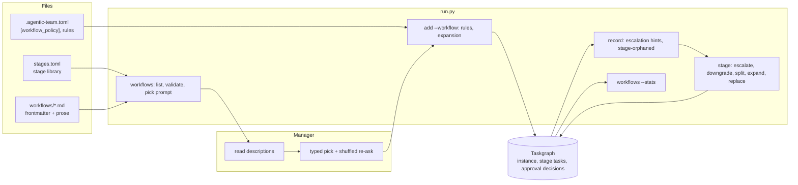
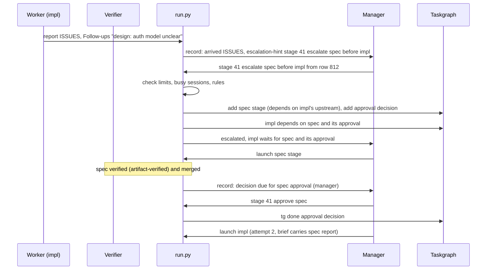
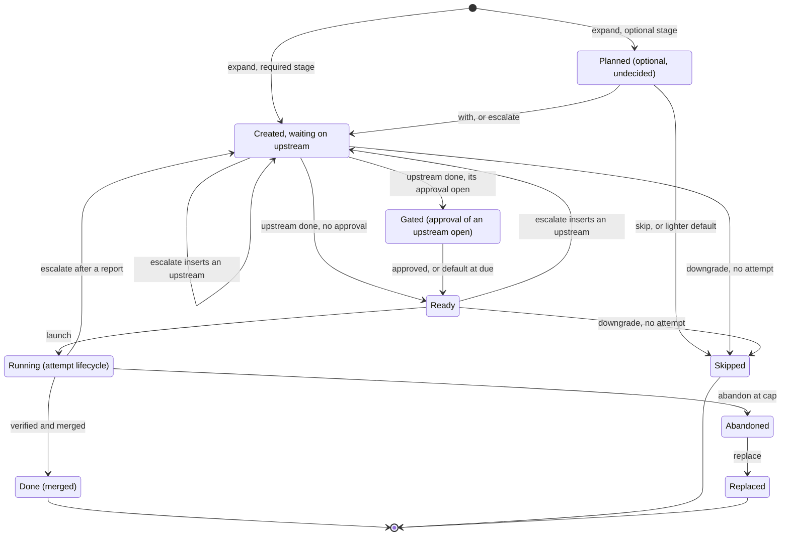

# Spec: workflow templates for agentic-team

Status: draft for owner review, 2026-11-20. Target: agentic-team 0.31.0 or later, after phase 1 (0.30.0) lands.
Binding input: the owner decisions of 2026-11-20 (memory `agentic-team-workflow-templates-design`).

## 1. Summary

A **workflow** is a markdown playbook with a small YAML frontmatter. The frontmatter lists stages (prd, spec, impl, test, ...), each with a role, a verify kind, an approval level and its upstream stages. `run.py add --workflow <name>` expands one piece of work into one Taskgraph task per stage, with the dependencies, roles, verify kinds and approval decisions already set. The prose body tells the Manager when to use the workflow and how to run its stages.

The Manager picks the workflow by reading the descriptions. It gives a typed answer (a workflow name or `unsure`), and one fresh subagent answers again with the options shuffled. A few structured hard rules (billing, migrations, security) force a workflow that has a spec stage. The Manager never asks the owner which workflow to use. When the pick is unsure, it takes the lighter workflow. Later evidence can add a stage before implementation starts, or drop one that is not needed. Every choice and change is written to task meta, and the retro reads it.

## 2. Problem and goals

**Problem.** Today every task is planned by hand. The Manager decides from prose (`playbooks/plan.md`) whether a piece of work needs a PRD, a UX design or a spec, and which tasks depend on which. vmt shows what that costs:
- the hand-written process rules in `manager-orders.md` (M2, M5, M24, M25, M26, M53, M58);
- missing dependencies, which is why the 0.28.1 `run.py add` gate and the dependency-check subagent exist;
- design found missing only after implementation started (M25: "first a planning task, then implementation, when (a)-(d) hold");
- owner questions per task (M24 and M32: which model, whether a design comes first).

None of this is visible in a retro as stage data.

**Goals and measurable outcomes.** Each is measured by `run.py workflows --stats` (section 10). A baseline comes from vmt's four weeks before rollout.

| # | Outcome | Measure | Target after the first retro tune |
|---|---|---|---|
| G1 | Fewer missing stages | Share of instances that escalated, or that had a `blocking[design]` verdict | Below 15% |
| G2 | Fewer missing dependencies | Dependency-check `missing` verdicts per 10 launches, workflow tasks compared with hand-planned tasks | At least 50% lower |
| G3 | No per-task questions | Operator decisions about the workflow choice | 0. Human approvals happen only where a rule or config says so |
| G4 | Retro-visible stages | Instances with a complete workflow record | 100% |
| G5 | Nothing blocks forever | Approval decisions still open one drain after their due time | 0 |

**Non-goals.**
- No workflow engine outside Taskgraph. Stages are ordinary tasks, and the attempt lifecycle (`Lifecycle.tla`) does not change.
- No calibrated confidence and no logprobs.
- No merge queue. No cause-based attempt cap (vmt M15). No GitHub issue mirroring (vmt M3).
- No automatic edits to workflow files. Retro proposes changes, and a task applies them.
- No per-stage model routing. Roles and `[models]` already cover it.

## 3. Overview



## 4. The file format

### 4.1 Where files live

| What | Plugin default | Project override (tracked in git) |
|---|---|---|
| Workflows | `templates/workflows/<name>.md` | `.claude/agentic-team/workflows/<name>.md` |
| Stage library | `templates/workflows/stages.toml` | `.claude/agentic-team/workflows/stages.toml` |

These rules mirror roles (`docs/roles-and-briefs.md`):
- The workflows a project has are the union of both folders. A project file wins over a plugin file of the same name.
- A project workflow may set `extends: <name>` to add to another workflow instead of replacing it. Extension is one level only. Stages of the child with the same `id` override the parent's fields, and new ids are appended. A child cannot remove a parent stage; to remove one, replace the file.
- A project `stages.toml` may add stage types or override fields of a shipped type.
- Adding a new stage type is a repository change, so it reaches the owner as a task or PR. This is the one library question the owner is asked (decision 4).

### 4.2 Stage library (`stages.toml`)

TOML, read with `tomllib`. One table per type, `[stage.<type>]`, with the keys below:
- `role`, `verify`, `approval` and `estimate`;
- `scope`: a path template such as `"{design_dir}/{slug}.md"`, or `"instance"` for the instance's SCOPE;
- `verify_cmd`: a template;
- `acceptance`: a list of lines. For `spec`, these are the design-doc template of `plan.md` step 2.

Shipped types:

| Type | Role | Verify | Approval | Scope |
|---|---|---|---|---|
| `investigate` | `architect` | `design-doc` | `manager` | the design dir |
| `prd` | `architect` | `design-doc` | `manager` | the design dir |
| `ux` | `architect` | `design-doc` | `manager` | the design dir |
| `spec` | `architect` | `design-doc` | `manager` | the design dir |
| `impl` | `software-engineer` | `code` | `auto` | instance |
| `test` | `software-engineer` | `code` | `auto` | instance |

`test` is an acceptance check of the merged change on the real surface. When the impl stage already added the tests, it closes as a no-change close with evidence (0.12.3 behaviour). `{design_dir}` is `[workflow_policy] design_dir` (default `docs/design`).

### 4.3 Workflow frontmatter

There is no YAML library. `run.py` reads a restricted subset:
- flat `key: value` lines, as role files use;
- one `stages:` key whose items are flow maps, one per line: `  - {id: x, after: [a, b]}`.

| Field | Required | Validation |
|---|---|---|
| `name` | yes | Same as the file name. Lowercase letters, digits and `-` |
| `description` | yes | 1-2 sentences, 300 characters or less. Shown in the pick prompt |
| `extends` | no | A workflow that does not extend another |
| `stages` | yes | At least 1 item. Ids are unique. The graph has no cycle. At least one required stage |
| stage `id` | yes | Lowercase letters, digits and `-`. It is a library type unless `type` is given |
| stage `type` | no | A library type, so that one type can appear twice (`impl-api`, `impl-web`) |
| stage `role`, `verify`, `approval`, `estimate` | no | Override the library values. Same checks as a role file: the role exists and is not broken; verify is `code`, `schema` or `design-doc`; approval is `auto`, `manager` or `human` |
| stage `after` | no | A list of earlier ids in the same workflow. An empty list means a root stage |
| stage `optional` | no | `true` or `false` (default). A workflow needs at least one required stage |
| stage `split` | no | `true` lets the Manager split this stage into parts (section 5.5). Only for stages whose verify is `code` |
| stage `decides` | no | `true` on exactly one root stage: its result names the remaining stages (figure-it-out). If set, no other stage may be listed |

`run.py workflows` lists every workflow with its source, description and stage chain, for example `prd → ux? → spec → impl* → test` (`?` optional, `*` splittable). Like `run.py roles`, it exits 1 and names each broken file. `add --workflow` refuses a broken workflow.

### 4.4 Body conventions

The body is prose for the Manager. It has three sections:
- `## When to use`: positive and negative signals, which the Manager reads to pick a workflow.
- `## Steps`: how to decide the optional stages and when to split.
- `## Stage notes` (optional): `### <id>` subsections of 150 words or less each. `run.py` pastes a subsection into that stage's brief under CONTEXT as `Workflow notes`.

The body is not enforced. A body over 600 words gets a `warn` line, as with roles.

### 4.5 Examples

**hotfix.md**

```markdown
---
name: hotfix
description: A defect with a known or quickly found cause, fixed inside one area with no design choice. Repro test first, then the fix.
stages:
  - {id: impl}
  - {id: test, after: [impl]}
---
## When to use
A failing behaviour you can reproduce, in one area, with an obvious fix shape. Not when the fix
changes an interface, data model, money or permissions (hard rules), or when the cause is unknown
after a short look (use fix or figure-it-out).

## Steps
1. Put the repro in ACCEPTANCE as a test that is red at base and green at head.
2. No optional stages. A worker census that touches more than its area escalates to fix.

## Stage notes
### impl
Commit the failing test before the fix, so history shows red, then green. Ship the smallest change the evidence supports.
```

**feature.md**

```markdown
---
name: feature
description: New user-visible behaviour or a new capability that needs product scope and a design before code. Several tasks, possibly parallel.
stages:
  - {id: prd}
  - {id: ux, optional: true, after: [prd]}
  - {id: spec, after: [prd, ux]}
  - {id: impl, after: [spec], split: true}
  - {id: test, after: [impl]}
---
## When to use
The request names an outcome, not a change: "users can ...", a new page, a new API surface, a
new integration. Not for a change whose scope is already decided (change) or a defect (fix).

## Steps
1. Include `ux` when the work decides an interaction flow, user path or information architecture
   (vmt M24 / M32c). Skip it for layout and style that follow an existing design.
2. The prd states the outcome as behaviour and acceptance; it never names files (vmt M26).
3. At the spec approval, split impl along the spec's phase table: one part per phase, its
   files as SCOPE, with the spec path and commit in the notes (vmt M25). Do not split by
   estimate alone (vmt M60). Give each part its own files; where parts share files, record
   the order as a dependency.
4. Each user-visible part lists the states to screenshot and adds one hour to its estimate (vmt M53).

## Stage notes
### spec
Name each phase's files or directories and a check that fails when the phase is wrong.
### test
Exercise every instance acceptance line on the real surface; paste the evidence.
```

**figure-it-out.md**

```markdown
---
name: figure-it-out
description: Work no other workflow fits, or that is large, cross-cutting or unclear. A short investigation designs the remaining stages first.
stages:
  - {id: investigate, decides: true, estimate: 2}
---
## When to use
Any of (vmt M25): (a) one PR or one timebox cannot hold it; (b) acceptance cannot be written as
checkable behaviour without code facts; (c) a design trade-off is open; (d) two or more tasks
need the same census. Also every pick where both answers were `unsure`.

## Steps
1. The investigate stage is read only. It ends with a `workflow-plan` block (below).
2. At its approval, run `run.py stage <inst> expand --from-row <row>`. Prefer a plan that names
   an existing workflow. A list of library stages is an ad-hoc workflow, reported in the
   next brief.
3. A plan that needs a stage type the library does not have is a decision for the owner,
   the only question this workflow may raise.

## Stage notes
### investigate
Define done as a falsifiable check, size the work, and list the riskiest unknown first. End
your report with:
    ```workflow-plan
    workflow: fix            # or: stages: [{id: spec}, {id: impl, after: [spec], split: true}]
    why: <one line>
    ```
```

## 5. Expansion

### 5.1 Command

```
run.py add "<title>" --pick <manager answer>,<re-ask answer> --seed <n>
           [--with <stage>]... [--skip <stage>]...
           --notes "..." --meta scope=... verify=... [--meta area=billing]
           (--depends ids | --blocks ids | --independent "<reason>")
```

`add --workflow` runs the 0.28.1 dependency gate once, for the whole piece of work, and lists the candidates. It refuses until the dependencies are settled, as today. Then it creates the following, in one locked run:

1. **The instance**: a parent task with the title and notes as given. It has `--meta workflow=<name> workflow_record=<json>` (section 10).
   - It is never launched. Its status is the Taskgraph summary status of its parts.
   - External `--blocks` ids depend on the instance. `launch` reads a dependency's derived status (`waiting_for`), so they wait until every stage is done. `refuse_unmerged_deps` never fires on the instance, because it has no `verdict_ref`. As a result, a task that depends on an instance cannot stack on an unmerged stage with `--base`; it waits for the merge.
   - `record` must skip an instance in its `unmanaged` list (a small run.py change).
   - On the GitHub backend the instance is the parent issue and the stages are its sub-issues.
2. **One stage task per required stage and per stage given with `--with`**, created with `--parent <instance>`:
   - title `<title> — <stage id>`;
   - meta `stage=<id>`, `role`, `verify_kind`, `scope`, `verify` and `estimate` from the library or the stage;
   - notes: the instance's purpose, then the stage's acceptance. The impl and test stages carry the instance's acceptance lines; a design stage carries the library acceptance plus "covers every instance acceptance line".
3. **Dependencies.** A root stage gets the external `--depends` ids. A stage gets `--depends` on each upstream stage task and on that stage's approval decision (5.3). Every stage task is created through `cmd_add` with real `--depends` ids, never `--independent`, so the gate's invariant holds for every task.
4. **Approval decisions** for each created stage whose approval is not `auto` (section 7).

A `--with` or `--skip` must name an optional stage. An optional stage named in neither flag follows `when_unsure`: `lighter` skips it. A skipped optional stage is never created. Its edges are contracted: a stage after it depends on its upstream stages instead. So no task ever waits on a stage that does not exist.

### 5.2 Relay of upstream results

Nothing new is needed. A brief already carries the latest report of each task it depends on (`docs/roles-and-briefs.md`, "Carried reports"). The upstream report's `Files:` names the spec path and its `Head`. Downstream stages depend on the upstream stage directly, not only on its approval, so its report is carried. A done decision's notes, which hold the approval answer, are pasted too. `run.py` adds one CONTEXT line: `Workflow: feature #41, stage impl (4 of 5); upstream spec: docs/design/x.md at <sha>`, plus the stage's `Workflow notes`.

### 5.3 Readiness

A stage becomes ready when Taskgraph says so: every dependency is done (merged), and every approval decision is done. `launch` already refuses a task that waits for an unfinished dependency or decision, including on a retry.

### 5.4 Merge semantics

A design stage's document merges like any change, and downstream stages build on it. A stage is done only when merged, as today.

### 5.5 Splitting a stage

```
run.py stage <inst> split <stage> --part "<title>" --meta scope=... [--depends <sibling ids>]
```

This adds parts of a stage whose frontmatter has `split: true`. It is allowed only while the stage has no attempt, normally at the upstream approval.
- Part 1 is the original stage task, renamed and re-scoped with `tg edit`. Each further part is created through `cmd_add`. It has the same upstream dependencies and `stage=<id> stage_part=<k>`, and the candidate list shows its sibling parts.
- Every stage after the split stage depends on all parts.
- A part that shares write paths with a sibling must name it with `--depends`. This uses the same candidate check, with strength 4 for a shared SCOPE path.

### 5.6 Figure-it-out expansion

`run.py stage <inst> expand --from-row <row>` reads the `workflow-plan` block of the investigate stage's report. It applies the hard rules and creates the rest. Every new root depends on the investigate stage and on its approval. The record gets `workflow=<named>` or `workflow=adhoc` with the stage list. `expand --workflow <name>` does the same without a plan row.

## 6. Selection

### 6.1 The pick

1. `run.py workflows --pick-prompt --seed <n> --title ... --notes-file ...` prints a prompt. It holds the task text (title, notes, SCOPE areas, issue references; no code census), the workflows as `A. <name>: <description>` in an order shuffled by the seed, and `unsure` in a shuffled place among them. It asks for exactly `PICK: <name|unsure>` and `WHY: <one line>`.
2. **Answer 1** is the Manager's own reading-based pick. The Manager answers that prompt in the typed format.
3. **Answer 2** comes from one non-fork subagent (Sonnet, read only, an existing agent type, so no restart is needed). It gets the same prompt rendered with seed `n+1`. When the Manager plans several items at once, one subagent call answers all of them, each with its own shuffle.
4. `add --pick a,b` resolves the two answers:

| Answers | Result | `unsure` recorded |
|---|---|---|
| a = b, a name | a | no |
| two different names | the lighter: fewer stages in the plan that would be created, then fewer non-auto approvals in it, then name | yes |
| one name and `unsure` | the name (a lone figure-it-out name beside `unsure` wins too) | yes |
| both `unsure` | figure-it-out; with `when_unsure = "heavier"`, the heaviest workflow | yes |

`--pick` replaces `--workflow`: `add` takes one of the two, never both.

A workflow with a `decides` stage (figure-it-out) is outside the lighter/heavier order. It is chosen when both answers name it, when both are `unsure`, or when one names it and the other is `unsure`. When it disagrees with another named workflow, the other workflow wins.

`[workflow_policy] when_unsure` is one of:
- `lighter` (the default) for disagreements;
- `heavier`;
- `figure-it-out`, which applies to all three unsure rows.

An unsure pick watches more closely during the run: `record` prints its escalation hints at the first matching row (6.3 and 8).

### 6.2 Hard rules

Hard rules are structured and few, and they live in `.agentic-team.toml`:

```toml
[[workflow_rule]]
name = "billing"
match_paths = ["apps/api/billing/**", "apps/api/credits/**"]   # globs over SCOPE write paths
match_area = ["billing", "payments"]                            # the task's area meta
require_stage = "spec"
approval = { spec = "human" }      # optional: raise the approval of a stage
risk = "high"                      # optional: set on every stage task
```

A rule matches on SCOPE globs or on the `area` meta, never on title words.
- If the picked workflow has `require_stage` as an optional stage, `add` forces `--with` it. A billing fix becomes `fix --with spec`, not `feature`.
- If the stage is absent, `add` upgrades to the lightest workflow that has it.
- Either way, it records `rule=<name>` together with the original pick. Rules are checked again whenever a stage's SCOPE widens (for example after an `answer` that widens scope) and on every `expand`. A new match on a running instance is an escalation (section 8).

Shipped default rules: none. The setup skill offers billing, migrations and security as commented examples.

### 6.3 Reporting, not asking

The pick, the rule and any default are written to the instance's `workflow_record`. The `added` line shows them: `added #41 feature (pick feature/change, unsure → lighter=change, rule billing → feature)`. The Manager's normal reply or digest lists the picks made since the last report. The owner overrides with `run.py stage <inst> rechoose <workflow> --by operator`. That works like an escalation or downgrade, outside the limits in section 8, and is recorded as `overridden`. `rechoose` matches the rules again against the paths of the whole instance (the record SCOPE and every stage and part SCOPE), keeps every rule that the record holds, and appends the new application rows to `rules` (`record.rule` stays for compatibility; `rules` is authoritative). The write paths that only a removed stage or part held are merged into the record SCOPE. It makes the new stages before it removes the old ones, and it is refused while a task outside the instance depends on a stage of it. `recheck` raises the approvals that are not done to the level of a rule that matched late, and sets its risk on the stages that have not started.

## 7. Approval

Approvals map onto Taskgraph decision nodes, not gates. A Taskgraph gate blocks `done`, not `ready`, and `run.py` owns `done`. A decision node blocks its downstream stages, reuses the `gated` event and the `decision` notification, and has a due date and a default.

| `approval` | Node | Who resolves it | Due | Default at due |
|---|---|---|---|---|
| `auto` | none | none | none | none |
| `manager` | `--type decision --meta decider=manager` | The Manager, at the drain after the stage merges | `manager_due_hours` (2) after the stage merges | approve |
| `human` | Created as `decider=manager` with no due. The merge record turns it into `decider=operator`, `--due`, `default=approve` | The owner (notified at that moment) | `human_due_hours` (48) after the stage merges | `on_timeout` (default `approve`) |

A human node is not created as an operator decision at expansion, because `cmd_add` queues the owner notice for every `decider=operator` add. That would ping the owner days before the spec exists. Instead, the merge path of `close` and `record` changes the node, sets its due time and queues the `decision` notice once the stage is merged. This is a run.py change.

**Manager approval** checks only workflow facts, never the work itself:
- the stage is done: its verdict closed its kind and it merged;
- every `decision:` follow-up of the stage has been triaged (`run.py triage`);
- for a `split` stage downstream, the split is done or declined in one line.

A failure becomes a task or a decision, not a rejection loop.

**Human approval** happens only where a hard rule or the workflow raises it.

The due time is set when the stage merges, not at creation, so a long stage does not make the deadline pass early. `record` applies the default itself when a decision passes its due time: it writes the decision's notes, runs `tg done` and prints `approval-due`. `run.py stage <inst> approve <stage> --default` does the same by hand for a Manager that has not run `record`; it refuses before the due time and changes nothing then. A stage that is split has one approval for all its parts: the approval opens, and can be answered, only when every part is merged. `on_timeout = "hold"` is allowed only in config, per rule. A held approval appears in every digest until the owner answers, so it is visible but may wait (G5 counts it separately).

**Conditions.** A stage's approval is the highest of three values: its frontmatter value, the `approval` of any matching rule, and `[workflow_policy] approval_floor` for a verify kind (for example `schema = "manager"`). Nothing lowers an approval during a run.

## 8. Escalation and downgrade mid-flight

**Triggers.** `record` turns each trigger into a hint line. Only the Manager runs the command.

| Trigger | Source | Signal | Hint |
|---|---|---|---|
| Worker census | worker report (any status) or ask | New Follow-ups label `design: <question>: <why>`. The software-engineer census ask (Method step 2) when the Manager judges it a design question | `escalation-hint #id: next: run.py stage <inst> escalate spec --before <stage> --from-row R` |
| Verifier finding | verify row | New category `blocking[design]:` (a required design decision is absent or contradicts the code) | same |
| Hard rule | SCOPE widened, or `expand` | A rule newly matches | same, with `--rule <name>` |
| Investigation says it is smaller | a design stage's report | A `workflow-plan` naming a lighter workflow, or `downgrade: <stage>: <why>` | Not built: no hint is printed. The Manager runs `downgrade` itself when it reads the report |
| Manager | evidence in a row | Cites the row id | none |

**Escalate**: `run.py stage <inst> escalate <type> --before <stage> --from-row R --why "..."`
- Creates the new stage task. It depends on the target stage's current upstream dependencies, and gets an approval node at the library level.
- Adds the new stage and its approval to the target's dependencies, and to its parts' dependencies.
- `escalate` is refused when the attempt has a passing verdict (`close` it instead), and when the newest row of an attempt at the cap (3) is a failure that no `escalated` row exempts: the next launch would be refused and the stage stuck. The owner decides (`abandon`, or `launch --attempt 4`).
- If the target has had an attempt, `escalate` refuses only a session that is busy (its turn is not over). A worker or verifier kept idle for a revision is stopped as `kept-session-stopped`, because no revision can follow once an upstream is inserted. The target's next launch waits for the new stage (launch refuses while it waits). The next attempt's brief carries the new stage's report.
- If the new design changes the target's ACCEPTANCE (brief frozen at start), the Manager abandons the target as `superseded` and creates a fresh stage task by hand. (`stage escalate --replace` is not built.)

**Downgrade**: `run.py stage <inst> downgrade <stage> --from-row R --why "..."` drops a planned stage, or skips a created stage that has no attempt. Only a stage made by `--with` (never a required stage, a stage a rule requires, or one that an escalation added). First the stage's upstream edges, tasks and approval decisions, move to each stage that depends on it, as `add` contracts a stage it leaves out; then the task is marked `tg done` with `stage_state=skipped` and no phase, and its approval node is closed with it (`approval_state=skipped`). `run.py` treats a done task with attempt 0 and `stage_state=skipped` as terminal and never derives a merge for it. Marking the task done alone is not enough: a stage after it would start before the skipped stage's upstream was merged and approved (`regress-wf-downgrade-done-only.cfg`).

**Orphans**: a stage whose upstream is abandoned would wait forever, because abandon never runs `tg done`. `record` prints `stage-orphaned`. The hint names one of two commands:
- `run.py stage <inst> replace <stage>`: a new task of the same type, with dependents moved to it and the old task detached from the instance. At most `max_replacements` (1) per stage.
- `run.py stage <inst> cancel --why`: skips every not-started stage, abandons every stage that still runs (also in parallel branches, so no session outlives the instance), closes every approval and ends the instance. It is not marked done: a task that waits for it never starts, and the `workflow-cancelled` line names those tasks.

**Limits** (no flapping):
1. At most `max_adjustments` (2) escalations plus downgrades per instance. Owner overrides do not count.
2. Each stage type is escalated at most once per instance.
3. A stage added by escalation cannot be downgraded. A stage required by a rule cannot be downgraded.
4. Never on a stage with a busy session. Escalation only inserts before a stage that is not done.
5. Past the limit, the hint becomes a Manager note in the report, never an owner question.

These limits bound the number of adjustments, so escalation terminates (section 11).



## 9. Stage lifecycle

Each stage moves through the states below. Running delegates to the attempt lifecycle that `Lifecycle.tla` checks.



| From | Event | Guard | To | Effect |
|---|---|---|---|---|
| (none) | expand | stage required, or `--with` | Waiting | task created with real `--depends` |
| (none) | expand | stage optional, undecided | Planned | recorded in `workflow_record` only |
| Planned | `--with` / escalate | limits hold | Waiting | task created, edges added |
| Planned | `--skip` / lighter default / downgrade | not rule-required | Skipped | edges contracted |
| Waiting | upstream done | an upstream approval is open | Gated | `gated` line |
| Waiting | upstream done | no open approval | Ready | `ready` line |
| Gated | approve, or due passes and default applied | `on_timeout` is not `hold` | Ready | decision done |
| Waiting, Ready | escalate | limits hold | Waiting | new upstream stage and approval |
| Running | escalate | report or verdict filed, no busy session | Waiting | idle kept sessions stopped; next launch waits |
| Waiting, Ready | downgrade | attempt 0, not rule-required, not added by escalation | Skipped | `tg done`, `stage_state=skipped` |
| Ready | launch | no open dependency or decision | Running | attempt 1 |
| Running | merge recorded | verdict closes the kind | Done | approval due time starts |
| Running | abandon | attempt cap | Abandoned | `stage-orphaned` for its dependents |
| Abandoned | replace | `max_replacements` not reached | Replaced | new task, dependents moved |
| Abandoned | cancel | (none) | Abandoned | not-started stages Skipped; the instance abandoned |

## 10. Retro data

**Per instance**: the `workflow_record` meta on the parent, as JSON.

```json
{"workflow": "change", "version": "<file sha>", "picks": ["feature", "change"], "unsure": true,
 "resolved_by": "lighter", "rule": null, "overridden": null, "optional": {},
 "adjustments": [{"kind": "escalate", "stage": "spec", "trigger": "verifier", "row": 812}], "ended": "merged"}
```

**Per stage task**: the meta keys `stage`, `stage_part`, `stage_state` (`skipped` or none) and `stage_origin` (`expand`, `with`, `escalate`, `split`, `replace`). Everything else comes from data that already exists:
- `sessions` gives the attempts, `cause`, `usage` and `tier`;
- verdict rows give `blocking[...]` categories;
- `depcheck` rows give the dependency-check verdicts;
- `triage` rows give where follow-ups went;
- approval decisions give their wait time and whether the default was applied.

**`run.py workflows --stats [--since <date>] [--json]`** prints:

| Query | Feeds |
|---|---|
| Instances per workflow; pick agreement rate; unsure rate; rule upgrades; owner overrides | G3, pick quality |
| Escalation rate per workflow and trigger category; downgrade rate | G1, the workflow is too light or too heavy |
| Verify-failed per stage, by category; attempts per stage; revisions per stage | where a stage is weak |
| Dependency-check `missing` per 10 launches, workflow tasks against hand-planned tasks | G2 |
| Approval wait time per level; defaults applied; holds | G5, due times |
| Tokens and wall time per stage | cost of each stage |
| Stage-orphaned and replacements | plan robustness |

From these, retro proposes changes, for example:
- "fix → add a `spec` rule for `apps/api/auth/**`: 3 of 5 escalated";
- "drop `ux` from change: skipped 9 of 9".

The owner approves them once, at retro time. Each approved change becomes one task that edits the workflow files or the rules.

## 11. TLA+ plan

Write a **new module, `model/Workflow.tla`**, not a refinement of `Lifecycle.tla`.

- Each stage's run is one abstract step with two outcomes, done or abandoned. This is exactly the end-state property that `Lifecycle.tla` checks: following `record`'s hints, an attempt ends merged or abandoned, with no dead end.
- `NOTES.md` states this as the interface assumption: Workflow assumes it, and Lifecycle proves it.
- Decisions and dependencies, which Lifecycle leaves out, are the subject of the new model.

**Constants**:
- `Types` (a small library, for example `{inv, spec, impl, test}`);
- `Base` (the workflow's DAG, with `Optional`, `Approval[s]` and `Decides`);
- `RuleRequired`, `OnTimeout ∈ {"approve", "hold"}`, `MaxAdj`, `MaxRepl`;
- sensitivity flags `REGRESS_NO_DEFAULT` (a decision without a default), `REGRESS_SKIP_RULE` (downgrade ignores rules), `REGRESS_INSERT_RUNNING` (escalate into a live stage), `REGRESS_NO_CONTRACT` (a skipped stage keeps its edges).

**Variables**:
- `st[s]` ∈ {absent, planned, waiting, gated, ready, running, done, skipped, abandoned, replaced};
- `deps` (the current edge set);
- `appr[s]` ∈ {none, open, approved, defaulted};
- `due[s]` (boolean);
- `adj`, `escalated` (a set of types), `repl[s]`;
- `inst` ∈ {open, merged, cancelled}.

**Actions**:
- `Expand` and `DecideOptional`;
- `BecomeReady` and `Gate`;
- `Launch`;
- `Finish(s, outcome)`, the abstract Lifecycle;
- `OpenApproval` (at done) and `Approve`;
- `DueArrives` (environment) and `ApplyDefault`;
- `Escalate(t, before)`, `Downgrade(s)`, `Replace(s)`, `Cancel`, `ExpandFromPlan` (decides);
- `OperatorAnswers` (fair only in the `hold` configs);
- `Done` (stutter at the end).

**Invariants** (safety):
- `TypeOK`, and `Acyclic(deps)`.
- `NoGhostDeps`: every dependency of a waiting, gated or ready stage exists, and is neither planned nor dropped.
- `NoBypass`: a running or done stage has every upstream approval `approved` or `defaulted`, unless that upstream is skipped.
- `RuleStagesKept`: a rule-required stage is never skipped.
- `AdjBound`: `adj ≤ MaxAdj` and `repl[s] ≤ MaxRepl`.
- `NoInsertIntoBusy`: escalation never changes the dependencies of a stage with a busy session.

**Properties** (liveness, under weak fairness of Manager actions and `DueArrives`):
- `EventuallySettled`: `<>(inst ∈ {merged, cancelled})`.
- `NoWaitForever`: for every s, `[](st[s] ∈ {waiting, gated} ⇒ <>(st[s] ∉ {waiting, gated}))`.
- Escalation terminates, by `AdjBound` plus a variant (`MaxAdj − adj`).

**Configs**: `wf-hotfix.cfg`, `wf-feature.cfg` (optional ux, split collapsed into one part), `wf-figure.cfg` (decides), `wf-hold.cfg` (`OnTimeout = "hold"` with operator fairness), and one `regress-wf-*.cfg` per flag, each of which must break. TLC's deadlock check means "no dead end" here too: without `Replace` and `Cancel`, an abandoned upstream deadlocks, which proves the orphan rule is needed.

**Results (W5, 2026-11-20).** `model/Workflow.tla` and its configs are in; `model/NOTES.md` ("The workflow model") maps each rule to the code, and `model/PREDICTIONS.md` ("Workflow templates W5") has the runs. The main check (`wf-check.cfg`, 2.7 million states) holds every rule with the W4 commands as guarded there, and each regress config breaks. Against the code after W3 the model found two breaks: an abandoned last stage with an auto approval gets no `stage-orphaned` hint, so the instance never ends (`orphan_note` reads only the task's `blocks`); and `rechoose` drops a rule that `recheck_rules` added after a split. It also sets requirements for W4: `downgrade` must move the skipped stage's upstream edges to its dependents (a done-skipped task alone lets a dependent start before that upstream is approved), `escalate` must refuse a target with a merged part and a verifier that has not filed, and must commit the WIP under its STOPPED row, and `cancel` must abandon the stages that still run. `Lifecycle.tla` has decision 4 (`ESCALATIONS`, `Reason: escalated`, exempt from the cap); every earlier config gives the same states as before.

## 12. Comparison with pstack

| | pstack poteto-mode playbooks | agentic-team workflows |
|---|---|---|
| Format | Prose playbook, numbered steps | The same prose, plus frontmatter that `run.py` enforces |
| Pick | The agent matches the task to a playbook title | The Manager reads descriptions; typed answer plus `unsure`; shuffled re-ask; hard rules |
| No fit | `figure-it-out` designs a playbook | `figure-it-out` workflow: an investigate stage writes a `workflow-plan` that `expand` applies |
| Steps become | Todo items in one session | Taskgraph tasks with dependencies, roles, verify kinds, approval decisions |
| Enforcement | The agent copies steps; skipping is a reason line | `launch` refuses until dependencies and approvals are done |
| Human | Never Block on the Human; pause for irreversible actions | The same principle: owner approvals only by rule; every decision has a due date and a default |
| Change mid-run | Rewrite the checkpoint at phase boundaries | `escalate` and `downgrade`, bounded, recorded |
| Learning | Encode Lessons in Structure, by hand | Retro queries over workflow records propose file and rule changes |

## 13. Migration and rollout

- **Off by default.** With `[workflow_policy] enabled = false` (the default), `add` refuses `--workflow` with a hint, and nothing else changes. Plugin defaults ship: `stages.toml`, and the workflows hotfix, fix (`spec? → impl → test`), change (`prd → impl → test`), feature and figure-it-out.
- **GitHub backend.** `workflow_record`, `stage`, `stage_part`, `stage_state`, `stage_origin` and `area` stay on the issue: another machine must see them. None of them is local. The `[projects.meta]` table in `docs/reference.md` and `config.py check` list them.
- **Manager text.** `agents/manager.md` gains a row: "New work, workflows on: `run workflows`, pick, then `add --workflow`". `playbooks/plan.md` step 2 gains "with workflows, the stage sets role, verify kind and approval; set them only to depart". Hand-planned tasks keep working beside workflow instances.
- **vmt is the first user.** Its manager-orders map as follows:

| vmt order | Becomes |
|---|---|
| M25 (a)-(d) planning task first | figure-it-out "When to use"; feature Steps 3 (split by the spec's phase table) |
| M24 / M32c UX design | feature Steps 1 (when to include `ux`); a project `ux` stage override sets the model |
| M26 acceptance is behaviour | prd Stage notes; feature Steps 2 |
| M53 screenshots | feature Steps 4 |
| M60 no split by estimate | feature Steps 3 |
| M5 fewer, larger PRs | fix and change Steps: merge small same-area items into one instance |
| M2 two failed spec reviews | spec Stage notes: a third failure turns each remaining issue into its own task |
| Standing order 22 (plan readiness) | `spec` library acceptance |
| M58 domain list (money, credits, payments, migrations, security, permissions) | `[[workflow_rule]]` billing, migrations, security: `require_stage = "spec"`, `risk = "high"` |
| M1, M21, M27, M29, M59 | Already covered by the plugin (brief frozen, `verifier_by_tier`, `--base` rule, `[scope] adjacent`, the judgement brief) |
| M3, M13, M15x, M19, M22, M33+ | Out of scope (issue mirroring, feature branches, cap by cause, slots, one-off holds and upgrades) |

- **Rollout steps.**
  1. Ship off.
  2. vmt turns it on for new work only. Running tasks stay hand-planned.
  3. Run the first retro after about 20 instances.
  4. Apply the approved changes.
  5. Make it the setup skill's suggested default only after G1-G5 hold.

## 14. Decisions (owner, 2026-11-20)

1. **Frontmatter parser:** the restricted YAML subset (flow maps, one per line), no PyYAML.
2. **Deadline for human approvals required by a hard rule:** `on_timeout = "approve"` after 48 h by default, with the default named in the notice; a single rule may set `on_timeout = "hold"` to wait without a deadline.
3. **Impl split:** the Manager splits, at the spec approval, following the spec's phase table.
4. **Escalation and the attempt cap:** the impl attempt that raised an escalation does not count toward the 3-attempt cap. `launch --cause escalated` is exempt like a pause; `Lifecycle.tla` gets that change (W5).

## 15. Effort and phasing

The estimates are worker-task hours. Each phase is one PR on one branch, and the phases merge together at the end.

| Phase | Content | Hours |
|---|---|---|
| W1 | Parser, `stages.toml`, `run.py workflows` (list, validate, `--pick-prompt`), shipped files, tests | 10 |
| W2 | `add --workflow`: instance, stage tasks, edge contraction, approval decisions, CONTEXT line, `stage split`, `approve --default`, `approval-due`, human node turned to operator at merge, instance skipped in `unmanaged` | 16 |
| W3 | Pick resolution, `when_unsure`, `[[workflow_rule]]`, rule re-check on scope change, `rechoose` | 8 |
| W4 | `escalate`, `downgrade`, `replace`, `cancel`, `expand`; `design:` label and `blocking[design]` category; record hints; limits; skipped handling in `derive_phase` | 14 |
| W5 | `Workflow.tla`, configs, regress checks, NOTES.md, statechart render | 10 |
| W6 | `workflows --stats`, docs (reference regenerated, lifecycle, roles-and-briefs), CHANGELOG | 8 |
| W7 | vmt rollout: project overrides, rules, first retro | 4, plus a retro after about 20 instances |

Total: about 70 worker hours. W5 runs alongside W2-W4 and should land before W4 merges, because the model is the check on escalation and orphans. Each phase needs a design-doc verify for W5, and a code verify by risk for the others.
