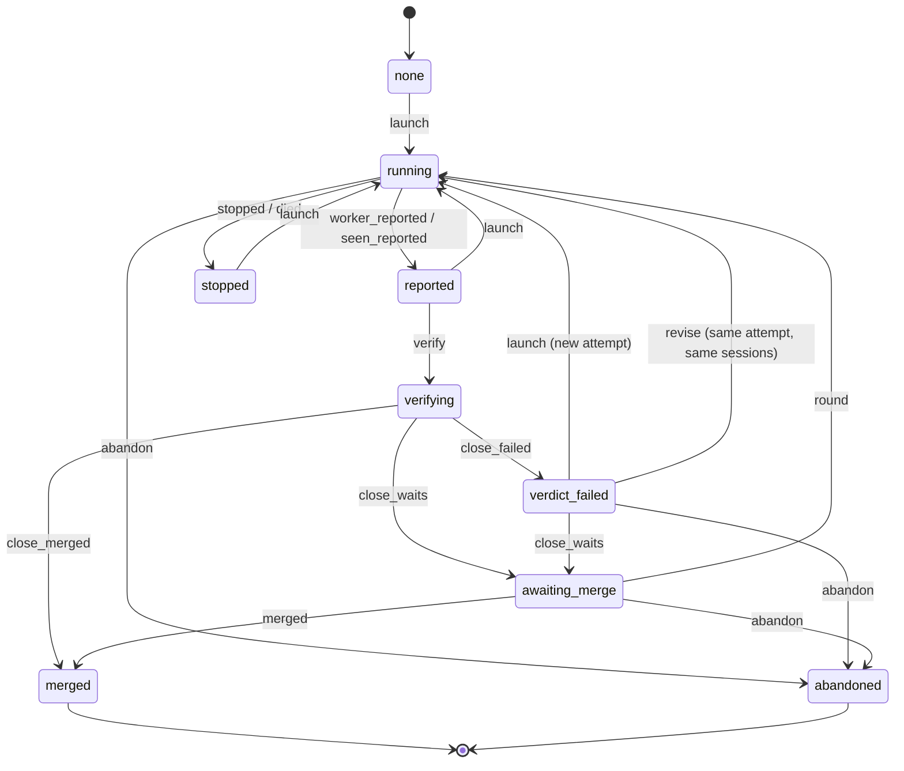

# Lifecycle

How a task moves from a ready Taskgraph task to a merged change: attempts, phases, verification, revisions and rounds. The checked model of this lifecycle is under [The checked model](#the-checked-model).

## Task lifecycle

A refused launch is fixed in Taskgraph, a retry or fix round renders a fresh
brief, and a merged task unblocks the next. One thing is fixed in place: a
verifier's blocking findings go back to the same worker session, in the same
worktree and attempt (a revision, see [Revisions](#revisions-fix-in-place)).
Only calls that need the operator leave the loop, as Taskgraph `decision` nodes.

### Launch

`run.py launch <id>` renders the brief and starts the worker in the task's one
worktree (`.claude/worktrees/task-<id>`), on the task's one branch
(`worktree-task-<id>`). A task keeps that worktree and branch for its whole
life. The first attempt creates the worktree itself, at the base commit, with
`git worktree add`, and `claude --bg --worktree` reuses it. This relies on
`claude --bg --worktree <name>` reusing an existing worktree, which was
verified with Claude Code 2.1.311; the `launched` and `verifying` events warn if
the session's worktree is no longer at the base. The worker resets and checks
out nothing: its brief names the commit the worktree is at, and it reports
`BLOCKED` if `HEAD` is not there. The first `launch` refuses when the branch or
folder already exists (the message gives the steps to reuse the name), and
removes the worktree and branch again if `claude` fails to start, unless a
session, a change or a new commit is there. The base of a first attempt is the
Manager's `HEAD`; in `pr` mode the fetched target branch replaces it.
`launch --base <sha|branch>` starts a first attempt from any commit and wins
over both.

### Retries and fix rounds

A retry or fix round is a fresh session with a fresh brief, in the same
worktree, on top of the commits of the earlier attempts. The attempt is only a
number: it caps retries at 3 and labels result rows, session names, and brief
files. The retry starts at the worktree's `HEAD`, and its brief says so and pastes
the previous report. `launch --base` on a retry is refused while the worktree
exists, and the message gives the by-hand reset; `run.py` never resets,
rebases, or checks out another commit in place, except the `close` catch-up with
`catch_up = "local"` (it rebases the idle worktree, and puts the old head back
when the change differs), `round` on a branch that stayed at `caught_up_from`
(it moves it to the host's head, the same change), and `round --cancel` (it
keeps the round's head in a ref, then resets to the verified head). Before a retry the worktree
must be clean. `launch` refuses a `STOPPED` attempt whose WIP commit is not made
yet (run `record` first). When a dead or stuck attempt left uncommitted files,
`launch` commits them as `WIP task <id> attempt <n>: <status>` and says so in
the `launched` line, with the file names. That commit holds every untracked file
that is not ignored, and in `pr` mode it is pushed with the branch. A worktree on another branch (a detached `HEAD` included), or a plain folder, is
refused with a fix that loses no commit. `record` never commits WIP in such a
folder: it files the `STOPPED` row with `Head: None` and says why. If the worktree is missing on a retry, `launch` reattaches
`worktree-task-<id>` when the branch exists; else it creates the worktree at the
`Head` of the latest worker or stopped result (an adopted task's first fix
round); else it asks for `--base`. A failed `claude --bg` on a retry removes
nothing. `base` in the task's metadata is the commit the branch forked from; it
is written once and a retry does not change it.

### Verifying

`run.py verify` starts the verifier in the task worktree, read only, once the
worker's turn is over (`[verify] seat = "task"`, the default): no new folder.
A recorded worker row with status `idle` that waits on nothing counts as over
once the worker's report of its revision is filed after the row started: a
resumed session that ended its turn reads `idle/working`.
It falls back to a worktree of its own (`verify-<id>-<attempt>`, then `-2`,
`-3` for a second verifier), fresh at the commit under review, with a
`seat-fallback` line, when the task folder is dirty, is not at the worker's
`Head`, or the worker is still busy `[verify] seat_wait_minutes` after its
report (before that, `verify` refuses and names the busy session), and always
with `seat = "own"`. In a revision the same wait applies before the kept
verifier is resumed in the task worktree; after it, a new verifier starts in a
folder of its own (a session resumes only in the folder of its conversation).
A verifier folder goes when its verdict is recorded:
`close`, the next `launch`, `round`, `round --cancel` and `abandon` remove each
clean `verify-*` folder that no session uses and whose `HEAD` and branch tip are
the `Head` of a worker or `STOPPED` row, with its branch; else one `kept` line
names the cause. `verify --again` reuses a clean verifier folder at the same
commit instead of creating `-<k>`. `claude --bg`
writes session data under `~/.claude`, so run
`launch` and `verify` outside the Bash sandbox or allow writes to `~/.claude`;
either needs the operator's agreement. Before it files its report, whatever the
status, the worker commits on its branch (a `WIP task <id> attempt <n>: <status>` commit for
`ISSUES` or `BLOCKED`), so `Head` is always set and the worktree is clean. It
writes its report to a file with the Write tool, checks it with
`run.py check-report`, and files it with
`mailbox.py report --body-file` (the same `tg result add`, behind a check that no steer of the
attempt is unacked, run under the task's lock), so no report text reaches a shell command, where a
project's guard could refuse it for a word. The report names the `Branch`, the
`Head` commit SHA, and the `Worktree` path. If the Manager set its address
with `run.py notify-to`, the session then sends it one line with SendMessage.
The Manager messages a worker only with `run.py answer` and `run.py steer`
(see [Messaging](messaging.md#messaging)), never with SendMessage.

### Finding results

`run.py record` finds the result, one line per event. A session that ends with
no result is filed as `DIED` and retried; a complete report in its report
file, its transcript or `claude logs` is filed as the worker's own. A session stuck on a permission prompt is
stopped and filed as `BLOCKED`; the row holds what it waited for, its model,
and the last lines of `claude logs`, read before the stop. The `stuck` hint
names a pinned model id only when the session ran on one. A session that waits
on a prompt after its result is filed is not stuck: its work is done. `launch`
stops such a worker (`stopped-idle`), and `record` stops such a verifier and
keeps its verdict. A worker that stays idle with no result is `unknown`; the
hint names `claude logs`, then `run.py stop`, `run.py record` and `run.py launch`. Attempt 3 is the
last (`launch` refuses a fourth): when it fails, `run.py abandon` marks the task abandoned. At attempt 3,
every `next:` hint that would retry the task names `run.py abandon <id> <mode>` and the
`--attempt 4` override instead of a plain `launch`. Its
worktree stays, and the report lists it for the operator to remove.

A verifier with no result gets the same search, once its turn is over. That
means state `stopped`, `done` or `failed`, or state `blocked` with no
`waitingFor`, and a status other than `busy`. A row in another state with no
`busy` status, for example `idle/working` after the session said that it will
check back, counts only after 30 minutes with no write to its transcript. A
report needs a `Verdict:` line with a known level. `record` files it under the
verifier's name, so it counts as the verifier's verdict, stops the session if
it is still there, and prints `salvaged`, then `verified`. When nothing is
found, every drain prints `no-verdict`, until a verdict or a new verifier
comes. `run.py verify <id> --again` stops the old session and starts a new one.
`run.py status` shows such a task under "In flight" with the verifier's name.
`claude logs` works only while the session's process lives, and it shows the
terminal screen. The report file and the transcript are the sources to rely on.

### Verdict and close

The Manager then verifies the commit. For a `risk=low` task it reruns VERIFY
inside the worker's worktree. For a `risk=high` task, `run.py verify` starts a
verifier in a worktree of its own, created at the `Head` commit. A `schema` or
`design-doc` task always goes to `run.py verify`, whatever its `risk`. The brief
carries the method for the task's verify kind, names the base and head commits, and names the project verify skill (`.claude/skills/verify/SKILL.md` at the commit under review, else in the main checkout, else none). Only `artifact-verified` closes those two kinds. Then
`run.py close` records the verdict and the token counts, stops the task's
sessions, and then follows `merge.mode`. A task is done only when its change is
merged: until then it stays in progress in Taskgraph with the `phase`
`awaiting_merge`, so the tasks that depend on it are not ready, and its session
slot is free. In `local` mode `close` merges only when a standing-orders line
starts with `MERGE:`, and only into the checked-out branch of a clean main
checkout. Without that line, during a pause, on a dirty or detached main
checkout, or on a conflict, the task waits: `close` lists the branch as ready
to merge, and on a conflict it aborts the merge and prints the decision to add,
naming both branches. Every merge record goes through one step: it writes
`merged_at`, `merged_by` and `phase=merged`, then runs `tg done`. That happens
when `close` merges, when `record` finds the branch in `HEAD` or the request
merged, and when the operator says a branch is merged, by any method including
squash or rebase, with `run.py merged <id>`. If a command stops between the two
writes, the next `record` finishes it. While the task waits, it carries a
Taskgraph gate `merge` that says what it waits for: `merge of <branch>` in
`local` mode, the request (`PR #<n>` or `MR !<n>`, with its URL) in `pr` mode.
`tg ls` shows it as `(waiting: ...)` and `tg ls --gated` lists those tasks. The
merge record clears the gate before `tg done`, and `abandon` clears it too. Two closes are done at once, with no
merge: output that is not a git commit, and a branch with no commit beyond its
base (`merged_by=no-change`). In `pr` mode `close` pushes the branch and opens a
request instead (next section). A task that depends on one that waits for its
merge is not ready; `launch --base <its branch>` builds on it anyway (`adopt`
takes only a branch that holds its commit), and the Manager says so plainly in its replies and reports. A task that waits for its
merge refuses `launch`, `adopt`, `verify` and `stop`; `close` again resumes at
the merge or the push, `round` starts a new attempt on the same branch and
request (see "Round" under [Merging through pull or merge requests](merge.md#merging-through-pull-or-merge-requests)),
and `abandon` drops it. After the merge, `run.py` removes
the worktrees of the task by default (`merge.remove_worktrees = true`). It
works in two steps.

1. It removes every session of the task with `claude rm`, newest first and the
   task's first session last. `claude` locks a worktree in the name of the first
   session that used it. `claude rm` of any later session removes only that
   row; `claude rm` of the first session removes the folder, when the tree is
   clean and pushed. `claude rm` refuses work that is on no remote, so the
   script passes `--discard-unpushed` only for a commit that
   `git merge-base --is-ancestor` finds in `HEAD` or, in `pr` mode, in the
   recorded merged head (`pushed`). A commit also counts as merged when the
   target holds the same patch, as after a rebase merge. `claude rm` deletes
   the folder with its ignored files, so `run.py` skips every session whose
   folder fails the container, `git status` or ignored-file check of step 2.
   Step 2 then names the reason.
2. It then removes every folder of the task that is still there: `task-<id>`,
   an old `task-<id>-<n>`, and `verify-<id>-<n>[-<k>]`. This covers a task that
   0.6.0 started, a folder whose lock owner has no row, and a row `claude rm`
   refused. It reads `claude agents` again first. A folder is removed only when
   all five checks hold, in this order:
   - No live session or process uses it: no live row has it as its working
     directory, and (when `lsof` is installed) no process has its working
     directory inside it. A lock must be Claude Code's own
     (`claude session <folder> (pid <N> ...)`) with a pid that has ended; any
     other lock reason, or a live pid, keeps the folder.
   - No Docker container uses it, running or stopped. A container's processes
     run in the Docker VM, so `lsof` does not see them. When `docker` is on
     `PATH`, `run.py` runs `docker ps -a -q --no-trunc` and one `docker inspect`
     of all the containers, once per command, with a 20-second limit for each.
     A container uses the folder when a mount source (`Mounts[].Source`) or its
     Compose working directory (the label
     `com.docker.compose.project.working_dir`) is the folder or a path in it. A
     mount of a folder above it, such as the main checkout, does not count. When
     `docker` is on `PATH` but fails or does not answer, every folder stays.
     Without `docker` on `PATH`, `run.py` skips this check.
   - `git status --porcelain` shows no change. Untracked or modified files keep
     the folder.
   - Every ignored path is disposable. `run.py` reads the ignored paths with
     `git status --porcelain --ignored=matching`, which names each path where
     its ignore rule matched (`src/__pycache__/`, `infra/.data/`). The folder
     goes only when each path, or a folder on its path, matches the disposable
     list: the defaults (see [Disposable patterns](configuration.md#disposable-patterns)) plus
     `[merge] disposable`. Any other ignored path may be data, such as a
     database folder that a container uses, an `.env` file or logs, and keeps
     the folder. The `removed` line counts the ignored paths that went with the
     folder and names the first five.
   - Its `HEAD` commit is safe to leave: merged, a verifier's recorded worker
     `Head`, or held by a branch that stays. Merged, in `local` mode: it is in
     the local branch the task merges into (the `target` meta, else
     `merge.base`, else the branch the main checkout is on; a detached checkout
     counts as nothing merged). After a squash or rebase merge that was
     recorded, the task's verified commit (`verdict_ref`), or a commit with the
     same change, counts as well. In `pr` mode: it is in `pushed`, the head the
     request merged, or in the fetched target branch, or it is the head that the
     host rebased (`caught_up_from`). The main checkout's `HEAD` is never the
     test in `pr` mode. A verifier folder whose `HEAD` and branch tip are the
     `Head` of a worker or `STOPPED` row also goes, with its branch: a verifier
     commits nothing. Any other folder whose `HEAD` is not merged goes when a
     local branch that stays (not a `worktree-verify-*` branch) holds that
     commit: a rebase or squash merge, or a task completed with nothing to
     merge, leaves it off the target, and the branch keeps the commits (with a
     `branch stays` line). A detached `HEAD` that no branch holds keeps the
     folder.

   Then `run.py` runs `git worktree unlock` when the folder is locked (it
   unlocks Claude Code's lock only for a clean, merged folder),
   `git worktree remove` without `--force`, and `git branch -D worktree-<folder>`
   when the branch tip is merged too. A branch checked out elsewhere, or with an
   unmerged tip, stays. It last runs `claude rm` for every session row that
   still names the folder, so `claude agents` does not list sessions of a
   folder that is gone. It prints `removed ... worktree <folder> (merged at <short>)`,
   `(at <short>, the Head of a worker result)` or `(at <short>, which branch <branch> holds)`.

A folder that fails a check stays, with one `kept` line that names the check:
`still running`, `process <pid> (<command>) uses it`, `locked (<reason>)`,
`used by docker: container <name> (<state>) mounts <path>` (or `... was started
by docker compose from <path>`), `docker did not answer (<why>); start Docker
and run run.py record again`, `uncommitted changes (<files>)`, `ignored files
that may be data: <paths>`, `commit <short> is not merged, and no branch holds
it`, or `pushed head <short> is not in this clone; fetch <remote>/<branch>, and no
branch holds it`. If git refuses the removal (for example for a worktree with a
submodule), the folder and its lock stay and the `kept` line quotes git's first
line; `run.py` does not retry with force. `run.py` never deletes a file and
never forces a worktree removal. A closed task that waits for its merge keeps
its worktree, and so does an abandoned task. `run.py record` repeats this for every done task with `merged_at` that
still has a folder, so it also removes the leftovers of tasks closed under 0.4.0
to 0.6.0. It prints a folder's `kept` line only when the reason differs from
the last one (stored in the task's `cleanup_kept` meta); the merge and
`run.py merged` always print it. The sweep is cheap on a project with many
kept folders: one `record` reads `claude agents`, `lsof` and `git worktree list`
once and reuses them for every folder. Before it removes a folder it reads all
three again and checks that folder once more, uncached, so a session or process
that started during the command still keeps it. A folder's `git status` result is
reused without running git while the modification times of the folder, its HEAD
and its index are unchanged, for at most 30 minutes; then it is checked again.
So a change deeper in the folder that moves none of those times (an untracked
file deleted from a subfolder) is seen within 30 minutes, not at once. The HEAD,
live-session, lock, process and Docker checks run every time. Set `merge.remove_worktrees = false` to keep everything: `run.py`
then removes no session and no worktree, and prints `kept <folder>:
merge.remove_worktrees is false` once, at the merge.

What the operator does with a `kept` line about data:

- `ignored files that may be data: <paths>`: look at each path. If the project
  rebuilds it with a command (a cache or build output), add a pattern for it to
  `[merge] disposable`. If it is data, copy what you need out of the folder,
  then delete those paths. The next `run.py record` removes the folder.
- `used by docker: ...`: stop and remove those containers (for a Compose
  stack, `docker compose down` in the folder that the line names), or start the
  stack again from the main checkout, which recreates its containers there.
  Then run `run.py record`.
- `docker did not answer`: start Docker, then run `run.py record`.

## Revisions (fix in place)

A verifier session's `verify-failed` verdict with `blocking:` lines no longer
starts a new attempt while both sessions of the attempt can still work. The
sequence:

1. The worker files `PASS`, ends its turn and stays idle (kept).
2. The verifier works in the task worktree, read only, once the worker's turn
   is over (see `[verify] seat`).
3. `run.py close` records `verify-failed` and hints `revise: run.py revise <id>`.
4. `run.py revise <id>` files a `revise` row, moves the phase
   `verdict_failed -> running` with `revision=<r>` and no verdict, files one
   steer of kind `finding` that lists every `blocking:` line as `F1` to `Fn`
   (see [Messaging](messaging.md#messaging), Finding steers), and wakes the same worker
   session (`claude --bg --resume <sessionId> --name <name>-r<r>`).
5. The worker acks the steer once, with one `F<n>: <action>` line per finding
   (`mailbox.py report` refuses while the ack does not name each finding),
   fixes each finding in the same worktree, runs VERIFY again and files a new,
   complete report in the same attempt, with each finding under `Deviations:`
   as `finding F<n>: <what changed>`.
6. `record` hints `run.py verify <id>`, which resumes the same verifier session
   with a short revision brief: the old and the new head, the diff, the worker's
   new report and the verifier's own findings. The verifier checks each
   finding. It reruns every VERIFY command and every `Checks` command of the project verify skill (lint, type check,
   tests) at the new head, then checks each fixed finding and the code that the revision diff touched (not the rest of
   the method), and files a new verify row. With `seat = "own"` its folder first moves to the new head.
7. `close` records the new verdict: a pass closes the task and stops both
   sessions; another `verify-failed` can take the next revision.

A revision is a step inside an attempt. It does not count toward the attempt
cap or `[rounds] cap`; `[verify] revisions_per_attempt` (default 2) caps it, and
the task's plan key `revisions` overrides that for one task. The old path, a
new attempt (`fix round: run.py launch <id>`, or `abandon` at the cap), applies
when the attempt is over the cap, when the worker or the verifier session is
gone (stopped, failed, no transcript, no folder, or its newest row is older
than `[verify] keep_sessions_minutes`), and when the verdict is not a verifier
session's (a CI run's, or the Manager's `close --verdict`). `record` stops a
kept session once its keep time ends, or once a failed verdict can have no
revision (`kept-session-stopped`); `launch`, a passing `close` and `abandon`
stop them too. An idle kept session holds no slot: one with state `done`, and,
while revisions are on for the task, one that reads `idle/working` once its work
of its revision is filed. With revisions off nothing stops the latter, so it
keeps its slot. The two sessions take turns
in the task worktree, because the CLI locks no worktree: `revise` refuses while
the verifier still works, and `verify` refuses while the worker still works,
naming the busy session. Before `revise` and `close`, a change that the
verifier left in the task worktree is stashed as
`agentic-team: verifier leftovers #<id> attempt <n> revision <r>`
(`verifier-leftovers`); no file is deleted. Each resume makes a new session id
(Claude Code 2.1.325), which `run.py` records as the next `sessions` entry
(`resumed_from` the old id, the same name); rows are matched by recorded id
only, and `cleanup` removes every row of the chain. Inside a round, `revise`
comes before `round --cancel` and keeps the round's meta.

The phases: `verdict_failed --revise--> running`, a new row of `TRANSITIONS`;
the rest of a revision uses the rows that exist (`seen_reported`, `verify`,
`close_*`). The rows of an attempt are read per revision: the rows after its
newest `revise` row. `revisions_per_attempt = 0` gives the lifecycle of 0.23.0.

The chart leaves out the `seen_*` edges, the `round_cancel` edges and the
abandon edges from every in-flight phase; the checked chart below has them.

A question only the operator can answer is a Taskgraph `decision` node that
`--blocks` the tasks it holds back. Blocked tasks leave `ready` by themselves,
and `run.py record` and `run.py status` list the open decisions.

A pause adds `STOP: ...` as the first standing-orders line. `run.py stop <id>`
stops a worker that cannot finish soon and files a `STOPPED` result. Once the
session has exited, `run.py record` commits the worktree's uncommitted work as
a WIP commit and files a second `STOPPED` row with its `Head`. The next
attempt is a fresh session in the same worktree, on top of that commit; there
is no resume. A stop under the `STOP` line is a pause (`Reason: pause`) and
does not use an attempt. A stop without it recovers a session that went quiet
or broke (`Reason: recover`), and the attempt counts toward the cap, as a
`DIED` attempt does.

## The checked model

The chart below is checked, not drawn by hand. [model/](../model/) holds a TLA+ model of one task's attempts in `run.py`. The [statechart](../../statechart/) skill, adapted from poteto's pstack, checks it with TLC and draws the chart. TLC checks every reachable state against the model's rules: following `record`'s hints never reaches a dead end, a verdict is never lost, nothing merges without a passing verdict (except a merge on the host of a head no verdict covers, which `record` records as the operator's), a task is done exactly when its change is merged, the attempt cap holds, and a conflict on a task that waits for its merge gets a round, never an abandon. The chart leaves out the operator's pause, which `pause.cfg` checks, and it leaves out decisions, splits, CI verify and the request states that the diagram above shows. The model also names each state's `phase`, and a test checks that `run.py`'s table `TRANSITIONS` has the same phase changes as the model, apart from a short list of known differences, each with its reason. [model/NOTES.md](../model/NOTES.md) says how to run the model and keep it current.

## How run.py matches a session to its task

`run.py` finds `tg.py` through `--tg`, then `$TASKGRAPH_TG`, then
`scripts/tg-path.sh`. It matches a session to its task by the session id it
recorded in the task's `sessions` meta when it started the session. A live or
finished row whose id is not recorded, and whose working directory is a
worktree folder of this repository (`.claude/worktrees/task-<id>` or
`verify-<id>-<attempt>`), belongs to the task of that folder, current attempt;
this covers a launch that died before it wrote its meta. A second
`claude --bg --worktree task-<id>` after the first session finished reuses the
same folder and branch, so the folder is shared by every attempt and the id
tells the sessions apart. It never uses names, because `claude agents --all`
lists every project on the machine. A session that `claude stop` ended shows
`state` `stopped`, no `status`, and the repository root as its directory. A
stopped row cannot be matched by its directory: `run.py` ties it to a task only
through its recorded id, counts it as exited, and derives the worktree path from
the task. A stopped row that is not recorded, such as a worker the operator
stopped by hand, belongs to nobody. The `Session: <id>` lines in result bodies
are a record, not the match. A row with no status and no pid has no process
now. It does not count toward the session cap, and cleanup removes it once its
task is merged. While its task is in progress, `record` reports it as `unknown`.
After 30 minutes with no transcript write it counts as ended, as a quiet
verifier does: `launch` no longer waits for it, and `record` salvages its report
or files `DIED`. A row that `run.py` stopped counts as ended at once.
