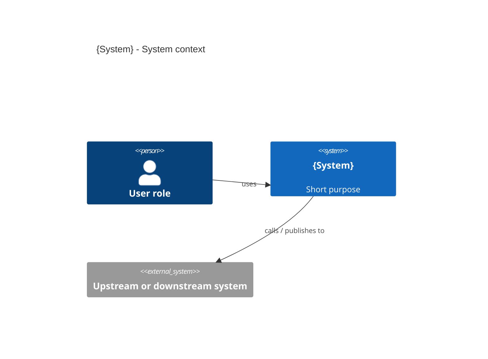
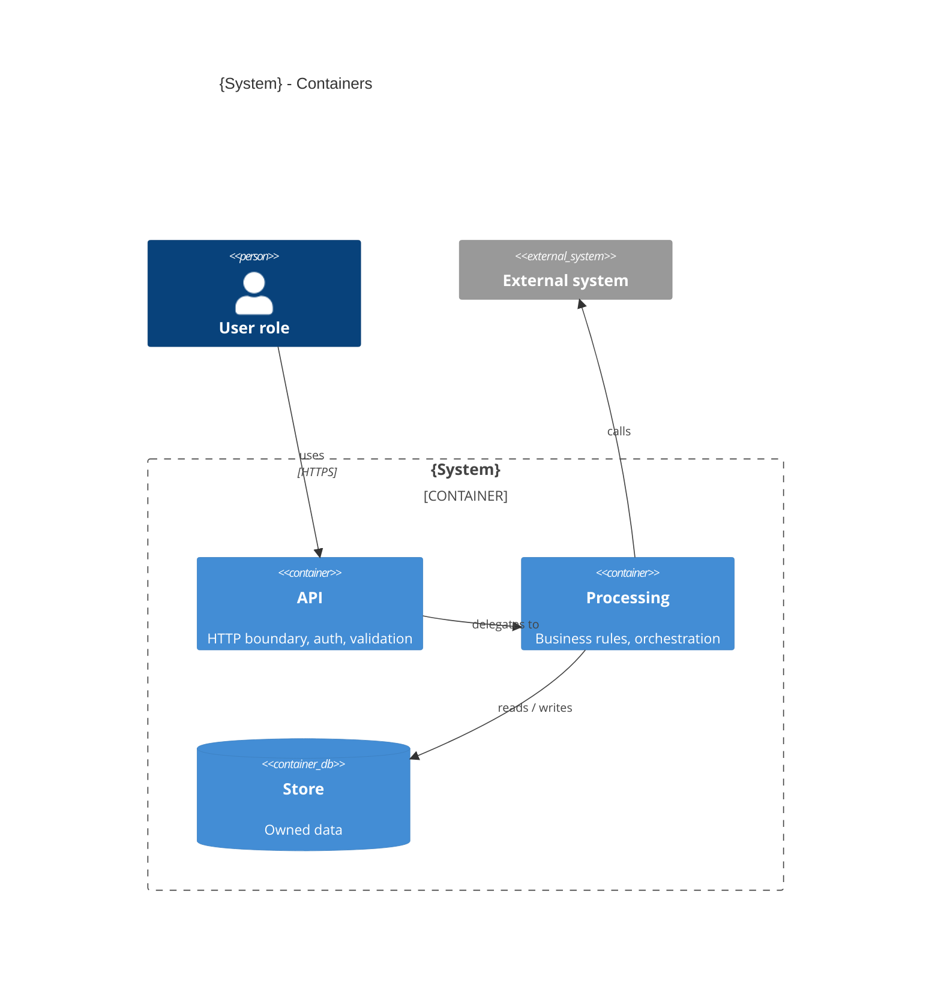
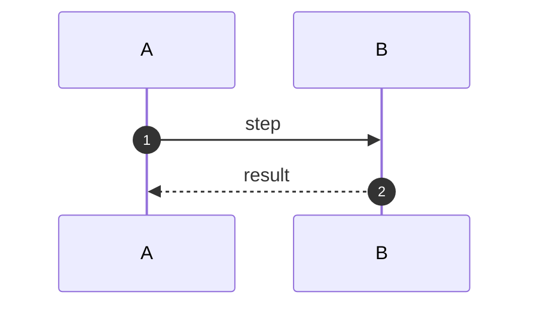
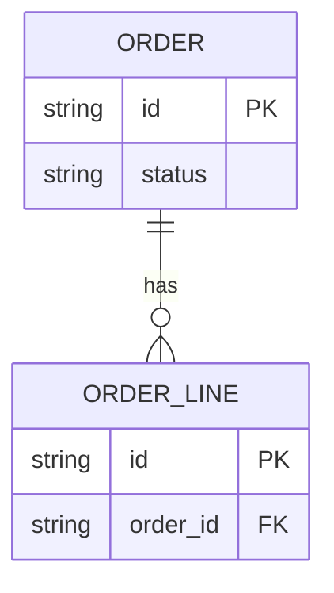

# {Title that states the design's main idea}

<!-- How to use this template
1. Copy it to the project's design folder. Use it for a system (several contexts or services) or a module (one part of a larger system).
2. Depth rule: the document holds the design at the level a reviewer needs in order to review it. Each section comment says CORE (always here) or BUILD DETAIL (may live in a companion document, linked from a one-line summary here).
3. Remove a section that does not fit the subject, with one line of reason in the review asks. Never leave a placeholder.
4. Argue for the design only after the problem, the goals and the options. The summary and context say what the design is; the case for it comes after the options. Arguing it first turns a review into rubber-stamping.
5. Name an industry standard (OIDC, OAuth 2, AMQP, REST) and link it. Describe only what is specific to this design: which provider, which scopes, which deviation, and why.
6. Diagrams: Mermaid, C4 style. Use role names ("Web layer", "Module database") unless the technology is the decision. Split a diagram that does not fit one screen.
7. Delete every comment, including this one, before the review opens. -->

- **Status:** Draft | Proposed | Accepted | Superseded
- **Scope:** System | Module (of {parent system})
- **Owner:** Name, team
- **Date opened:** YYYY-MM-DD
- **Review window closes:** YYYY-MM-DD
- **Last updated:** YYYY-MM-DD
- **Related:** ADRs, RFCs, parent system architecture
- **Migration mode:** Replacement of {predecessor} | Greenfield
- **Owned data domains:** {the data this design is the only writer of}

## Summary

<!-- CORE. Three to five sentences: what the system is, its main design idea, and what the review must do. -->

## Context

<!-- CORE. Who uses it, its boundary, and how it fits the wider landscape. State the dominant design choice here as orientation only; the argument comes later. -->

### System at a glance

### Main business flows

<!-- CORE. A system or module document lists its flows; one sequence diagram per flow belongs in the Runtime view. -->

1. **{Flow, for example "Submit order"}**: trigger {…}; this design's role {…}; other systems involved {…}; outcome {…}.
2. **{…}**

### Workload and traffic

<!-- CORE. Order-of-magnitude numbers, each with its source (telemetry, predecessor baseline, forecast). NFR targets and deployment sizing are checked against these. -->

| Measure | Steady | Peak | Source |
| --- | --- | --- | --- |
| Concurrent users | | | |
| Request rate | | | |
| Inbound messages or events | | | |
| New records per day | | | |
| Total stored | | | |
| Payload size, typical and max | | | |

**Workload pattern:** {interactive, batch, event-driven or mixed; daily, monthly and seasonal shape}

## Problem, outcomes and goals

### Problem

<!-- CORE. At most five sentences. State the problem without naming a solution. -->

### Outcomes

<!-- CORE. What will be better, and how it will be measured. An outcome is a result for users or the organisation; an NFR is a property of the system. -->

| Outcome | Measure | Baseline today | Target |
| --- | --- | --- | --- |

### Quality goals, ranked

<!-- CORE. Ranked: the ranking is the tie-breaker every trade-off appeals to. A goal that changes no decision is not a goal. -->

1. **{Goal, for example "Data integrity"}**: why {…}; drives {the decisions it shapes}.
2. **{…}**

### Trade-offs

<!-- CORE. For each pair of goals that conflict: the goal that wins, the goal that loses, the compromise, and the decision it traces to. "We balance X and Y" is not a trade-off. -->

1. **{Higher goal} over {lower goal}**: conflict {…}; compromise accepted {…}; decision {section or ADR}.

### Non-goals

<!-- CORE. What this design deliberately does not cover. -->

- {Out of scope, explicitly}

### Measurable NFRs

<!-- CORE. Each NFR proves a goal, as a quality scenario: stimulus, response, measurable target, with its workload assumption. Cover usage (latency, availability, robustness) and change (how fast a rule, format or dependency can change).
Status: Committed (agreed and verifiable now) | Provisional (the design does not depend on it; name who confirms it and by when) | Blocking (the design depends on it and the target is unclear; sign-off waits, and it is also an open question). A Provisional NFR that turns out to shape the design is Blocking. -->

| NFR | Goal | Scenario | Target | Verification | Status |
| --- | --- | --- | --- | --- | --- |

### Constraints

<!-- CORE. What the design must accept and cannot change. -->

- **Technical:** {what must be used or cannot be replaced; inherited platform standards}
- **Business and regulatory:** {data residency, retention, audit, the compliance regime}

### Assumptions

<!-- CORE. What the design takes as true that nobody has confirmed. Each with who can confirm it. -->

| Assumption | Affects | Who can confirm |
| --- | --- | --- |

## Fundamental options

<!-- CORE. The few top-level shapes considered, including doing nothing where that is possible. Brief and factual. Compare them against the ranked goals, plus complexity, cost and team familiarity. Then state the choice and why. -->

| Option | {Goal 1} | {Goal 2} | {Goal 3} | Complexity | Cost | Team familiarity |
| --- | --- | --- | --- | --- | --- | --- |
| {Option A} | | | | | | |
| {Option B} | | | | | | |
| Do nothing | | | | | | |

**Choice:** {option}, because {reason in terms of the ranked goals}.

## Building block view

### Level 1: contexts or containers

<!-- CORE. System scope: the contexts or services and who owns each. Module scope: the module's containers. Every element in the diagram gets a row below; an element without a row comes out of the diagram. -->

| Element | Does | Owns data | Outbound calls | Transactions it holds |
| --- | --- | --- | --- | --- |

### Trust boundaries

<!-- CORE as a summary; the full per-boundary detail is BUILD DETAIL. One row per arrow that crosses a network or process boundary. -->

| Boundary | Auth | Identity propagation | Encryption | Input validation | Audit | Rate limiting |
| --- | --- | --- | --- | --- | --- | --- |

### Level 2: key components

<!-- BUILD DETAIL beyond the first diagram. Decompose a container only when it owns durable state, an external protocol or a cross-team contract. Show other Level 1 containers as external participants. -->

## Runtime view

<!-- CORE. The happy path of each main flow, plus at least three failure modes. For each failure: detection, recovery (retry, compensate, alert) and user-visible impact.
Failure modes to choose from: store unreachable; downstream timeout against permanent failure; partial commit or orphaned write; message lag or redelivery; resource exhaustion (thread or connection pools, concurrency limits, throttling, quotas). -->

### Scenario 1: {name} (happy path)

### Failure modes

<!-- One row per failure, at least three. Add a sequence diagram only where the recovery path is not obvious. -->

| Failure | Detection | Recovery | User-visible impact |
| --- | --- | --- | --- |

## Cross-cutting concerns

<!-- CORE. One row per concern. Link the standard where one exists; describe only deviations and choices the standard leaves open. Where no standard exists, write the approach and say "no standard yet" so the gap is visible. Mark a concern out of scope as N/A with a reason. -->

| Concern | Approach in this design | Standard | Described in |
| --- | --- | --- | --- |
| Authentication | | | |
| Authorisation | | | |
| Error handling | | | |
| Transactions and distributed transactions | | | |
| Idempotency | | | |
| Caching | | | |
| API versioning and schema evolution | | | |
| Resilience of sync calls | | | |
| Async and background work | | | |
| Rate limits and quotas | | | |
| Observability | | | |
| Audit | | | |
| Secrets | | | |
| Time and clocks | | | |

## Data model

<!-- CORE: the logical model and which context owns each entity. BUILD DETAIL: indexes, partitioning, full schemas. -->

- **Storage decisions:** {store, ownership, what is queryable and what is opaque, retention}
- **Reference data:** {what is consumed, its source of truth, cache and refresh}

## API and message contracts

<!-- CORE: operation groups, owners and delivery guarantees. BUILD DETAIL: the full specification, linked. -->

| Operation group | Operations | Owner | Auth |
| --- | --- | --- | --- |

| Queue, topic or event | Direction | Payload schema | Idempotency key | Delivery guarantee |
| --- | --- | --- | --- | --- |

## Deployment

<!-- CORE: topology and failure modes. BUILD DETAIL: sizing. Keep one of the two variants. -->

{Deployment diagram}

**Containers variant:** resources and limits; min and max replicas; scale-out trigger and cooldown; liveness and readiness checks.

**Serverless variant:** concurrency limits per function group; queues and their dead-letter queues; service quotas; account and environment topology.

**Both:**

- **Shared-platform failure modes:** {identity provider down, cache down, broker down: the effect of each and the fallback}
- **Network and access:** {ingress, egress, isolation}
- **Config and secrets:** {where they live, who rotates them}
- **Backup and DR:** {mechanism, schedule, drill cadence; the RPO and RTO targets are NFRs}

## Security and compliance

<!-- CORE. Data classification; encryption in transit and at rest; how sensitive fields are protected and who can see them. The compliance regime and this design's position against it. Every control the design cannot meet alone is listed as blocking, with an owner. Full control mapping goes in Appendix B. -->

| Control or requirement | Position | Owner if blocking |
| --- | --- | --- |

## Operations

<!-- BUILD DETAIL. Dashboards, alerts and who is paged, on-call, the three most likely failures with their runbooks. -->

## Testing

<!-- CORE: architecture tests (fitness functions) and their thresholds. BUILD DETAIL: the rest. -->

| Check | Threshold | When |
| --- | --- | --- |

Unit, integration, end-to-end, performance and security verification: {scope, environment, sign-off}

## Migration and cutover

<!-- MANDATORY. CORE: strategy, rollback and decommission criteria. BUILD DETAIL: the data mapping.
Greenfield: replace this section with one paragraph that starts "Greenfield: no predecessor and no data to move." and cites the evidence. A bare "N/A" is not acceptable. If reference data is copied from an older system, that part is a migration. -->

- **Strategy:** {big-bang, phased, parallel run or strangler, justified against the alternatives}
- **Traffic shifting:** {routing key, where the rule lives, who switches it}
- **Environment sequence:** {each environment with entry criteria, exit criteria, owner}
- **Dual-run and comparison:** {what is written to both, what is compared, drift tolerance, exit criterion}
- **Rollback:** {triggers, who authorises, mechanism, what data state is kept and lost}
- **Communications:** {users, go or no-go, incidents}
- **Decommission criteria:** {traffic threshold, clean reconciliation for N days}
- **Data migration:** {source and owner, target, mapping (link), approach, reconciliation, dry run, archival and access to old data}

## Decisions inside this design

<!-- CORE. An index: one row per key decision, pointing to the section that argues it. Never restate the reasoning here. Status values are those of a key decision: Draft, Proposed, Accepted, Rejected, Withdrawn, Superseded. -->

| Decision | Section | ADR | Status |
| --- | --- | --- | --- |

## Risks and open questions

<!-- CORE. Blocking open questions first: those the design depends on, including every Blocking NFR. -->

| Question | Blocks | Resolution path | Owner | By |
| --- | --- | --- | --- | --- |

| Risk | Likelihood | Impact | Mitigation | Owner | By |
| --- | --- | --- | --- | --- | --- |

## Review

<!-- CORE. This section and the decisions table are history by design: entries are added, never edited. -->

### Affected parties and experts

{Who has been asked to review, and why each.}

### Review log

| ID | Reviewer | Team or role | Date | Review comment and reasoning | Source |
| --- | --- | --- | --- | --- | --- |
| R1 | | | | | Conversation, comment, forum |

### Declined or no response

| Person | Date asked | Outcome |
| --- | --- | --- |

### Response to review

| Review ID | Taken? | Response and reasons |
| --- | --- | --- |
| R1 | Yes / Partly / No | |

### Review asks

{What the review must decide, accept or assign.}

## Appendix A: Glossary

<!-- CORE when the document uses domain terms; expand each on first use in the body as well. -->

## Appendix B: Traceability

<!-- BUILD DETAIL. Requirements and compliance controls mapped to the sections that meet them. IDs live here, not in the argued text. -->

## Appendix C: Reviewer checklist sign-off

<!-- Reviewers initial each review ask, and each item of the project's design review checklist if it has one, before sign-off. -->
