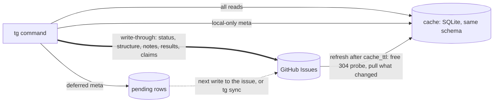
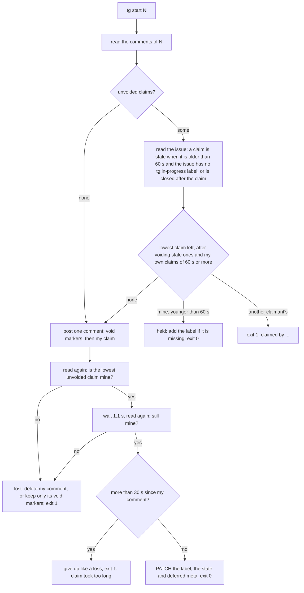

# Taskgraph CLI

## Invocation and data

```bash
python3 scripts/tg.py [--db PATH] [--project NAME] [--json | --brief] [--fresh] COMMAND ...
```

For an installed plugin, use `${CLAUDE_PLUGIN_ROOT}/skills/taskgraph/scripts/tg.py`. In the example, `scripts/` is relative to the skill directory. The script uses only the Python standard library (3.9 or later; a `.taskgraph.toml` needs 3.11, see [the GitHub backend](#the-github-backend)). Data lives in `$TASKGRAPH_DB`; the default is `~/.taskgraph/tasks.db`. Storage sits behind a store interface (`scripts/tgstore/`). The default store is this SQLite file, and with no `.taskgraph.toml` nothing changes for it. A project can instead live in GitHub Issues, see [the GitHub backend](#the-github-backend). `--fresh` makes a read command refresh a GitHub project first; the local store ignores it. The graph works offline. Cytoscape.js, dagre, and cytoscape-dagre (MIT) are vendored in `scripts/vendor/` and inlined.

When parsing output, pass `--json` or `--brief`. See [planning and task semantics](./planning.md) for types, dates, status, and dependency flags.

## Commands

| Command | Purpose |
|---|---|
| `add TITLE [--type T] [--parent ID] [--depends ID ...] [--blocks ID ...] [--start D] [--due D] [--promised D] [--notes T] [--meta k=v ...]` | Create a task and its links. |
| `dep add TASK DEPENDS_ON` / `dep rm TASK DEPENDS_ON` | Add or remove a dependency. Taskgraph rejects cycles. |
| `ls [--status open\|in_progress\|done\|ready\|blocked ...] [--type T ...] [--parent ID] [--search TEXT] [--owner P] [--lane L] [--team T] [--meta k=v ...] [--due-before D] [--sort id\|due\|late] [--all-projects]` | List tasks with dates, people, and lanes. Done tasks are hidden by default. Repeated flags accumulate. `--owner` matches owner, decider, or party. `--lane` and `--team` include inherited values. |
| `ready [--all-projects]` | List leaf tasks that can start now. |
| `show ID` | Show details, dependencies, dependents, and conflicts. |
| `start ID` / `done ID` / `reopen ID` | Change a task's status. |
| `date ID [--start D] [--due D] [--promised D] [--clear start\|due\|promised ...]` | Set or clear dates. |
| `agenda [--within DAYS] [--type T ...] [--all-projects]` | List late, at-risk, conflicting, due-soon, and chase-due items. It also lists tasks whose start dates have passed and items without dates. |
| `edit ID [--title T] [--notes N] [--type T] [--parent ID \| --no-parent] [--meta k=v ...] [--unset-meta k ...]` | Edit fields. Metadata merges. Valid JSON values are parsed as JSON. |
| `rm ID [--recursive]` | Delete a task and its links. |
| `path ID` | Show the upstream chain, slack at each step, driving chain, and verdict. |
| `why ID` | Show the chains from a task to its goals, through dependencies and parents (`via`: `blocks` or `parent`). |
| `tree [ID]` / `tree --children [ID]` | Show the dependency tree from goals or the parent hierarchy. |
| `graph [--out PATH] [--all-projects] [--no-open]` | Create and open the interactive graph. |
| `serve [--port N] [--all-projects] [--no-open]` | Serve all projects live. The page refreshes when the database changes. |
| `changes [--since 7d\|2w\|DATE] [--all-projects]` | Show changes since a date. |
| `baseline set [--label L] [--replace]` / `baseline ls` / `baseline diff [--label L]` / `baseline rm LABEL` | Create, list, compare, or remove date snapshots. |
| `deps [--cross lane\|team\|owner\|project] [--open] [--all-projects]` | List dependency links with people, lanes, statuses, and slack. Use `--cross` to show only cross-group links and `--open` to hide completed work. |
| `report [--by lane\|team\|owner\|project] [--within DAYS] [--since 7d\|DATE] [--risks N] [--md] [--all-projects]` | Create a one-page status report. |
| `load [--by owner\|team\|lane] [--weeks N] [--from DATE] [--week-hours H] [--all-projects]` | Show estimated hours, over-committed weeks, unscheduled work, and work without estimates. |
| `result add ID --status S [--kind K] [--attempt N] [--by NAME] [--body TEXT \| --body-file PATH]` | Add one entry to a task's result log. `S` and `K` are one word of letters, digits, `_`, or `-`. `K` defaults to `task`. Use `--body-file -` to read the body from stdin. |
| `result ls [ID] [--kind K] [--attempt N] [--status S] [--latest] [--all-projects]` | List result entries, oldest first. Without `ID`, list the project's entries with each task's project and title. `--latest` keeps the newest match for each task. `--brief` leaves out the bodies. |
| `export [--all-projects] [--out PATH]` | Export tasks, metadata, links, and results as JSON. Taskgraph has no import command. |
| `sync [--full]` | GitHub projects only: send deferred meta, then refresh the cache. `--full` also re-reads every task's dependencies and every comment, and drops tasks that left GitHub. The local store answers `error: tg sync: this project uses the local store; nothing to sync`. |
| `projects` | Show each project's RAG status, totals, done, ready, blocked, late, conflicts, at-risk milestones, and next milestone. |

The result log is append-only. `result add` is one insert, so several writers can add to the same task at once. It does not change the task: not its status, notes, metadata, or `updated_at`, and it writes no history. Taskgraph has no command to edit or delete a single entry. Removing the task removes its entries. `show --json` lists the entries without bodies, `show --brief` leaves them out, and `result ls` reads them. Use this command as the one write that a background agent may make. A permission rule that allows it still lets the agent read any file it can open into the log through `--body-file PATH`, and create a database anywhere through `--db`. To narrow it, pin `--db` and allow only `--body` or `--body-file -`.

Stored statuses are `open`, `in_progress`, and `done`. Taskgraph derives `blocked` and `ready`. Exit code 1 and an `error:` message on stderr indicate an error.

## The GitHub backend

A `.taskgraph.toml` can map a project to a GitHub repository, so people and several machines share one plan. A project that the file does not name, and every project when there is no file, keeps using the local SQLite file. Commit the file; it holds no secrets. tg calls `gh api` and stores no token (`GH_HOST` and `GH_TOKEN` pass through). Python 3.11 or later is needed when the file exists (`tomllib`); without a file, 3.9 still works.

```toml
version = 1

[projects."my-project"]            # the tg project name
backend = "github"
repo = "owner/name"
label = "taskgraph"                # optional, default "taskgraph"
cache_ttl = 30                     # optional, seconds a read may use the cache
full_every = 600                   # optional, seconds between full pulls (at least 60)
cache = "~/.taskgraph/cache/github/owner/name.db"   # optional
claimant = "me@laptop"             # optional; default "<gh login>@<host>:<checkout id>"; TASKGRAPH_CLAIMANT overrides

[projects."my-project".meta]
local = ["sessions", "session", "cleanup_kept", "host_rebase"]   # stay in the cache on this machine, never sent
deferred = ["tokens", "model", "started_at"]                      # sent with the next write to the same issue, or by `sync`
```

The file is found through `$TASKGRAPH_CONFIG` (a path; an empty value turns it off), else the first `.taskgraph.toml` in the current folder or a parent, else the main checkout of a git worktree. `--db` does not apply to a GitHub project.

A task is an issue with the label `taskgraph`; its id is the issue number. A dependency is GitHub's "blocked by", a parent is a sub-issue, the status is open or closed plus the label `tg:in-progress`, the type is a label `tg:type:<type>`, notes are the issue body, and other meta is a hidden JSON block at the end of the body. A result is a comment with a hidden marker. `rm` closes the issue as not planned with the label `tg:removed`.



Reads come from the cache and refresh when it is older than `cache_ttl` (a probe that finds nothing costs no rate limit). Every write command refreshes first, validates against the fresh cache, sends the change to GitHub, and only then commits; if GitHub refuses, nothing changes in the cache and the error says what GitHub already applied. GitHub wins for every shared field. History for `changes` and `report` starts at the first pull on a machine, and baselines stay on the machine.

Limits: dependencies cannot cross projects (one repository is one project); at most 50 blockers per task, 100 sub-issues per parent, 8 issues in a parent chain; a body above 260,000 bytes is refused (GitHub truncates silently at 262,144); a long result is split into several comments and joined when read; people can break tg's rules in the GitHub UI, and tg then shows a conflict on the task instead of failing. A meta block that tg cannot read is never overwritten: fix or delete it on GitHub. Two Managers of agentic-team must not run the same project at once (agentic-team, not tg, would treat the other machine's tasks as dead). A refresh reads GitHub before it takes the cache lock, so a write that commits in between can be shown with older GitHub data until the next refresh (at most `cache_ttl`). With any `.taskgraph.toml` present, tg needs Python 3.11, also for a project the file does not name.

### Claiming a task

`start` reads GitHub, never the cache. The lowest unvoided claim comment wins; a loser exits 1 with `error: #N is claimed by <claimant>`.



`done` and `reopen` post nothing. Without the label a claim goes stale after 60 s, and the next claimer voids it. The claim uses only the issue API; if GitHub's comment order does not hold, two claimants can both win, and `show` then reports `claim conflict`. The session that `run.py launch` starts before `tg start` is not protected by the claim.
